# mudplot

*[English docs: README.md](README.md)*

논문용 그래프를 위한 Python 플롯 라이브러리. Matplotlib 위에서
**지각적으로 균일하고(perceptually uniform), 색맹을 고려한(colorblind-aware)**
색상 팔레트와 스타일을 제공합니다(`Palette.report()`로 직접 측정한 값이며,
인증된 접근성 기준은 아님 — 아래 참고).

핵심은 **LCH(CIELAB 극좌표) 기반 색상 엔진**입니다.

- **같은 명도(L\* 고정)** → 흑백 인쇄/명암에서 공정
- **최대 대조** → 색상 간 지각 색차(CIEDE2000)의 최솟값을 최대화
- **색맹 고려** → 일반 시각 + protanopia/deuteranopia 시뮬레이션의 최악 대조를
  최적화(`Palette.report()`로 직접 측정한 값이며, 인증된 접근성 기준은 아님);
  아래 [검증된 명칭 팔레트](docs/DEMO.md#4-colour-palette-presets-measured-not-assumed)
  참고
- **흑백 인쇄 안전** → 그룹화된 bar/box/violin 도 기본적으로 해칭 패턴을 함께
  사용해, 색상이 비슷해져도 막대가 구별됩니다 —
  [흑백 인쇄 데모](docs/DEMO.md#5-grouped-bar-chart-readable-after-black--white-printing)
  참고

## 읽기 중심 예제

<a href="docs/VISUAL_REVIEW.html">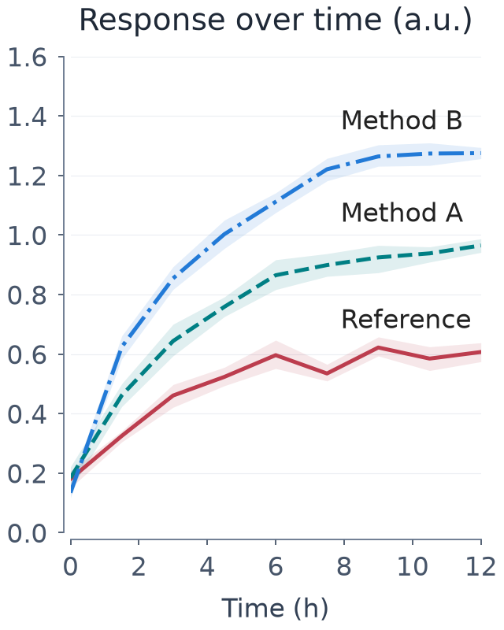</a>

4개 그림을 한 장에 줄여 넣지 않은 320px 미리보기입니다. 음영은 평균의 점별
95% CI이며 데이터는 합성입니다.
**[데스크톱/모바일 리뷰 열기](docs/VISUAL_REVIEW.html)** ·
[별도 endpoint 그림](docs/images/visual_endpoint.png) ·
[평가 기준과 reference](docs/VISUAL_QUALITY.ko.md) ·
[실행 코드](examples/publication_showcase.py).
Source-tree 에디터(`python -m dashboard serve`)의 **Start from a sample →
Complete figure drafts**에서도 같은 그림을 고를 수 있습니다. 선택은 Open 폼만
채우며 명시적으로 열기 전까지 현재 그림을 바꾸지 않습니다.
이전 프로토타입의 원자료와 추정값을 유지합니다. 실제 저장 PNG·브라우저 크기
검사가 독립적인 가독성 평가 결과를 뜻하지는 않습니다.

## 아키텍처: Spec 중심 상태 전이 (functional core / imperative shell)

그림의 모든 상태를 **직렬화 가능한 선언적 `FigureSpec`** 으로 표현한다.
Reducer는 입력을 변형하지 않고 새 spec을 반환하며, render/file I/O/preview는
effect 경계에 둔다.

```
 Action (직렬화 가능한 데이터)
     │
     ▼  reduce(state, action) -> state'      ─┐ 부수효과 없는 상태 전이 계층
 FigureSpec (dataclass ⇆ JSON, .mplot.json) ─┘
     │
     ▼  render / io / preview                ── imperative shell (effect)
 matplotlib → PNG/PDF/SVG
```

여기서 **순수**는 `reduce()`가 입력을 변형하거나 I/O를 수행하지 않는다는
좁은 동작 의미입니다. 패키지 전체가 persistent immutable 구조나 zero-copy
갱신을 쓴다는 뜻은 아닙니다. `FigureSpec`은 mutable dataclass/list 그래프이며,
reducer와 `Store`는 snapshot 격리를 위해 방어적 deep copy를 사용합니다.
따라서 action 비용은 inline data를 포함한 전체 spec 크기에 비례하고,
undo/redo는 history를 재생합니다. 이는 일반적인 논문 데이터에서 단순하고
감사 가능한 의미론을 우선한 설계이지, 수백만 행을 고빈도로 갱신하는
streaming pipeline 설계가 아닙니다. 그런 workload는 먼저 집계/downsample하고
benchmark하세요.

- fluent 빌더는 **action을 dispatch하는 설탕** — `Store`가 reducer 구동.
- `mudplot/` 엔진은 UI 의존 없음. `dashboard/`는 별도 source-tree 패키지
  (아래 참고).
- Python과 Rust editor는 같은 action/JSON schema로만 소통하며, 현재
  reducer/validator/renderer를 Python CLI에 위임.

## 상태

**v1.0.0**, 안정된 1.x 공개 Python/CLI/JSON 계약을 제공하며 Matplotlib을
canonical renderer로 유지합니다. [호환성 정책](docs/COMPATIBILITY.ko.md),
아키텍처/전체 마일스톤은
[`DESIGN.md`](DESIGN.md), 버전별 상세 내역은 [`CHANGELOG.md`](CHANGELOG.md),
다음 단계는 [`ROADMAP.md`](ROADMAP.md) 참고.

**37종 layer 지원은 Matplotlib·Seaborn과 전체 기능이 동등하다는 뜻이 아닙니다.**
[기능 지원 비교표](docs/FEATURE_COVERAGE.ko.md)는 부분 지원과 빠진 옵션·자동 통계·
facet/grid 구성을 구분하고 Matplotlib 직접 수정 경로의 한계도 설명합니다.

**엔진 (`mudplot/`)의 구현 범위는 아래와 같습니다.** 최신 전체/최소환경/대상
검증 결과와 적용 범위는 [개발 체크포인트](docs/V1_1_PLAN.ko.md#현재-체크포인트)를
확인하세요.

- [x] 색 엔진: sRGB ↔ linear ↔ XYZ ↔ Lab ↔ LCH (numpy 전용); CIE76/CIEDE2000
      색차(Sharma 2005 검증값); Machado 2009 색맹 시뮬레이션; qualitative/
      sequential/diverging 팔레트 생성기 + preview
- [x] **이름 붙은 검증된 qualitative 팔레트 프리셋 3종** (`paper`/`vivid`/
      `soft`) — 명시된 카테고리 수까지 CVD·진짜 흑백 안전성을 직접 측정;
      bar/box/violin도 기본적으로 그룹마다 해칭 패턴을 함께 사용해 색상
      개수와 무관하게 흑백 인쇄에서 구별됨
- [x] 선언적 Spec 모델(`FigureSpec`) + 무손실 JSON 왕복 + 부수효과 없는 reducer +
      action + store (`Store.undo()`/`redo()`) — render/io/preview 등
      effect는 가장자리로 분리
- [x] 렌더러: 레이어 37종(line/lineplot/regplot/scatter/stripplot/swarmplot/bar/barplot/
      pointplot/countplot/errorbar/
      band/stackplot/hline/vline/text/annotate/hist/box/boxenplot/violin/kde/kde2d/ecdf/rug/
      hist2d/hexbin/quiver/heatmap/clustermap/contour/contourf/pie/scatter3d/
      line3d/surface/wireframe), 멀티패널 레이아웃, 보조 y축, 공유축,
      despine, 외부 범례, 연속값 컬러매핑 + colorbar
- [x] **자동 facet 첫 범위**: 단일 템플릿 뒤
      `.facet(row=..., col=..., col_wrap=...)`로 셀을 만들고 공통 축·범주/hue 자리·
      semantic domain을 유지합니다. 통계는 셀별입니다.
      [지원 범위와 예제](docs/FACETS.ko.md); raw 그룹 궤적/막대도 원래 값과
      hue 자리를 유지합니다. Legacy c/colorbar facet은 남았습니다.
- [x] **Joint histogram/KDE grid**: `.scatter(...).joint(...)` 또는
      `.regplot(...).joint(...)`로 같은 완전 관측 x/y/group 행과 histogram/KDE를
      연결하며 원자료를 버리지 않습니다. Count/density 축은 측정값 축과
      독립입니다. [지원 범위와 예제](docs/JOINT_GRID.ko.md) 참고.
- [x] **Numeric pair matrix 첫 범위**: `.pair(["a", "b", "c"], group=...)`로
      쌍별 결측을 처리한 raw scatter와 대각선 histogram/KDE를 구성합니다. 이름 기반
      축으로 측정값 범위를 공유하되 대각선 density는 분리합니다.
      [지원 범위와 예제](docs/PAIR_GRID.ko.md) 참고.
- [x] **Typed heatmap 옵션**: opt-in `HeatmapSpec`의 mask/주석/label,
      linear/log/중심/robust 색상 범위·정사각 셀·경계를 지원하며 원래 행렬과
      legacy 기본값은 유지합니다. [범위와 예제](docs/HEATMAP.ko.md) 참고.
- [x] **설정형 회귀/residual (Unreleased)**: `RegressionSpec`의 log-x/Huber/
      binomial-logit/LOWESS와 원자료 y-fitted의 `.residplot()`. Advanced effect만
      optional `regression` extra를 쓰고 기존 polynomial/core는 유지합니다.
      [범위와 예제](docs/REGRESSION.ko.md) 참고.
- [x] **군집 heatmap (Unreleased)**: `.clustermap()`/`ClusterSpec`으로 행/열
      계층 군집·트리/label/mask/색 strip과 z-score/min-max 표시를 정렬합니다.
      원래 행렬은 유지하고 SciPy는 optional `cluster` effect로 분리합니다.
      [범위와 예제](docs/CLUSTERMAP.ko.md) 참고.
- [x] **TeX 대응 크기 지정과 측정 기반 레이아웃**: `.tex_size(preset,
      columns=1|2)`로 실제 figure를 문서 컬럼폭/전체 텍스트폭에 맞춤;
      `render()`가 넘치는 제목을 자동 줄바꿈하고 외부 범례를 위한 캔버스
      여백을 자동 확보(matplotlib 자체 레이아웃 엔진 + 텍스트 측정
      렌더러 사용, 직접 만든 레이아웃 시스템 없음)해 지정한 물리적
      크기를 유지합니다. 임의 주석/데이터와의 겹침은 별도 검토가 필요하며
      TeX WYSIWYG `.preview()`(article/ieee/revtex/nature/acm)의 기반이기도 합니다.
- [x] **재현 가능한 export**: 같은 환경에서 반복한 PNG/PDF/SVG export는
      byte-identical하며 변동하는 PDF/SVG metadata와 ID는 제거하거나
      canonical spec에서 유도
- [x] **정확한 위치 지정**: 범례(`.legend(bbox_to_anchor=...)`), 패널
      제목(`.title_position(...)`), `text`/`annotate` 레이어
      (`.set_layer_at(...)`)를 정확한 위치에 고정 — 인터랙티브 에디터의
      드래그 핸들도 이 기능을 사용
- [x] **LaTeX 네이티브 참조**: 범례 항목이나 패널 제목에 BibTeX 키·URL을
      연결. `.pgf` 내보내기는 `\figcite{}`/`\href{}`를 남겨 논문의
      bibliography·hyperref가 해석하고, SVG는 클릭 가능한 링크, 래스터는
      일반 텍스트로 처리(tectonic으로 실제 논문을 컴파일해 PDF에서 번호를
      다시 읽어 검증)
- [x] 선언적/JSON core의 필수 third-party 의존성 0(numpy/matplotlib은
      선택적 색상/렌더링 extras); 다양한 입력 형식(dict/records/DataFrame/numpy/
      pyarrow/SQL) 지원; AI 에이전트 친화 인터페이스(`capabilities()`/
      `json_schema()`/`apply()`/`action_log`); 렌더링 전 자동 실행되는
      부수효과 없는 `validate()`/`assert_valid()`
- [x] CLI (`python -m mudplot capabilities|schema|docs|validate|apply|render|migrate`);
      JSON 스키마/capabilities/docs export 파일 + CI 동기화 검증
- [x] 안정성 하드닝 3회, 실제 버그 약 20건 발견/수정 후 회귀 테스트로
      잠금 (저널 크기 미적용, Store 상태 외부 변형 유출, 범주형 좌표가
      레이어·패널 간 불일치, `save()`가 지정 크기를 무시하고 자동 크롭
      등) — 자세한 내용은 `DESIGN.md` §4c2,
      `tests/test_bugfixes.py`/`tests/test_stabilization.py`

**대시보드 (`dashboard/`, source-tree 도구) — 로컬 editor + 문서:**

- [x] 실제 코드에서 생성하는 37개 전체 layer 영문·한글 실행 갤러리,
      디자인 갤러리 및 엔진 reference 정적 사이트
      (`python -m dashboard build`)
- [x] 로컬 인터랙티브 에디터(`python -m dashboard serve`) — fluent API와
      동일한 Store/action/reducer 사용. 한 서버 안에 **Editor**/**Docs**
      탭, htmx 부분 갱신(전체 리로드 없음; vendoring, 0BSD, 새 Python
      의존성 없음), 미리보기 위에서 범례·제목·주석을 마우스나 화살표
      키로 직접 드래그하는 핸들
- [x] 캔버스 중심 레이아웃, 멀티패널 편집(격자 + 활성 패널), 제목·reference,
      x/y/z축(scale, 고정/자동 limits, 보조 y축, Cartesian/polar/3-D projection) 직접
      편집, 저장된 `.mplot.json` 열기, 지정 크기 그대로 PDF/SVG 내보내기
- [x] 실제 브라우저 테스트(Playwright, 선택적 `browser` extra) — HTML
      검사로는 볼 수 없는 드래그·키보드·멀티패널 경로 검증
- [x] capabilities 기반 advanced 폼으로 등록된 레이어 37종 모두 지원;
      향후 registry 추가도 자동 반영. htmx로 전체 페이지 reload 없이 app
      fragment만 갱신. 인증 없는 서버는 loopback bind/Host, same-origin
      mutation, browser security header, 16 MiB request 상한을 강제

**Rust editor (`mudplot-editor/`, v1.0):**

- [x] 함께 versioning하는 axum + Askama + htmx 로컬 서버. serde
      `FigureSpec`/action envelope, atomic open/action history, PNG cache,
      PDF/SVG/JSON export, undo/redo/reset, agent JSON route와 전체
      layer/theme/projection capability 기반 control 지원. 자세한 내용은
      [`mudplot-editor/README.ko.md`](mudplot-editor/README.ko.md).

## 설치

현재 release는 GitHub에서만 배포하며 PyPI trusted publishing은 의도적으로
활성화하지 않았다.

```bash
# Core package만 (필수 의존성 0) — spec/actions/store/JSON/TeX 크기 계산
python -m pip install "mudplot @ https://github.com/mud-the-developer/mudplot/releases/download/v1.0.0/mudplot-1.0.0-py3-none-any.whl"

# 색상 엔진 + 렌더링까지 (numpy + matplotlib)
python -m pip install "mudplot[render] @ https://github.com/mud-the-developer/mudplot/releases/download/v1.0.0/mudplot-1.0.0-py3-none-any.whl"
```

wheel에는 `mudplot` engine만 포함됩니다. Python dashboard와 Rust editor는
source-tree 도구이므로 template·계약 version을 맞추기 위해 같은 release tag를
checkout해서 실행하세요.

개발:

```bash
uv sync --locked --extra dev
```

Unreleased robust/logistic/LOWESS는 이 source tree의 `pip install '.[regression]'`
경로에 있으며 이미 공개한 v1.0.0 wheel의 기능이 아닙니다. `all`/`dev` extra는 이를
포함하고 `render`만 설치하면 기존 NumPy/Matplotlib만 사용합니다.

검사 명령, 브라우저/TeX 설정, 스키마 재생성 방법은
[`CONTRIBUTING.ko.md`](CONTRIBUTING.ko.md)를 참고하세요.

### 의존성 계층

| 계층 | 모듈 | 의존성 |
| --- | --- | --- |
| 의존성 없는 상태 core | `spec` `actions` `reducer` `store` `validate` `schema` | **없음** |
| stdlib effect/helper | JSON/CLI I/O, bibliography, TeX 크기 계산 | **없음** |
| 색상 엔진 | `color/*` | NumPy ≥ 1.23 |
| 렌더 effect | `render` `tex_preview` | NumPy ≥ 1.23 + Matplotlib ≥ 3.8 |
| Advanced 회귀 effect (Unreleased) | `regression` extra | render + statsmodels ≥ 0.14.1; 필수 core 의존성 없음 |
| 군집 effect (Unreleased) | `cluster` extra | render + SciPy ≥ 1.10; 필수 core 의존성 없음 |

## 실제 렌더링 데모

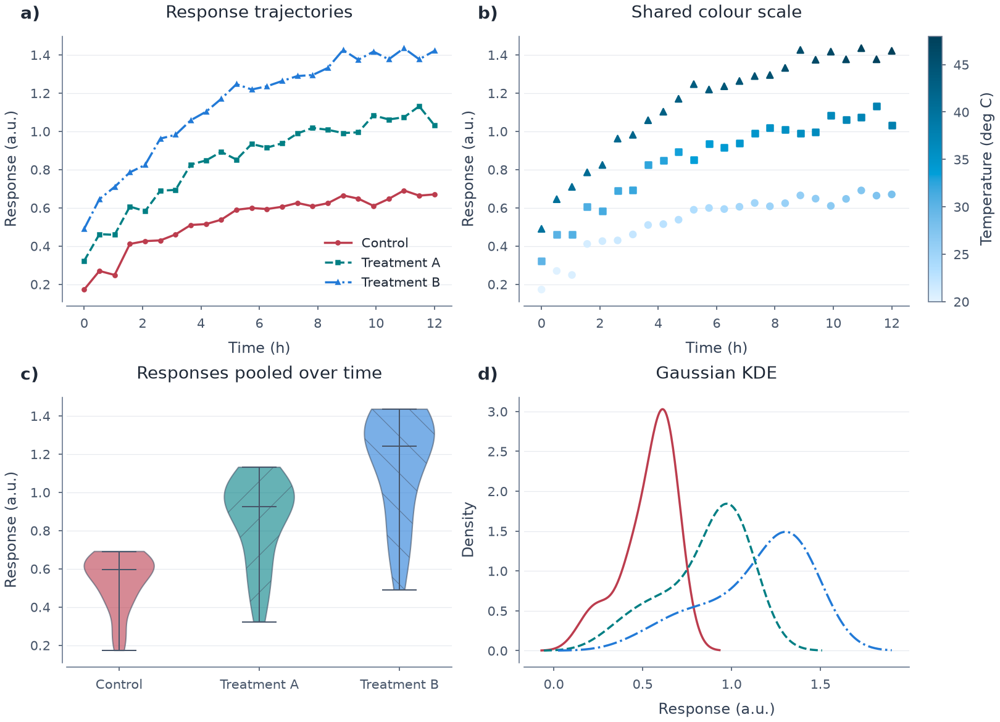

`python -m scripts.render_docs_demo`로 생성한 실제 출력입니다.
고정 난수 시드의 **합성 데이터**이며 실험 결과가 아닙니다.
**[37개 전체 layer 플롯 갤러리](docs/PLOT_GALLERY.md)**에서 각 plot의
실행 코드·실제 출력·편집 가능한 spec을 확인할 수 있습니다.
**[디자인 데모 갤러리](docs/DEMO.md)**에는 수정 전후 이미지, heatmap·3D,
PDF 및 실행·검증 방법이 있습니다.
전체 데모 재생성은 `mudplot[render]` 외에 pandas와 optional `regression`
extra가 필요합니다(`dev`에 포함).

## 사용 예

### 직관적 fluent 빌더

```python
import mudplot as mp

(mp.plot(data)                        # 아래 어느 형식이든 가능
    .line(x="voltage", y="current", group="order")
    .labels(x="Voltage (mV)", y="Current (μA)")
    .legend(title="Order")
    .theme("paper").journal("nature")
    .palette("qualitative", hue_start=30)
    .save("fig.pdf"))
```

`save()`는 지정한 figure 크기를 유지합니다. 내용에 맞게 잘라내려면
`save("fig.pdf", tight=True)`를 사용하세요. 반환된 Matplotlib figure는 열린
상태이므로 사용 후 `plt.close(fig)`로 닫습니다. `Plot.spec`과 `Store.state`는
독립적인 스냅샷입니다. 직접 변경하지 말고 빌더 메서드나 action으로 수정하세요.

### 논문용 bar: SD와 95% CI

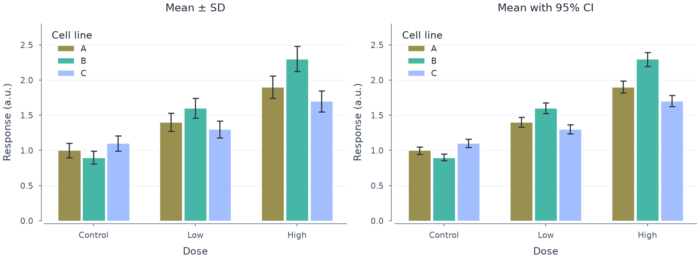

그룹 bar에서도 오차막대가 각 막대의 실제 중심에 맞춰 표시됩니다.

```python
summary = {
    "condition": ["Control", "Treatment"],
    "mean": [1.0, 1.45], "sd": [0.12, 0.17],
    "ci_low": [0.93, 1.35], "ci_high": [1.08, 1.57],
}
(mp.plot(summary).theme("publication")
    .bar("condition", "mean", yerr="sd", bar_width=0.60)
    .labels(y="Response", title="Mean ± SD")
    .save("mean_sd.svg"))

# 오차 크기가 아닌, 구간의 절대 하한·상한:
(mp.plot(summary).theme("publication")
    .bar("condition", "mean", y_lower="ci_low", y_upper="ci_high")
    .labels(y="Response", title="Mean with 95% CI")
    .save("mean_ci95.svg"))
```

`yerr`는 대칭인 비음수 오차 크기입니다. 대신 `y_lower`와 `y_upper`를 함께
지정하면 중심값을 포함하는 절대 구간을 표시하며, `errorbar()`에서도 같은
방식으로 쓸 수 있습니다. **이 primitive는 통계를 계산하지 않습니다.** SD는 관측값의
산포이고 CI는 추정량의 불확실성입니다. CI 계산 방법은 사용자가 선택해야 하며,
평균의 95% CI를 단순히 `1.96 * SD`로 만들면 안 됩니다. 위 코드는 설명용
요약값을 직접 제공한 예입니다.

`bar_width`는 범주에 할당된 전체 폭(기본 0.8, 그룹별 분할),
`edge_color`/`line_width`는 막대 테두리를 조절합니다. 오차막대의 색·굵기·캡은
`error_color`, `error_line_width`, `capsize`, `capthick`으로 조절하며,
선과 캡 크기의 단위는 point입니다. `capsize=0`이면 캡이 없어집니다.
선택형 `publication` 테마는 차분한 색상·축과 막대 뒤의 옅은 가로 그리드를
사용합니다. 기존 테마와 오차가 없는 bar의 기본값은 그대로 유지합니다.
기본 해칭 구분도 유지하며, 갤러리에서는 깔끔한 면을 위해 명시적으로 끕니다.
soft 팔레트의 측정된 안전성 보장 범위는 최대 5개 범주입니다.

`uv run python examples/bar_uncertainty.py`로 이미지를 재현할 수 있습니다.
이 예제는 고정 시드의 합성 관측값(셀·dose별 12개)에서 `ddof=1` 표본 SD와
4,000회 재표본화한 평균의 95% percentile-bootstrap CI를 **렌더러 밖에서**
계산합니다.
[기존 스타일](docs/images/bar_before.png) ·
[SD SVG](docs/images/bar_sd.svg) · [CI SVG](docs/images/bar_ci95.svg) ·
[편집 가능한 비교 spec](docs/images/bar_uncertainty.mplot.json).

### v1.1 개발: 원자료 통계 그래프

첫 하위 범위는 구현했습니다. 남은 배치·검증 조건은
[v1.1 진행표](docs/V1_1_PLAN.ko.md)를 따릅니다. 아직 1.1 릴리스는 아닙니다.

```python
raw = {"dose": ["Control"] * 3 + ["High"] * 3,
       "response": [0.9, 1.0, 1.1, 1.7, 1.9, 2.1]}
(mp.plot(raw).theme("publication")
   .barplot("dose", "response", errorbar=("ci", 95), n_boot=1000, seed=42)
   .labels(y="Response", title="Mean with bootstrap CI")
   .save("raw_mean_ci.svg"))
# 대안: .pointplot("dose", "response", errorbar="se")
# 또는: .countplot("dose") — response 열도 필요하지 않음.
```

새 builder는 요약값 대신 원자료와 이름 기반 `StatSpec`을 저장합니다.
mean/median/sum/min/max/count와 `errorbar=None`, `"sd"`, `"se"`, `"pi"`,
`"ci"`, `(method, level)`을 사용합니다. SD/SEM은 `ddof=1` 표본 통계와
기본 배수 1, PI/CI는 coverage percent(기본 95)를 뜻합니다. SEM은 표본평균의
표준오차이며 임의 estimator의 불확실성이 아닙니다. count에는 구간이 없습니다.
기본 bootstrap은 cell 내부 독립 행과 저장한 local seed를 사용합니다.
`weights=`는 평균과 값·가중치 쌍 bootstrap CI를 지원하며, 가중치를 추출
확률로 사용하지 않습니다. 0 가중치 행은 제외합니다. `units=`는 독립 단위를
뽑고 선택한 단위 내부 행을 재표본화합니다. 점 추정값은 관측 행 기준이며
단위별 평균을 동일 가중하는 방식이 아닙니다. 필요한 x/y/group/weight/unit의
결측 행은 제외하고 유효 관측값·단위가 2개 미만이면 구간을 경고와 함께
생략합니다. 추정값 밖의 일반 구간도 임의 clipping 없이 표시합니다.

`order`/`hue_order`로 범주 선택·순서를 지정하며 빈 범주에는 자리를 남기되
추정값을 만들지 않습니다. `orient="h"`는 좌표만 바꾸며 x는 범주, y는 값입니다.
bar `gap`은 할당된 폭에 대한 비율입니다. countplot은 모든 선택된 유효 행을
분모로 하는 `stat="probability"`/`"proportion"`/`"percent"`와 `stack=True`를
지원합니다. bar/count `value_labels=True`, `label_format=".2f"` 등으로 값을
표시합니다. 충돌하는 shared-axis 순서는 거부하고 가로 그래프의 y2 routing은
미지원입니다. Native/log는 아래 명시적 범위로 지원하고 임의 callable은 미지원이며
**upstream 전체 동등성을 뜻하지 않습니다.**

`python examples/statistical_categories.py`로 가중치·단위 CI, 가로 SEM,
누적 percent 비교를 재현합니다:
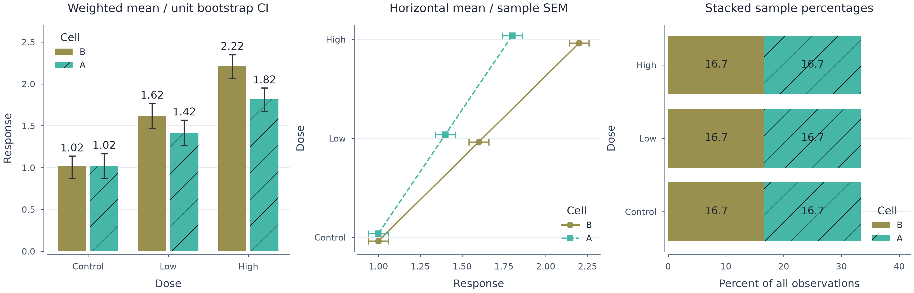
[편집 가능한 비교](docs/images/statistical_categories.mplot.json).
[Bar 결과](docs/images/plots/barplot.png) ·
[Point 결과](docs/images/plots/pointplot.png) ·
[Count 결과](docs/images/plots/countplot.png) ·
[실행 코드와 편집 가능한 spec](docs/PLOT_GALLERY.md).

### v1.1 개발: 통계 native/log 축

```python
p = (mp.plot(raw_numeric)
       .barplot("dose", "response", native_scale=True, stat_scale="axis",
                baseline=0.5, errorbar=("ci", 95), seed=7)
       .xscale("log").yscale("log"))
```

Bar/point/count는 숫자 native 범주를 지원하며 bool/문자열/날짜는 제외합니다.
Order는 실제 위치를 선택·예약하고 폭/dodge는 선택·예약 최소 축 좌표 간격 비율입니다.
Log 범주에서는 log10 간격, 범주 하나에서는 1을 사용합니다. Point의 빈 셀은 선을
끊지만 단순히 실제 위치가 멀다고 끊지 않습니다. Native bar_width는 (0,1], point
도지는 [0,1]이며 공통 hue 색상/해칭·빈 자리도 유지합니다.

Log 값축에서도 기본은 원자료 추정입니다. Stat_scale="axis"만 log10에서
mean/median/min/max·SD/SEM/PI/CI를 계산한 뒤 중심/구간을 역변환합니다. 값·가중치·
단위의 행 쌍도 유지합니다. Log 평균은 산술평균이 아닌 기하평균이며 axis/log의
sum/count는 곱/거듭제곱으로 해석하지 않고 거부합니다. Count 정규화 분모는 그대로입니다.

비누적 bar/count baseline은 원자료 값이며 선형 기본 0, log에서는 명시적 양수가
필요합니다. 도형은 baseline→추정값이고 라벨은 높이 또는 baseline+추정값이 아닙니다.
누적 count의 값축은 선형이어야 하고 명시적 baseline은 거부하되 native/log 범주 축은
지원합니다. 비양수인 계산 구간·역변환 overflow는 clip 없이 오류로 알립니다.
Primary 2-D 하위 범위이며 기존 선형 ordinal y2는 유지합니다.
[실행 예제](examples/statistical_scales.py):
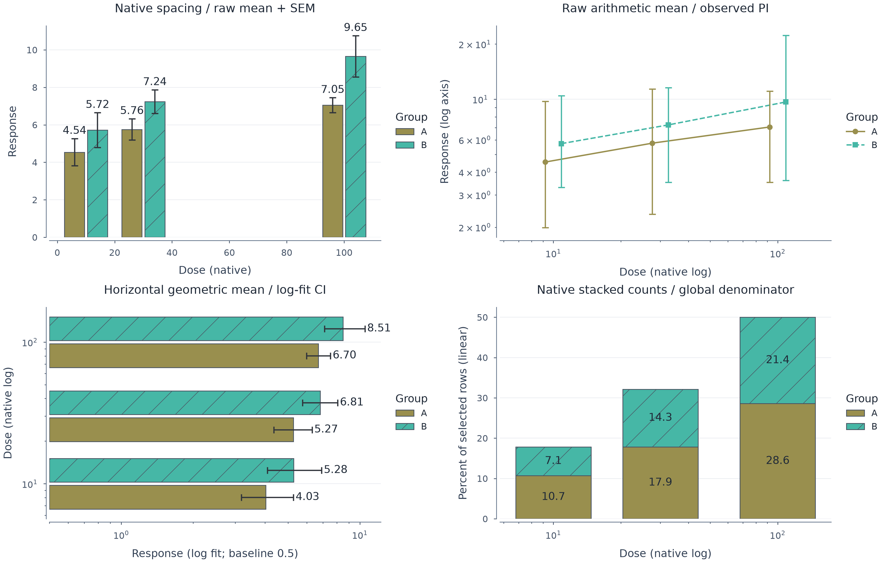
[편집 가능한 비교](docs/images/statistical_scales.mplot.json).

### v1.1 개발: 독립 lineplot 매핑

```python
p = mp.plot(raw).lineplot("time", "response", errorbar="sd",
    semantics=mp.SemanticSpec(hue="method", size="dose", sizes=[1, 3],
                              style="batch", dashes=["-", "--"]))
```

서로 다른 **원본 hue/size/style tuple은 별도 곡선**이며 predictor/곡선 셀별 named
추정·점별 구간을 씁니다. 숫자 표시 clip은 곡선을 합치지 않으며 weighted/x별
unit CI도 전체 궤적 resampling은 아닙니다. Size는 **main 선 두께 points**이지
scatter 면적/구간 폭이 아닙니다. Style은 독립 filled marker·선택적 서로 다른
named dash이며 scalar override를 조용히 허용하지 않습니다. 결측 역할과 결측/
0 weights/units 행을 짝지어 제외하고 숫자/가로/raw/log-fit/정렬/구간 결측 계약을
유지합니다. 0 stroke도 marker/구간/행을 보존합니다. scale_id는 lineplot/scatter
범위를 공유하고 혼합 geometry는 두께/지름 guide를 따로 표시하며 가짜 데이터/
limit이 없습니다. Core/JSON/editor/export/RNG/기존 호출과48개 테스트, 상한은
행10000/원본곡선256/level64/충분한marker/dash입니다. Raw line/date/y2/colorbar/
callable/동시CI의 구현/전체 동등성을 주장하지 않습니다.
[실행 비교](examples/line_semantics.py):
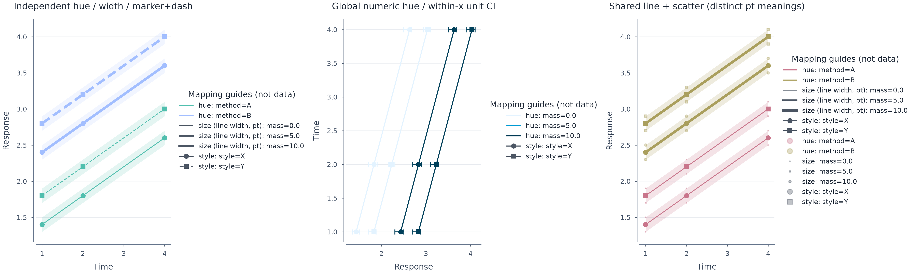
[편집 가능한 비교](docs/images/line_semantics.mplot.json).

### v1.1 개발: 이름 기반 figure 공통 scatter 척도

```python
mapping = mp.SemanticSpec(scale_id="study", hue="species", size="mass", style="batch")
p.scatter("left_x", "y", semantics=mapping, panel=0)
p.scatter("right_x", "y", semantics=mapping, panel=1)
```

scale_id=None은 기존 layer-local 매핑입니다. 이름을 주면 **선택 row ID의 중복 없는
합집합을 원래 table 순서로** 모아, 한 패널의 결측 좌표가 공통 색/범위/크기/marker
슬롯을 바꾸지 않습니다. 설정은 동일해야 하며 legend만 달라도 됩니다(숫자 hue
cmap도 일치해야 함). 충돌·pooled 행/level/marker 한계는 native 도형 전에 거부합니다.
공통 색 block은 기존 항목보다 앞에 고정하며 같은 척도의 반복 layer가 중복
소모하지 않습니다. Guide는 **pooled 범위의 매핑 설명**이며 가짜 관측/limit을
추가하지 않고 여러 member가 있어도 패널마다 한 번만 표시합니다. Dataset label은
따로 유지하고 다른 이름은 독립입니다. 공유 기반이며 grid 구성에는 별도의
[자동 facet API](docs/FACETS.ko.md)를 사용합니다.
Lineplot 매핑 확장은 위에 설명했습니다. [비교](examples/shared_semantics.py):
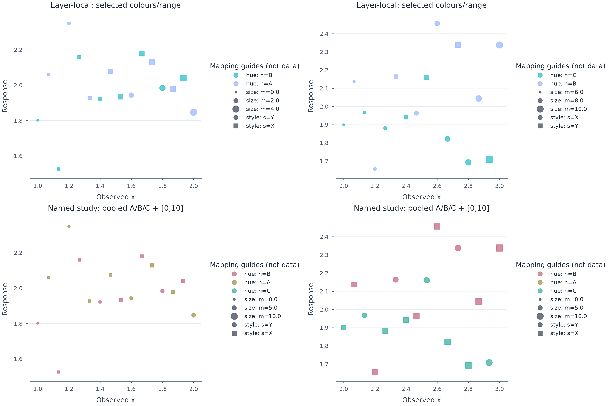
[편집 가능한 비교](docs/images/shared_semantics.mplot.json).

### v1.1 개발: 독립 scatter 매핑

```python
p = mp.plot(raw).scatter("x", "y", hue="species", size="mass", style="batch")
# 고급 설정: semantics=mp.SemanticSpec(hue="score", hue_kind="numeric",
#     hue_norm=[0, 10], size="mass", size_norm=[0, 100], sizes=[2, 9], style="batch")
```

Strict SemanticSpec/dict로 역할을 분리하며 기존 group/c/marker 호출은 유지합니다.
Hue 기본 범주형(숫자는 명시), size 기본 숫자(범주는 명시), style은 항상 범주입니다.
Order는 선택/예약하며 x/y/역할 결측 행을 짝지어 제외합니다. 범위는 **style별이
아닌 선택한 전체 행**에 적용하고 매핑만 clip하며 관측을 자르지 않습니다.
`sizes`는 **points 단위 지름**을 보간한 뒤 제곱해 native marker 면적으로 넘깁니다.
상수 숫자는 중간값/guide 1개, 극단 크기/인접 low bits는 안정적인 차이를 씁니다.
양수 면적 underflow는 오류이며 정확한 0 크기도 보이지 않는 행을 보존합니다.
Marker는 서로 다른 이름 기반 filled 기호이며 반복해서 역할을 숨기지 않습니다.
범례는 관측 범주와 **숫자 매핑 guide이지 추가 데이터가 아니며** data limit을
늘리지 않습니다. Global reference는 명시적 layer label이 필요합니다. Group/c/
스칼라 override 충돌·colorbar·outline/date/y2/line/facet 매핑은 첫 scatter 범위에서
거부합니다. 기존 c/colorbar는 그대로이며 넓은 기능은 계획에 남고 동등성 주장은
없습니다. [실행 예제](examples/scatter_semantics.py):
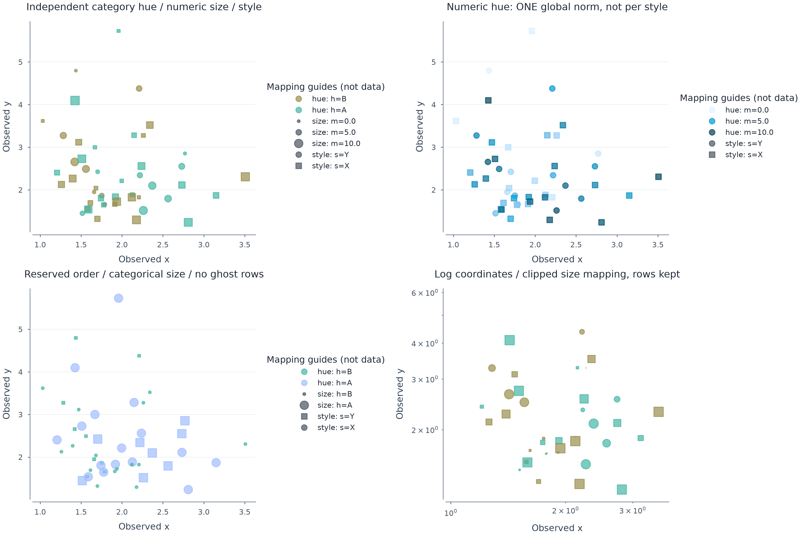
[편집 가능한 비교](docs/images/scatter_semantics.mplot.json).

### v1.1 개발: 숫자 x별 집계선

```python
p = mp.plot(raw).lineplot("time", "response", group="method", errorbar="ci",
                          n_boot=1000, seed=7, error_alpha=.25)
```

원자료 `.line()`은 바꾸지 않습니다. 숫자 x별 named 추정값과 공유 SD/SEM/PI/
seeded CI·가중 평균/행 쌍 CI·x별 단위 bootstrap을 지원합니다. **점별 구간이지
동시 신뢰대역이나 전체 궤적 resampling이 아닙니다.** 면은 관측 셀 경계를
표시용으로 연결하며 미관측 x의 모델 coverage를 보장하지 않습니다. 구간 없는
셀은 면을 끊되 추정값은 유지합니다. 기본 x 오름차순, sort=False는 hue별 첫
관측 순서입니다. 비단조 면은 오류이며 정렬하거나 error_style='bars'를 쓰세요.
면 alpha 기본은 .2*line alpha이고 error_alpha는 정확히 덮어씁니다. Cap/선 두께는
bars만 받습니다. 양 방향·양수 log predictor·raw/명시적 log10 response fit을
지원하며 잘못된 끝점은 clip하지 않습니다. Primary2D만, 범주/날짜 x·y2·dodge/
order·callable·독립 semantic map은 이 범위에서 미지원입니다.
[실행 비교](examples/line_estimates.py):
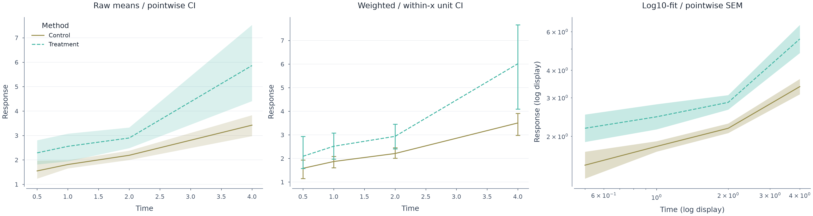
[편집 가능한 비교](docs/images/line_estimates.mplot.json).

### v1.1 개발: 가중 violin

```python
p = mp.plot(raw).violin("dose", "response", group="method", weights="weight",
                        inner="quart", split=True, density_norm="count",
                        common_norm=True)
```

짝지은 비음수 상대 가중치로 unbiased Gaussian 공분산/effective n을 계산하며
행을 복제하지 않습니다. 결측/0 가중치는 양수 검사 전에 제외합니다. 가중
분위수/중앙값은 **역 가중 ECDF**로 동률을 모두 세고 보간하지 않으므로 동일
가중치도 기존 선형 분위수와 의도적으로 다를 수 있습니다. 평균은 선언한
원자료/log10 좌표에서 가중 계산하며 point/stick은 양수 행을 한 번만 표시합니다.
`count` 폭은 **행 개수/effective n이 아닌 총 가중 질량**입니다. 셀끼리 비교할
가중치 단위를 일치시키세요. Cut/clip은 평가만 제한하며 fit/inner 행과 질량은
유지합니다. 상수/단일값은 관측 point mass의 퇴화 도형이지 가짜 Gaussian이
아닙니다. 유효 행 10000개와 bounded kernel chunk로 제한하고 계산 오류를
명확히 알립니다. 비가중 기존 fit/표시는 유지하며 새 의존성/전체 동등성 주장은
없습니다. [실행 예제](examples/weighted_violin.py):
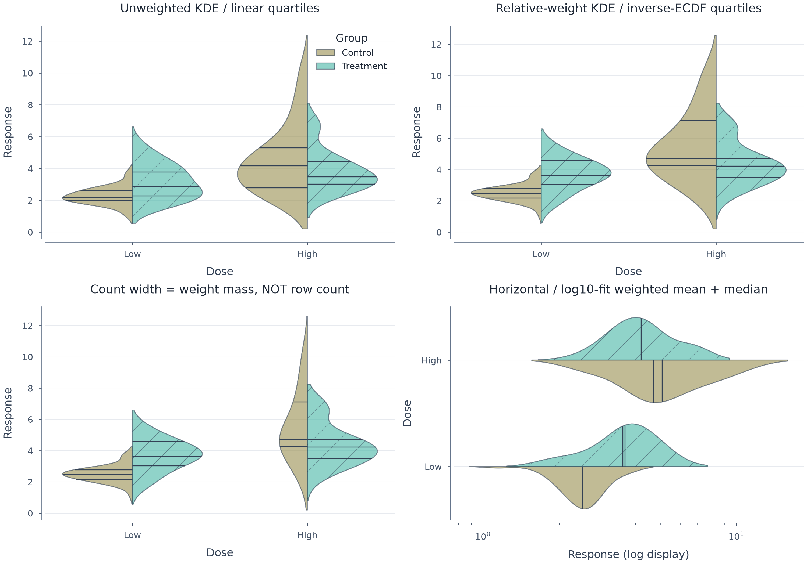
[편집 가능한 비교](docs/images/weighted_violin.mplot.json).

### v1.1 개발: 가중 2변량 KDE 등고선

```python
p = mp.plot(raw).kde2d("x", "y", weights="weight", group="method",
                      levels=[.5, .8, .95], gridsize=80, fill=True, alpha=.5)
```

Strict `KDE2DSpec`은 상대 가중 전체 공분산/effective n을 사용하며 2D의
Scott/Silverman은 `n_eff**(-1/6)`으로 같습니다. Cut/clip은 평가만 제한하며 fit
행/밀도 꼬리 정규화를 바꾸지 않습니다. 공통 질량에는 단일값 hue도 포함하고,
공통 격자는 pooled 범위와 조건부 공분산을 유지합니다. 부족/일직선/수치적 rank
결손은 경고를 선택하며 jitter/가짜 Gaussian 없이 건너뜁니다. 결측/0 가중치도
x/y 행 쌍을 유지합니다.

**Levels는 유한 격자 안 trapezoidal 고밀도 영역의 조건부 질량 비율입니다.**
동률을 모두 포함합니다. 근사 KDE 영역이지 **신뢰구간/전체 공간 확률 보장이
아닙니다.** Clip/grid를 바꾸면 HDR 문턱도 변하지만 밀도는 raw 정규화입니다.
Native 선/채운 등고선·hue dash/hatch·정확한 alpha/outline을 지원합니다. Log 표시도
양수 관측/범위의 원자료 단위이며 Jacobian을 적용하지 않습니다. 유효 행 10000개,
축별 격자 256개, (0,1) 증가 levels 16개로 제한하며 잘못된 범위/밀도/격자 질량/
동률 문턱은 오류입니다. 2D 누적/자동 보정/colorbar/다른 커널/callable/날짜/y2/
절대 밀도 수준/log fit/stack/multiple/kwargs 및 upstream 전체 동등성은 미지원입니다.
[실행 예제](examples/kde2d_semantics.py):
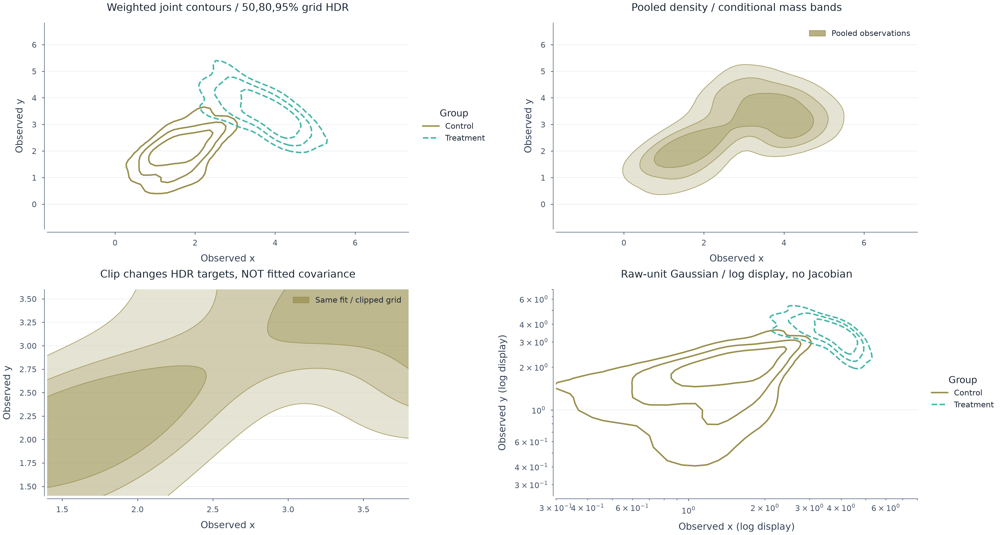
[편집 가능한 비교](docs/images/kde2d_semantics.mplot.json).

### v1.1 개발: 설정 가능한 가중 Gaussian KDE

```python
p = mp.plot(raw).kde("value", weights="weight", group="method",
                    bw_method="scott", bw_adjust=.8, common_norm=False,
                    common_grid=True, cut=3, clip=(0, None), fill=True, alpha=.4)
# cumulative=True는 전체 Gaussian CDF이며 ECDF/격자 누적합이 아닙니다.
```

새 옵션은 strict `KDESpec`이며 기존 기본 호출의 비가중
1.06*sample-SD*n**(-1/5)·200-point 계산과 단일값 fallback을 유지합니다.
상대 행 가중치 p=w/sum(w)로 unbiased covariance와 effective n=1/sum(p**2)를
계산합니다. Scott=n_eff**(-1/5), Silverman=(3*n_eff/4)**(-1/5)이며 숫자 method는
절대 대역폭이 아닌 공분산 factor입니다. 가중치는 표본 복제 횟수가 아닙니다.
필수 결측/0 가중치·선택 밖 hue를 행 쌍으로 제외하며 관측/가중치는 non-bool
유한 수, 가중치는 비음수입니다.

Common_norm=True는 건너뛴 단일값 hue를 포함한 유효 선택 질량 전체, False는
곡선별 분모입니다. Cut/clip은 평가 범위만 제한하며 fit 행/꼬리 정규화를 바꾸지
않습니다. 전체 실수축 면적/CDF 끝은 그룹 비중 또는 1이고, 유한 표시 범위의
면적/끝이 1인 것은 아닙니다. Common_grid는 pooled 가중 범위를 쓰되 각 hue의
대역폭을 유지합니다. 단일값/상수는 경고를 선택적으로 내며 건너뛰고 가짜
Gaussian/CDF/범례를 만들지 않습니다.

누적은 첫 격자점이 아닌 -infinity부터의 해석적 Gaussian CDF 합입니다. 크기를
맞춘 질량/공분산·정확한 양수 합·bounded 평가로 큰 행렬/소실을 피하고 계산된
범위/대역폭/높이가 잘못되면 오류로 알립니다. Primary2D 선/채우기/v-h·정확한
alpha/width·면 outline·hue dash/hatch·reference를 지원합니다. 관측 log 표시도
원자료 단위 fit이며 Jacobian을 적용하지 않으므로 관측값과 평가 범위 모두
양수여야 합니다. Clip/cut을 명시해야 할 수 있고 density/CDF 축은 선형입니다.
2변량/날짜/y2/stack/다른 커널/callable bandwidth/log-fit/구간/임의 kwargs와
upstream 전체 동등성은 미지원입니다. 가중 violin KDE는 위의 별도 violin 옵션으로 지원합니다.
[실행 예제](examples/kde_semantics.py):
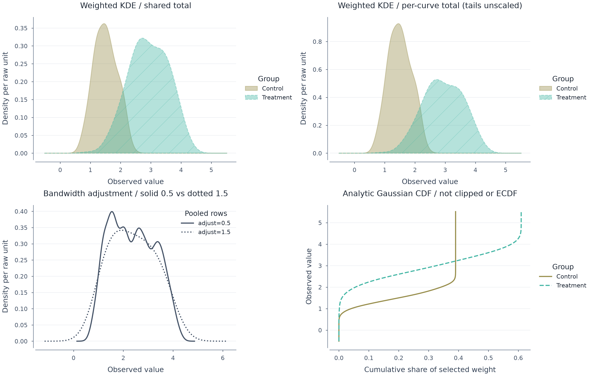
[편집 가능한 비교](docs/images/kde_semantics.mplot.json).

### v1.1 개발: 히스토그램 통계·가중치

```python
p = mp.plot(raw).hist("value", bins=[0, 1, 3, 6], weights="weight",
                     stat="density", group="method", multiple="stack",
                     element="step")
# 기본 element="bars"는 multiple="dodge"도 지원합니다. Step은 layer/stack만 지원합니다.
# cumulative=True는 질량 적분, orient="h"도 x 인자는 관측 열입니다.
```

새 옵션은 typed `HistogramSpec`을 사용하며 기존 density 기반 호출의 그룹별
bin/정규화/기본 alpha를 바꾸지 않습니다. 새 정수 bins는 선택한 유효 관측값을
모아 공통 경계를 만들고 명시적 edges도 공유합니다. [left,right)이며 마지막
경계만 포함합니다. 결측 및 0 가중치를 제외하고 가중치는 bool을 제외한 유한
비음수입니다. Bin 밖 질량은 분모에서 제외합니다. Common_norm=True는 전체
in-bin 질량, False는 각 곡선 질량입니다. Count=가중 질량, frequency=질량/원자료
폭, probability/proportion=질량/분모, percent=100배, density=질량/(분모*폭)입니다.
Density는 높이 합이 아닌 적분이 1입니다.

누적 density는 확률 질량의 적분이며 정확한 ECDF가 아닌 binned CDF입니다.
누적 frequency는 거부합니다. 크기를 맞춘 비율 합·독립 bin 합·정확한 행 prefix로
overflow/작은 질량 소실/비단조를 피하고, 잘못된 계산 폭/높이·raw 총합은 오류로
알립니다. Primary2D v/h 막대·빈 step 윤곽선과 양수 관측 log 축에서도 원자료 폭이며 높이 축은
선형입니다. Hue 자리/해칭·alpha/outline·reference metadata를 지원합니다.
`multiple="stack"`은 hue 순서대로 높이를 쌓고 `"dodge"`는 빈 예약 hue까지 포함해
원자료 bin 폭을 같은 크기 자리로 나눕니다. 높이·정규화는 그대로이고 density/
frequency 분모는 원래 bin 폭이므로 dodge는 높이 보정 없이 표시 면적만 줄입니다.
Stack overflow/소실되는 양수 증가분과 해상도가 부족한 dodge 자리는 그리기 전에
거부합니다. `element="step"`은 native stairs로 layer에서는 0에 닫히고 stack에서는
절대 윗선과 이전 baseline을 둘러쌉니다. 빈 hue는 테마 선 모양/색상 자리를 유지하며
`edge_color`는 선 색상을 덮어씁니다. Alpha/두께는 0까지 정확히 반영합니다.
Step+dodge·채운 step·fill/poly/discrete/자동 bin 규칙/날짜/2변량/KDE/y2/구간은
미지원이며 upstream 전체 동등성을 주장하지 않습니다.
[실행 예제](examples/histogram_statistics.py):
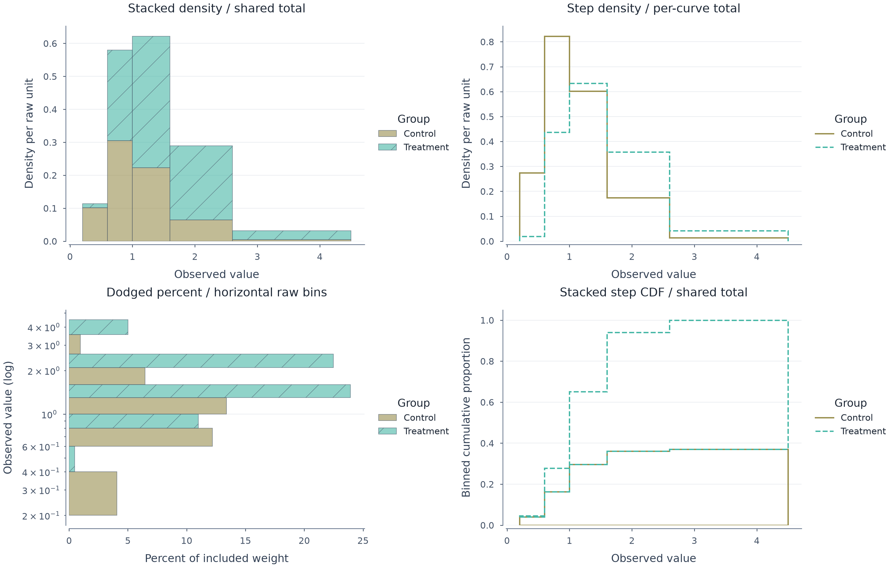
[편집 가능한 비교](docs/images/histogram_statistics.mplot.json).

### v1.1 개발: 경험적 누적 분포(ECDF)

```python
p = (mp.plot(raw)
       .ecdf("value", weights="weight", group="method", stat="percent")
       .labels(x="Value", y="Within-curve percent"))
# 또는 .ecdf("value", complementary=True, orient="h") — strict upper tail.
```

ECDF는 원자료와 typed `ECDFSpec`을 저장하며 fit/histogram/KDE가 아닙니다.
기본 proportion은 F(t)=sum(w for X<=t)/sum(w), percent는 100배,
count는 누적 가중 질량(가중치가 없으면 관측 개수)입니다. Countplot의 전체 분모와
달리 선택한 각 곡선 안에서 정규화합니다. 보완형은 같은 값을 모두 제외한 X>t이며
반복값은 한 번의 완전한 jump입니다. 가로 방향에서도 x 인자는 관측값 열이고,
최솟값 jump부터 실제 유한 최댓값까지 표시하며 임의 꼬리는 연장하지 않습니다.

필요한 x/group/weight 결측 행과 0 가중치를 log 양수 검사 전에 제외합니다.
값·가중치는 bool을 제외한 유한 숫자이며 가중치는 비음수입니다. 빈 hue에는 곡선/
범례를 만들지 않고 hue_order로 색상·선 모양 자리를 선택·예약합니다. 크기를 맞춘
비율 합과 반올림하지 않은 누적 prefix로 overflow/비단조 문제를 피하고,
오른쪽에서 더한 보완형은 1-F의 작은 꼬리 소실을 피합니다. Count overflow는 오류입니다.

Primary Cartesian2D의 v/h·양수 log 관측값 축·선형 질량 축을 지원합니다.
이름 기반 선/alpha 스타일·reference metadata도 유지합니다. Bin/평활화/구간,
censoring/Kaplan-Meier·마커·날짜/2-D ECDF·y2는 미지원이며 전체 동등성이 아닙니다.
[실행 예제](examples/ecdf_semantics.py):
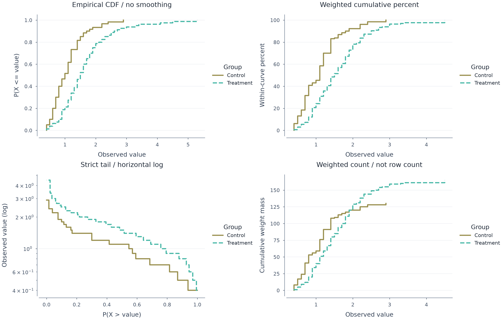
[편집 가능한 비교](docs/images/ecdf_semantics.mplot.json).

### v1.1 개발: 범주/그룹 중첩 box·violin

```python
p = mp.plot(raw).box("dose", "response", group="cell", whis=(5, 95),
                     order=["Control", "Low", "High"], gap=0.12,
                     showmeans=True, showfliers=False)
q = mp.plot(raw).violin("dose", "response", group="cell", orient="h",
                        bw_method="silverman", points=100,
                        showextrema=False, edge_color="#4b5563")
```

기존 한 열 `.box("response", group="cell")` / `.violin("response", group="cell")`
의미는 유지합니다. 두 열일 때 x는 항상 범주, y는 값이며 가로 방향에서도 같습니다.
order/hue order, width/gap, 숫자 dodge(None 자동·0 겹침), 공통 hue 색상/해칭을
지원하고 필요한 결측 행은 함께 제외하며 빈 범주에는 도형을 만들지 않습니다.
box whisker는 IQR/분위수 규칙이지 **신뢰구간이 아닙니다**. notch는 결정론적
Gaussian 근사입니다. violin은 native Gaussian KDE, 각 violin 폭 정규화와
관측 min/max 범위를 사용하고 showmeans/showmedians/showextrema로 표시를
선택합니다. 이름 기반 inner·두 hue split·area/count·bw_adjust·cut/clip은
아래 확장 옵션으로 지원합니다. 가중/callable KDE·임의 inner kwargs는 미지원이며
중첩은 primary 축의 숫자 native/log 범주와 양수 log 값을 지원합니다.
[Box 코드](examples/plots/box.py) · [Box 결과](docs/images/plots/box.png) ·
[Violin 코드](examples/plots/violin.py) · [Violin 결과](docs/images/plots/violin.png).

### v1.1 개발: 독립 box/boxen 구성 요소

```python
p = mp.plot(raw).box("dose", "response", showmeans=True, components={
    "body": {"alpha": 1},
    "median": {"color": "#b54b00", "line_width": 2},
    "mean": {"marker": "s", "face_color": "white", "edge_color": "black"},
    "flier": {"marker": "d", "marker_size": 3, "edge_color": "#0072b2"}})
```

Box는 body/whisker/cap/median/mean/flier, boxenplot은 body/median/flier만 받습니다.
ComponentStyleSpec/DistributionComponentsSpec 타입도 공개합니다. 생략한 스타일은
기존 native/layer/hue를 유지하고 이름 기반 속성만 shorthand를 덮어씁니다.
통계·좌표는 바꾸지 않으며 body 색상은 boxen의 tint 계층을 유지합니다. 빈 hatch는
중복 해칭을 끄고 구성 요소 alpha=1은 정확히 불투명합니다. Marker 윤곽/채움은
edge_color/face_color로 따로 선택합니다. Mean은 showmeans=True가 필요하고
숨김·미지원·알 수 없는 옵션은 render 전에 거부합니다. 제한된 basic/hex/cycle 색상,
이름 기반 선/marker·유한 크기만 지원하며 임의 kwargs·hue/띠별 매핑·precomputed bxp는
미지원입니다. [실행 예제](examples/distribution_components.py):
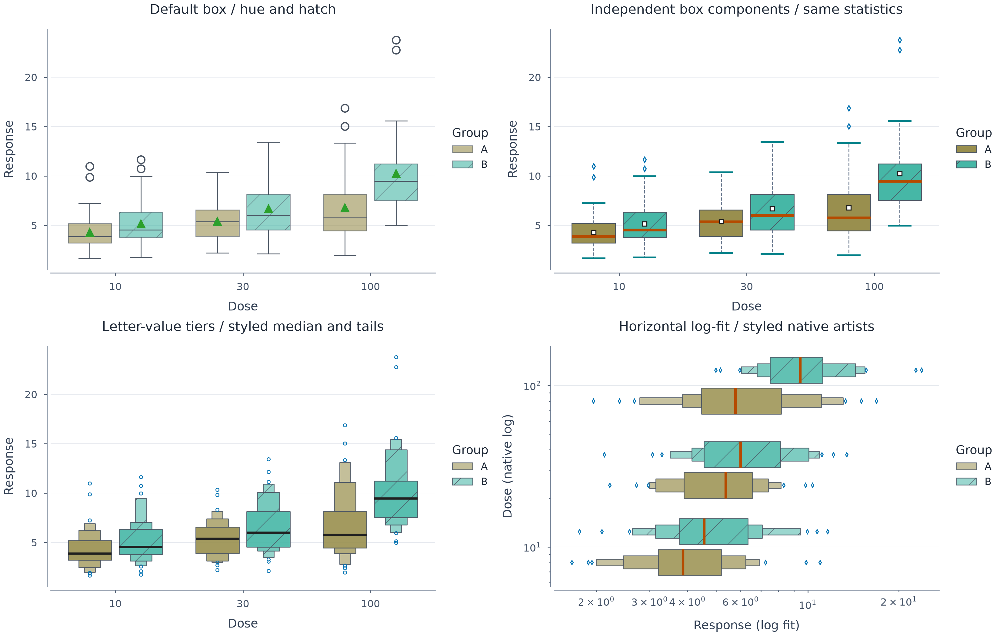
[편집 가능한 비교](docs/images/distribution_components.mplot.json).

### v1.1 개발: violin inner·밀도 의미

```python
p = mp.plot(raw).violin("dose", "response", group="cell", inner="quart",
                        split=True, density_norm="area", bw_adjust=0.8, cut=1)
```

기본값은 기존 중앙값/폭/관측 범위(inner="legacy", density_norm="width", cut 0)를
유지합니다. Inner는 box(IQR/whisker/median, CI 아님), quart, point, stick 또는 None.
Showmeans/showmedians/showextrema는 legacy에서만 지원합니다. Point/stick은 유효
선택 행 10000개까지 샘플링 없이 보존합니다. Split은 선택·예약 hue가 정확히 둘이며
공통 중심을 쓰고 양수 dodge와 함께 쓰지 않습니다. 빈 반쪽은 만들지 않습니다.

Area는 공통 KDE peak 기준, count는 셀 n/기준 최대 n 비율로 폭을 조정합니다.
Common_norm=False는 hue 내 범주끼리, True는 모든 셀끼리 비교하며 area/count에서만
지원합니다. 잘린 grid의 실제 면적이 정확히 같다는 뜻은 아닙니다. Bw_adjust는
(0,1000] 배율, cut은 [0,10] bandwidth, clip은 원자료 단위 finite/None 경계이며
KDE 범위만 제한하고 fit 행·개수·inner 원자료는 제외하지 않습니다. Log clip은
양수이며 stat_scale의 raw/명시적 log 통계 선택을 유지합니다. 전체 동등성이 아닌
제한된 하위 범위입니다. [실행 예제](examples/violin_semantics.py):
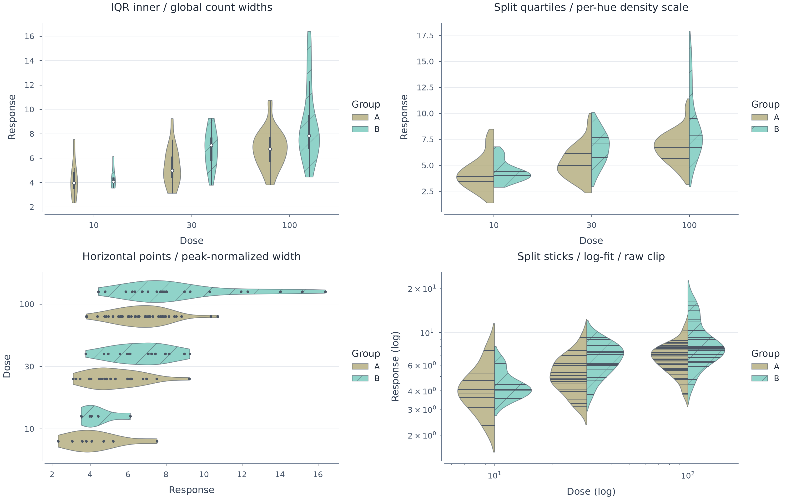
[편집 가능한 비교](docs/images/violin_semantics.mplot.json).

### v1.1 개발: 화면 좌표 swarm 배치

```python
p = (mp.plot(raw).swarmplot("dose", "response", group="cell",
                           order=["Control", "Low", "High"],
                           marker_size=5, warn_thresh=0)
     .yscale("log"))  # 양수 관측값만 가능
```

매 draw마다 실제 레이아웃/축 변환·DPI·원형 marker 크기와 선 두께를 반영해
다시 배치하고 원래 관측값은 유지합니다. 방향·순서·width/gap·숫자 dodge
(None 자동·0 hue를 함께 배치)을 지원합니다. 과밀할 때도 **모든 행을 보존**하고
collection당 한 번 경고하며 `crowded_count`로 현재 상태를 확인합니다.
marker 크기를 줄이거나 figure를 넓히세요. 결정론적 greedy 방식이며
최적 배치 보장이 아니고 레이어당 유효 관측값 2000개로 제한합니다.
숫자 native/log 범주 축은 `native_scale=True`로 지원합니다.
임의 marker/size 매핑·y2는 아직 미지원입니다.
[실행 가능한 비교](examples/swarm_categories.py):
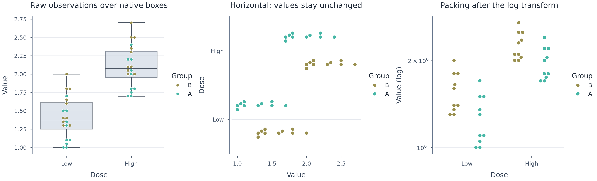
[편집 가능한 비교](docs/images/swarm_categories.mplot.json).

### v1.1 개발: letter-value 분포

```python
p = (mp.plot(raw).boxenplot("dose", "response", group="cell",
                           k_depth=4, width_method="exponential", gap=0.15)
     .theme("publication"))
```

`boxenplot`은 꼬리 쪽으로 확장하는 원자료 분위수이지 **신뢰구간이 아닙니다**.
깊이는 tukey(기본)/full/proportion/trustworthy 또는 정수 1..32이며 이름 규칙도
최대 32로 제한합니다. 폭은 exponential/linear/area(실제 확률 질량/띠 높이를
셀 안에서 정규화)입니다. Full은 min/max까지 포함하며 다른 꼬리점은 가장 바깥
분위수 밖의 실제 관측값이지 IQR 이상치가 아닙니다. 반복값·단일 관측도 유한하게
처리하고 높이 0인 area 띠는 폭 0, 모두 같은 값이면 exponential 폭을 사용합니다.
한 열 grouping·범주/hue 중첩·순서/방향/gap/dodge·중앙값/꼬리 가시성과 스타일을
primary 2-D 숫자 native/log 축에서 지원합니다. weights·임의 구성 요소
kwargs는 아직 미지원입니다. [실행 가능한 비교](examples/letter_value_categories.py):
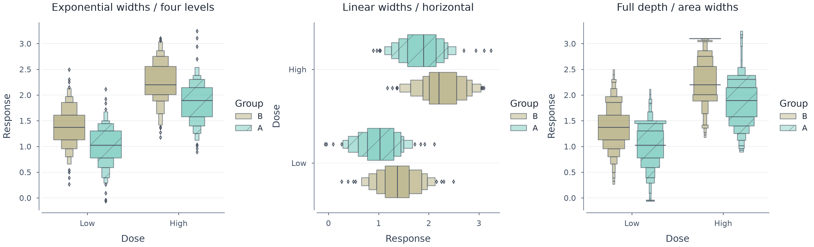
[편집 가능한 비교](docs/images/letter_value_categories.mplot.json).

### v1.1 개발: native/log 범주 좌표

Box·violin·boxenplot·swarmplot은 `native_scale=True`(기본 False)로 유한한
숫자 범주 ID를 실제 좌표에 배치합니다. 문자열/bool/날짜는 미지원입니다.
Order는 실제 위치를 선택·예약하며 물리적 순서를 뒤집지 않습니다. Width/dodge는
선택·예약한 범주의 최소 간격 비율이고, log 범주 축에서는 log10 좌표로 계산합니다.
범주 하나의 간격은 1이며 기존 ordinal/one-based 기본값은 유지합니다.

요약 타입의 기본 `stat_scale="data"`는 원자료 통계를 유지합니다.
명시적인 `stat_scale="axis"`만 log10 분위수/KDE 계산과 도형 역변환을 사용합니다.
Swarm은 항상 원래 관측값을 유지하며 log 값/범주는 양수여야 합니다. 공통 축의
native/ordinal 혼용과 상충하는 scale 선언은 거부합니다. 통계 bar/point/count도
위 문서화한 하위 범위에서 같은 간격을 사용하며 추가 매핑은 아직 미지원입니다. [실행 예제](examples/native_categorical_scales.py):
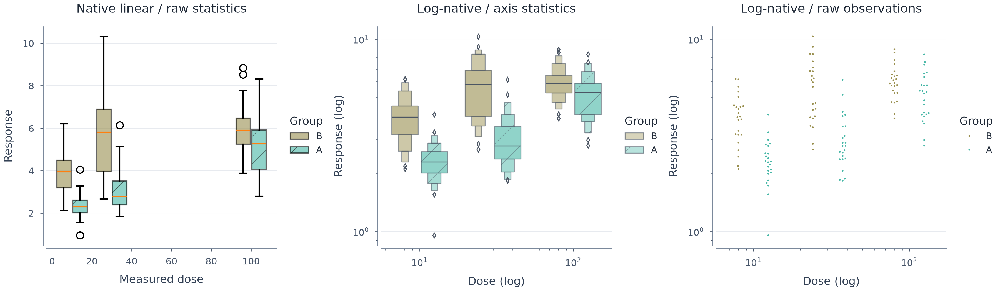
[편집 가능한 비교](docs/images/native_categorical_scales.mplot.json).

### 지원하는 플롯 종류

기본(line/regplot/scatter/bar/errorbar/band/stackplot), 원자료 통계(barplot/pointplot/countplot), 분포(hist/box/boxenplot/violin/kde/rug/stripplot/swarmplot),
2D 필드(heatmap/contour/contourf/hist2d/hexbin), 벡터장(quiver), polar line/scatter/bar(`.projection_polar()`), 3D(scatter3d/line3d/surface/wireframe),
주석(hline/vline/text/annotate), pie. `line(..., drawstyle="steps-post")`
(`steps`/`steps-pre`/`steps-mid` 포함)으로 계단선을 그릴 수 있습니다.
`regplot("x", "y", degree=2, confidence=95)`의 신뢰구간은 prediction
interval이 아닌 **평균 fit의 정규근사 구간**이며 기본값은 비활성입니다.
항상 최신 목록은 `mp.capabilities()` 또는 영어 README.md의 표를 참고.

### Spec 저장/불러오기 (Rust editor와 동일한 포맷)

```python
p = mp.plot(data).line("x", "y")
json_text = p.to_json()               # .mplot.json
p2 = mp.Plot.from_json(json_text)     # 무손실 왕복
fig = p2.render()
```

### TeX WYSIWYG 미리보기

```python
# 논문 컬럼폭·폰트에 맞춘 실제 크기 미리보기 (모의 본문 컬럼 + 캐션)
fig = (mp.plot(data).line("voltage", "current", group="order")
         .labels(x="Voltage (mV)", y="Current")
         .preview(tex="ieee", caption="Figure 1. ..."))
```

### 실제 figure를 1단/2단 컬럼 폭에 맞추기

`.tex_size(...)`는 `.preview()`와 같은 컬럼폭·폰트 크기 계산을, 미리보기가
아니라 실제로 `.render()`/`.save()`하는 figure에 적용합니다. 긴 제목이나
바깥쪽 범례도 이 크기에서 겹치거나 잘리지 않도록 자동으로 배치됩니다
(아래 "레이아웃" 참고).

```python
p.tex_size("ieee", columns=1)    # 한 컬럼 폭
p.tex_size("nature", columns=2)  # 전체 텍스트 폭 (2단 논문의 figure*)
```

### 레이아웃: 지정한 크기 그대로, 텍스트가 잘리거나 겹치지 않게

`render()`/`save()`는 내용에 맞춰 figure를 자르거나 다시 늘리지 않습니다 —
`.size()`나 `.tex_size()`로 지정한 물리적 크기가 그대로 유지되며, 이는 TeX
배치에서 중요합니다. 대신 figure를 반환하기 전에 다음을 수행합니다.

- figure 폭을 넘는 제목/suptitle을 자동 줄바꿈(matplotlib의 실제 렌더러로
  측정한 네이티브 텍스트 줄바꿈이며, 직접 계산한 추정치가 아님)
- 이름이 붙은 `"outside ..."` 범례 위치를 위한 캔버스 여백을 정확히
  확보해, 플롯 영역과 겹치거나 가장자리에서 잘리지 않게 함

명시적으로 지정한 `bbox_to_anchor=[x, y]`(아래 참고)는 그대로 신뢰하며
자동 조정하지 않습니다 — 플롯 위에 겹치는 배치를 의도했을 수도 있기
때문입니다. 이 과정은 모두 matplotlib 자체의 레이아웃 엔진과 텍스트 측정
렌더러를 사용하며(직접 만든 레이아웃 시스템 없음), 이미 잘 맞는
figure에는 아무 변화도 주지 않습니다 — 잘릴 우려가 없다면 폰트 크기는
지정한 그대로입니다. matplotlib의 constrained layout이 3D Axes를 잘
지원하지 않아 3D 패널은 당분간 `tight_layout()`으로 대체됩니다.

### 그림 안에 citation과 링크 넣기 (LaTeX 연동)

범례 항목이나 패널 제목에 BibTeX 키와 URL을 붙일 수 있습니다. 이미지에 번호를
굽지 않고 **논문이 컴파일 시점에 해석**하므로, 그림 안의 `[1]`이 References의
`[1]`과 정확히 같은 번호가 됩니다.

```python
(mp.plot(data)
    .line("x", "y", label="RANSAC",
          citation="fischler1981",             # BibTeX 키
          href="https://doi.org/10.1145/358669.358692")
    .labels(title="Robust fitting")
    .title_reference(citation="hartley2003")
    .tex_size("ieee", columns=1)
    .save("fig.pgf"))                          # .pgf -> LaTeX 네이티브 내보내기
```

```latex
\input{preamble.tex}   % 또는 mudplot.PREAMBLE 내용을 한 번 붙여넣기
\begin{figure}\centering
  \input{fig.pgf}
  \caption{Errors of two estimators.}
\end{figure}
```

내보낸 파일은 `\cite{...}`가 아니라 `\figcite{fischler1981}`를 남깁니다.
그림 인용을 무엇으로 처리할지 **문서가 결정**하게 하기 위해서입니다:

```latex
\providecommand{\figcite}[1]{\cite{#1}}   % mudplot.PREAMBLE; \citep, \autocite 등으로 교체 가능
```

같은 spec이라도 백엔드별로 처리가 다릅니다:

| 형식 | citation | href |
| --- | --- | --- |
| `.pgf` | `\figcite{key}` — 논문 bibliography가 번호 부여 | hyperref로 `\href{url}{...}` |
| `.svg` | 생략 (해석할 대상이 없음) | 텍스트가 클릭 가능한 링크 |
| `.png`/`.pdf` | 생략 | 생략 |

이 값들은 LaTeX 소스에 그대로 치환되므로 `validate()`가 중괄호·백슬래시를
거부합니다. 링크는 절대 `http`/`https`/`mailto` URI만 허용하며 active/file/
data/custom scheme, 상대 링크, control 문자, 공백은 SVG/PGF export 전에
거부합니다. `_`/`:`/`-`/`&`/`#`/`%` 같은 일반 URL 문자는 계속 허용합니다.

`group=`으로 묶인 레이어는 `references=`(`{group값: mp.Reference(...)}` 딕셔너리)로
시리즈별로 다른 논문을 인용할 수 있습니다. 딕셔너리에 없는 group 값은 인용/링크가
붙지 않습니다:

```python
(mp.plot(data).line("snr", "bler", group="method", references={
    "RANSAC": mp.Reference(citation="fischler1981", href="https://doi.org/..."),
    "J-Linkage": mp.Reference(citation="toldo2008"),
}))
```

citation key/URL을 직접 입력하는 대신 기존 `.bib` 파일에서 바로 가져올 수도
있습니다. `mp.ReferenceCatalog`는 실제 `.bib` 파일이 쓰는 흔한 BibTeX 문법을
읽는 최소한의(의존성 없는) 리더입니다 — 완전한 참고문헌 관리자는 아닙니다:

```python
refs = mp.ReferenceCatalog.from_bib("references.bib")
ref = refs["fischler1981"]   # -> ReferenceSpec(citation=..., href=...)
# href는 (네트워크 접근 없이) mp.resolve_reference_href로 해결됩니다:
# doi 필드(맨, "doi:" 접두사, 또는 전체 doi.org URL 모두 동일하게 정규화)
# -> https://doi.org/...; 없으면 arXiv id(eprint + archiveprefix/eprinttype
# == "arxiv", arXiv 자체 "export bibtex" 형태) -> https://arxiv.org/abs/...;
# 그런 url 필드; 다 없으면 None
p.line("x", "y", label="RANSAC", citation=ref.citation, href=ref.href)
```

PGF 레이아웃은 기본적으로 간결한 숫자 인용 스타일(`"[12]"`)을 기준으로
측정됩니다. 저자-연도 등 더 긴 스타일을 쓴다면
`.reference_style(measure_text="(Author, Year)")`를 지정해 범례 크기가
실제 컴파일 결과 폭에 더 가깝게 예측되도록 하세요.

### 범례·제목·주석을 정확한 위치에 놓기

```python
p.legend(bbox_to_anchor=[0.8, 0.5])    # figure 비율 [x, y], location을 덮어씀
p.legend(location="upper left")        # bbox_to_anchor=None으로 이름 위치 복원
p.title_position([0.1, 0.85])          # axes 비율 [x, y]; None이면 기본값 복원
p.set_layer_at(layer_index, [3, 0.5])  # text/annotate 레이어 위치 이동(데이터 좌표)
```

인터랙티브 에디터의 드래그 가능한 핸들(마우스 또는 화살표 키, 미리보기 위에서
직접)도 이 기능을 사용합니다 (`dashboard/README.md` 참고).

### Figure lint / 출판 preflight

`validate()`는 구조적 올바름만 검사합니다("이 레이어에 `axis='y2'`가 허용되는가").
`.lint()`는 대신 실제 출판용 품질 휴리스틱을 검사합니다 — 지정된 크기에서 실제로
흑백·색맹 안전하고 읽기 쉬운 논문용 그림이 맞는지. 강제 실패가 아니라 검토할 항목을
알려주는 방식입니다:

```python
report = p.lint(journal="ieee")
print(report)
# ✓ width fits ieee single column (3.49in <= 3.49in)
# ✓ dpi (300) meets ieee recommendation (300 DPI)
# ✓ all text >= 6pt
# ⚠ palette does not pass the measured CVD-safety threshold for 9 series -- see Palette.report()
# ⚠ palette colours become ambiguous in true greyscale
# ✓ grouped series have redundant marker/line-style/hatch encoding
# ⚠ 9 series in one group exceeds the marker/line-style cycle length (4) -- ...
# ⚠ legend contains 9 entries (> 8) -- consider splitting into panels or using direct labelling
# ✓ citation/href metadata is well-formed

report.ok   # error 레벨 항목이 있을 때만 False (예: 페이지에 안 맞는 크기)
```

검사 항목: 지정한 journal 프로필에 대한 페이지 폭·래스터 DPI, 최소 글자 크기,
팔레트 CVD/흑백 안전성(`Palette.report()` 재사용), 그룹화된 시리즈의 이중
인코딩, 마커/선스타일 사이클 소진, 범례 크기, 참고문헌 메타데이터 유효성.
기준값은 해당 journal 프로필(아래 참고)을 기본으로 사용하고 호출당 덮어쓸 수
있습니다(`min_font_pt=`, `max_legend_entries=`). `journal=`을 생략하면 이미
`.journal(...)`로 지정한 것을 자동으로 사용합니다. `mp.lint_figure(spec, ...)`는
부수효과 없는 에이전트용 동일 함수입니다 — 실제로 렌더링하지 않으므로 matplotlib 없이 `color`
extra(numpy)만 있으면 됩니다.

### Journal 프로필 (스타일 시트가 아닌 출판 제약 모음)

지원하는 각 저널은 하나의 `JournalProfile`로, **스타일**(폰트, 선 굵기, 관례적
그림 크기) + **TeX 기하학**(컬럼/텍스트 폭, 단 수) + **preflight 제약**(최소 글자
크기, 권장 래스터 DPI, 범례 수 상한, 흑백 정책)을 함께 보유합니다. 따라서
`.journal()`, `.tex_size()`, `.lint()`이 서로 따로 찾는 게 아니라 하나의 정의를
공유합니다:

```python
mp.AVAILABLE_JOURNALS          # ('nature', 'ieee', 'acm', 'revtex')
prof = mp.get_journal_profile("acm")
prof.columnwidth_pt            # 241.0
prof.min_font_pt               # 6.0
prof.recommended_dpi           # 300

# 저널 이름을 넣는 자리엔 프로필 객체도 그대로 들어감
p.journal(prof).tex_size(prof, columns=1).lint(journal=prof)
```

`mp.capabilities()["journal_profiles"]`에서 에이전트용 JSON으로 전부 노출됩니다.

### AI 에이전트용 (JSON만으로 전체 조작)

엔진은 기계 친화적으로 설계돼 있어, 에이전트가 탐색→생성→렌더를 전부
텍스트/JSON으로 할 수 있다 (사람이 보는 쪽은 `dashboard/`):

```python
import mudplot as mp

caps = mp.capabilities()   # 레이어/테마/저널/TeX프리셋/액션 어휘 (기계 가독)
schema = mp.json_schema()  # FigureSpec 전체 JSON Schema

spec = mp.apply([          # render/I/O effect 없이 JSON action으로 구성
    {"type": "SetData", "columns": {"x": [1, 2, 3], "y": [1, 4, 9]}},
    {"type": "AddLayer", "layer": {"type": "line", "x": "x", "y": "y"}},
    {"type": "SetAxisLabel", "axis": "x", "text": "X"},
    {"type": "SetTheme", "name": "paper"},
])
issues = mp.validate(spec)  # 부수효과 없는 렌더 전 에이전트 피드백
mp.save(spec, "fig.pdf")   # effect (내부에서 assert_valid 자동 호출)

# 빌드 이력(replay/undo)
p = mp.plot(data).line("x", "y").theme("paper")
log = p.action_log         # [{"type": "SetData", ...}, ...]
assert mp.apply(log).to_dict() == p.spec.to_dict()   # 재현 가능
```

### CLI (에이전트/셸 자동화용)

```bash
python -m mudplot capabilities                    # 엔진 능력 JSON 출력
python -m mudplot schema --out s.json              # FigureSpec JSON Schema 저장
python -m mudplot validate fig.mplot.json          # 저장된 spec 검증
python -m mudplot render fig.mplot.json out.pdf    # suffix에 따라 PNG/PDF/SVG/PGF 렌더
python -m mudplot apply fig.mplot.json action.json -o next.mplot.json
```

### Reducer / store 직접 사용

```python
from mudplot import Store, actions as A

store = Store()
store.subscribe(lambda spec, action: print("changed:", type(action).__name__))
store.dispatch(A.SetTheme("paper"))
store.dispatch(A.SetPalette(kind="qualitative", params={"hue_start": 30}))
spec = store.state          # 방어적 snapshot; 변경은 action으로
```

### 지원하는 입력 데이터 형식

`mp.plot(data)`는 다음을 모두 자동 인식 (의존성 없는 core는 numpy/pandas를
직접 import하지 않고 덕 타이핑으로 처리):

```python
mp.plot({"x": [1, 2], "y": [3, 4]})          # 열 딕셔너리
mp.plot([{"x": 1, "y": 3}, {"x": 2, "y": 4}]) # 레코드(list[dict])
mp.plot([[1, 3], [2, 4]])                     # 2차원 행 -> c0, c1 자동 명명
mp.plot(df)                                   # pandas / polars DataFrame
mp.plot(np_structured_array)                  # numpy 구조화 배열
mp.plot(np_2d_array)                          # numpy 2차원 -> c0, c1 ...
mp.plot(arrow_table)                          # pyarrow Table
mp.plot(cursor)                               # 실행된 DB-API 커서
mp.plot(conn, query="SELECT x, y FROM t WHERE run = ?", params=(run_id,))
                                              # 매개변수화 DB-API 쿼리(sqlite)
```

입력 adapter는 일반적인 결측 sentinel(`NaN`, `pd.NA`, `NaT`)을 JSON
`null`로, date/time 값을 ISO 8601 문자열로, NumPy scalar를 일반 Python
값으로 정규화합니다. 무한대와 지원하지 않는 객체는 조용히 바꾸지 않고
엄격한 JSON 검증에서 계속 거부합니다. 열 이름은 문자열 변환 후에도
고유해야 하며, 충돌은 덮어쓰지 않고 거부합니다.

### 팔레트 직접 사용

```python
pal = mp.color_palette(5, "qualitative")   # 등명도·최대대조
print(pal.hex, pal.min_delta_e())
print(pal.report())      # {'cvd_safe': True, 'grayscale_safe': ..., 'note': ...}
cmap = mp.color_palette(256, "sequential").to_cmap()

# 이름 붙은 검증된 팔레트(명시된 카테고리 수까지 적색맹·녹색맹·진짜 흑백에서
# 안전함을 측정함; mp.capabilities()["palette_presets"] 참고):
pal = mp.color_palette(6, "qualitative", preset="paper")   # 또는 "vivid" / "soft"
p = mp.plot(data).line("x", "y", group="g").palette(preset="paper")

# bar/box/violin 도 기본적으로 그룹마다 해칭 패턴을 함께 사용해(ThemeSpec.hatches),
# 색상 개수와 상관없이 흑백 인쇄에서도 그룹이 구별됩니다.
p2 = mp.plot(data).bar("category", "value", group="g")  # 색상 + 해칭
p3 = p2.encoding(redundant_encoding=False)               # 색상만
```

### 대시보드 (사람이 보는 문서 + 디자인 갤러리)

엔진과는 별도인 `dashboard/` 패키지다 (엔진 → 대시보드 단방향 의존).
대시보드는 엔진의 `capabilities()`/`reference_markdown()`과 렌더러를 그대로
재사용해 **문서와 실제 그림이 항상 엔진과 일치하는** 정적 사이트를 만든다.

```bash
python -m dashboard --out dashboard/site_build
# dashboard/site_build/index.html 열기 → 엔진 능력 마크다운 문서 + 디자인 갤러리
```

### Rust editor (로컬 v1.0)

```bash
MUDPLOT_PYTHON="$PWD/.venv/bin/python" \
  cargo run --locked --manifest-path mudplot-editor/Cargo.toml
```

Python action/reducer 의미를 복제하지 않고 같은 계약을 호출한다. 인증 없는
서버는 non-loopback bind/HTTP Host와 cross-origin browser mutation을
거부한다.
범위와 route는
[`mudplot-editor/README.ko.md`](mudplot-editor/README.ko.md) 참고.

## 개발

```bash
uv sync --locked --extra dev --extra browser
uv run pytest -q -m "not browser"
uv run python scripts/check_schema_sync.py
uv run python scripts/check_wheel.py
cargo test --locked --manifest-path mudplot-editor/Cargo.toml
```

전체 Python/browser/TeX/Rust preflight는
[`CONTRIBUTING.ko.md`](CONTRIBUTING.ko.md), 비공개 취약점 제보는
[`SECURITY.ko.md`](SECURITY.ko.md) 참고.
