# mudplot

*[한국어 문서 / Korean docs: README.ko.md](README.ko.md)*

A Python plotting library for scientific papers, built on Matplotlib. It
provides **perceptually uniform, colourblind-aware** colour palettes and
styles (measured via `Palette.report()`, not a certified accessibility
guarantee -- see below).

At its core is an **LCH (CIELAB polar coordinates) colour engine**:

- **Equal lightness (fixed L\*)** → fair under greyscale printing / contrast
- **Maximum contrast** → maximises the minimum perceptual colour distance
  (CIEDE2000) between colours
- **Colourblind-aware** → optimises the worst-case contrast across normal
  vision and protanopia/deuteranopia simulation (measured via
  `Palette.report()`, not a certified accessibility guarantee); see
  [named, pre-verified presets](docs/DEMO.md#4-colour-palette-presets-measured-not-assumed)
  below
- **Finite redundant group patterns** → grouped bar/box/violin fills cycle
  hatch patterns to help when colours compress to similar greys. Cycles repeat;
  inspect the actual size/output rather than assume unlimited separation — see the
  [B&W print demo](docs/DEMO.md#5-grouped-bar-chart-readable-after-black--white-printing)

### Finite saved axis controls (N12, v2 work in progress)

`ticks(..., which="major"|"minor")`, typed `axis_scale` parameters and named
`secondary_xaxis`/derived `secondary_axis` views join JSON/actions/CLI/editor.
See the [bounded scientific contract](docs/FEATURE_COVERAGE.md) and
[executable six-panel example](examples/axis_controls.py). Explicit clocks,
source units and independent y2 remain separate; no arbitrary callbacks or
new dependencies. Isolated qualification does not claim all-v2 completion.

## Reading-first examples

<a href="docs/VISUAL_REVIEW.html">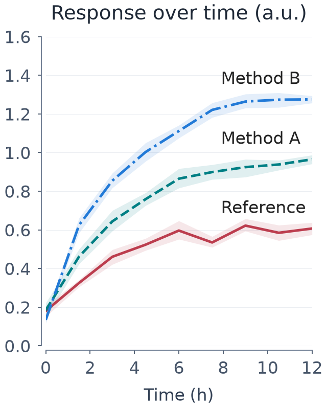</a>

A 320px preview, not four charts squeezed into one image. Shading is a pointwise
95% CI of the mean; data are synthetic.
**[Open the desktop/mobile review](docs/VISUAL_REVIEW.html)** ·
[Separate endpoint chart](docs/images/visual_endpoint.png) ·
[Criteria and references](docs/VISUAL_QUALITY.md) ·
[Runnable sample](examples/publication_showcase.py).
The source-tree editor (`python -m dashboard serve`) offers the same figures
under **Start from a sample → Complete figure drafts**; selection only fills
the Open form until you explicitly apply it.
Raw data and estimates are preserved from the rejected prototype. Checks on
saved PNGs and real browser sizes are **not** an independent readability rating.

## Opt-in scientific composition (Unreleased)

Use `render(layout_policy="smart")` or `save(..., layout_policy="smart")` for
measured legend/data collision repair, shared legends and directly labelled
simple two-method bars. `smart-print` preserves their hatch encoding.
`lint(visual=True).to_dict()` reports actionable composition/scale problems at
the configured publication size. `mp.recommend(...)` returns deterministic
chart advice without changing geometry, measurements or unknown units.
Defaults and FigureSpec/JSON remain unchanged.

[Usage, limits and four actual-size before/after comparisons](docs/SCIENTIFIC_QUALITY.md)
· [300-DPI QA report](docs/images/scientific_quality/report.json)
· [Runnable examples](examples/scientific_quality.py).

## Architecture: spec-centric state transitions (functional core / imperative shell)

Every bit of figure state is represented as a **serialisable, declarative
`FigureSpec`**. The reducer returns a new spec without mutating its arguments;
rendering, file I/O, and preview remain at the effect boundary.

```
 Action (serialisable data)
     │
     ▼  reduce(state, action) -> state'      ─┐ side-effect-free transition layer
 FigureSpec (dataclass ⇆ JSON, .mplot.json) ─┘
     │
     ▼  render / io / preview                ── imperative shell (effects)
 matplotlib → PNG/PDF/SVG
```

Here **pure** has that narrow behavioural meaning: `reduce()` does not mutate
its inputs or perform I/O. It does not mean that the whole package uses
persistent immutable structures or zero-copy updates. `FigureSpec` is a
mutable dataclass/list graph, and the reducer and `Store` use defensive deep
copies for snapshot isolation. Consequently, action cost grows with the full
spec, including inline data, and undo/redo replays retained history. The default
pure reducer can start from one bounded checkpoint; custom reducers keep full
replay. This favours simple,
auditable semantics for ordinary publication datasets—not streaming or
high-frequency updates over millions of rows. Pre-aggregate/downsample and
benchmark those workloads.

- The fluent builder is just **sugar for dispatching actions** — a `Store`
  drives the reducer underneath.
- The `mudplot/` engine has no UI dependency. `dashboard/` is a separate
  source-tree package (see below).
- Python and the Rust editor agree only on the same action/JSON schema; the
  current Rust editor delegates reduction/validation/rendering to the Python CLI.

## Status

Current version: **v2.0.0**.
The JSON wire remains 0.1 and Matplotlib is the canonical renderer. See the [compatibility policy](docs/COMPATIBILITY.md),
[`DESIGN.md`](DESIGN.md) for architecture and the milestone log,
[`CHANGELOG.md`](CHANGELOG.md) for
version-by-version detail, and [`ROADMAP.md`](ROADMAP.md) for concrete next
steps (more layer types, quality work, and the Rust editor).

This version includes bounded v2 workflows.
Start with the [executable workflow and upgrade guide](examples/README.md).
The 66 registered layer types are **not** full Matplotlib or Seaborn parity.
See [feature coverage](docs/FEATURE_COVERAGE.md) for applicable combinations
and [v2 evidence and gates](docs/V2_SCOPE.md) for the distinction between
source checks, installed milestones and final release qualification. The
release workflow publishes only after artifact and TeX verification pass.

**Engine (`mudplot/`) — implemented surfaces below.** See the
[development checkpoint](docs/V1_1_PLAN.md#current-checkpoint) for the latest
full/minimum/focused verification receipts and their scope.

- [x] Colour engine: sRGB ↔ linear ↔ XYZ ↔ Lab ↔ LCH (numpy-only); CIE76/
      CIEDE2000 colour difference (Sharma 2005 reference values); Machado
      2009 colour-vision-deficiency simulation; qualitative/sequential/
      diverging palette generators + preview
- [x] **Three named, pre-verified qualitative palette presets**
      (`paper`/`vivid`/`soft`) — measured (not assumed) CVD-safe and
      true-greyscale-safe up to a documented category count; bar/box/violin
      fills add finite repeating hatch patterns, which complement colour but
      do not guarantee unlimited categories or readability at every print size
- [x] Declarative spec model (`FigureSpec`) + lossless JSON round-trip +
      side-effect-free reducer + actions + store (`Store.undo()`/`redo()`) — effects
      (render/io/preview) kept at the edges
- [x] Renderer: 66 registered types, named panel layouts, shared and secondary
      axes, measured guides, and [runnable layer examples](docs/PLOT_GALLERY.md).
- [x] **Facet, pair and joint workflows:** supported live facet templates and
      scalar-c guides, pairwise corner grids and weighted complementary
      marginals, and paired joint panels with shared selectors. The applicable
      marks, axes and statistical restrictions differ; see [facet](docs/FACETS.md),
      [pair](docs/PAIR_GRID.md) and [joint](docs/JOINT_GRID.md) contracts.
- [x] **Typed heatmap controls**: opt-in `HeatmapSpec` mask/annotations/labels,
      linear/log/centered/robust colour ranges, square cells and borders; raw
      matrix data and legacy defaults stay intact. [Scope and example](docs/HEATMAP.md).
- [x] **Configured regression / diagnostics (Unreleased)**: all five models support
      explicit paired-case percentile inference, relative criterion masses, partial
      nuisance workflows, source-aligned hold-out predictions and independently
      owned residual trends/fit/scatter styles. Legacy polynomial/core behavior and
      the optional regression effect boundary remain. [Science, API and resource
      scope](docs/REGRESSION.md). Nominal pointwise uncertainty is not a prediction
      interval or a guarantee of simultaneous/population coverage.
- [x] **Clustered heatmaps (Unreleased)**: `.clustermap()` / `ClusterSpec` link
      hierarchical rows/columns, aligned trees/labels/masks/colour strips and
      opt-in z-score/min-max display. Source matrix stays intact; SciPy belongs
      to optional `cluster` effects. [Scope and example](docs/CLUSTERMAP.md).
- [x] **TeX-ready sizing and measured layout**: `.tex_size(preset,
      columns=1|2)` sizes the actual figure to a document column/full text
      width; `render()` wraps overflowing titles and reserves canvas space
      for outside legends automatically (matplotlib's own layout engine +
      text-measurement renderer, no custom layout system) so figures stay
      at their configured physical size. Arbitrary annotation/data overlaps still
      need review. This also underlies the TeX-aware WYSIWYG `.preview()`
      (article/ieee/revtex/nature/acm).
- [x] **Reproducible export**: in the same environment, repeated PNG/PDF/SVG
      exports are byte-identical; volatile PDF/SVG metadata and IDs are removed
      or derived from the canonical spec
- [x] **Exact-position placement**: pin the legend
      (`.legend(bbox_to_anchor=...)`), a panel title (`.title_position(...)`),
      or a `text`/`annotate` layer (`.set_layer_at(...)`) to an exact spot —
      also what the interactive editor's drag handles dispatch
- [x] **LaTeX-native references**: attach a BibTeX key and/or URL to a legend
      entry or panel title; `.pgf` export emits `\figcite{}`/`\href{}` for
      the paper's own bibliography and hyperref to resolve, SVG gets a
      clickable link, raster stays plain (verified by compiling a real paper
      with tectonic and reading the numbers back out of the PDF)
- [x] Zero required third-party dependencies in the declarative/JSON core
      (numpy/matplotlib are optional colour/rendering extras); broad input-format support
      (dict/records/DataFrame/numpy/pyarrow/SQL); AI-agent-friendly interface
      (`capabilities()`/`json_schema()`/`apply()`/`action_log`);
      side-effect-free `validate()`/`assert_valid()` run automatically before
      rendering
- [x] CLI (`python -m mudplot capabilities|schema|docs|validate|apply|render|lint|migrate`);
      JSON schema/capabilities/docs export files + CI sync checks
- [x] Three stability-hardening passes, ~20 real bugs found/fixed and
      locked in with regression tests (journal size not applied, `Store`
      state leaking external mutations, categorical axis positions
      disagreeing across layers/panels, `save()` silently cropping the
      configured size, and more) — see `DESIGN.md` §4c2 and
      `tests/test_bugfixes.py`/`tests/test_stabilization.py`

**Dashboard (`dashboard/`, source-tree tool) — local editor + docs:**

- [x] Static docs with an executable bilingual gallery for the registered layers,
      plus the design gallery and engine reference, generated from live code
      (`python -m dashboard build`)
- [x] Local interactive editor (`python -m dashboard serve`) driving the
      exact same Store/actions/reducer as the fluent API — **Editor**/
      **Docs** tabs in one running server, htmx partial-page updates (no
      full reloads; vendored, 0BSD, no new Python dependency), and
      draggable handles to reposition the legend/title/annotations
      directly on the preview (mouse or arrow keys)
- [x] Canvas-first layout, multi-panel editing (grid + active panel), direct
      title/reference and x/y/z axis editing (scale, fixed/automatic limits,
      secondary y-axis, Cartesian/polar/3-D projection), open a saved `.mplot.json`, and
      export exact-size PDF/SVG
- [x] Real-browser test coverage (Playwright, optional `browser` extra) for
      the drag/keyboard/multi-panel paths that HTML-level tests can't see
- [x] The capabilities-driven advanced form exposes registered layer types;
      checked JSON fields automatically follow future registry
      additions. htmx updates the app fragment without a full-page reload.
      The unauthenticated server enforces loopback bind/Host, same-origin
      mutations, browser security headers, and a 16-MiB request ceiling.

**Rust editor (`mudplot-editor/`, v1.1 local candidate):**

- [x] Co-versioned axum + Askama + htmx local server with serde
      `FigureSpec`/action envelopes, atomic open/action history, cached PNG,
      PDF/SVG/JSON export, undo/redo/reset, agent JSON routes, and
      capabilities-driven controls for every layer/theme/projection. See
      [`mudplot-editor/README.md`](mudplot-editor/README.md).

## Security support floor (Unreleased, v1.1)

The current checkout requires **Python 3.11+**, NumPy 1.23.5+ for colour/rendering,
and Pillow 13.0.0+ for rendering. Python 3.10 support ends as an owner-approved
security exception: the patched Pillow line requires Python 3.11. The Python
API, FigureSpec/JSON, original measurements and Matplotlib defaults stay intact.
This does not rewrite the published v1.0.0 artifacts or claim a v1.1 release has
already been published. See the [release checklist](docs/V1_1_RELEASE_CHECKLIST.md).

## Installation

To install v2.0.0 from source, run these commands from its checkout:

```bash
# Core package only (zero required third-party dependencies)
python -m pip install .

# Colour engine + Matplotlib rendering, with security-constrained Pillow
python -m pip install '.[render]'
```

Once the release workflow publishes the assets, download the wheel or source
archive from the [official v2.0.0 GitHub release](https://github.com/mud-the-developer/mudplot/releases/tag/v2.0.0).
The [wheel download](https://github.com/mud-the-developer/mudplot/releases/download/v2.0.0/mudplot-2.0.0-py3-none-any.whl)
is available only once published.
Publishing is GitHub-only; PyPI trusted publishing is not enabled.

The wheel contains the `mudplot` engine only. Run the Python dashboard and Rust
editor from this same checkout or the matching `v2.0.0` tag so templates and
contracts stay aligned.

Development:

```bash
uv sync --locked --extra dev
```

Unreleased robust/logistic/LOWESS effects are available from this source tree
(`pip install '.[regression]'`), not the already-published v1.0.0 wheel. `all`
and `dev` extras include them; `render` remains NumPy/Matplotlib with the
security-constrained Pillow image dependency.

### Current checkout resource scope (Unreleased)

| Boundary | Supported bound |
| --- | --- |
| Figure structure | `max_panels = 256`, `max_layout_cells = 256` |
| Layer model | `max_layers = 1024` total across panels |
| Bivariate grids | hist2d `max_bins_per_axis = 512`; hexbin gridsize ≤512 |
| Owned canvas work | `max_canvas_pixels = 40_000_000`, including output DPI/tight bounds |

Above these bounds, requests fail explicitly rather than being silently clamped.
The source DPI remains valid and capped editor previews retain original state.
These are not total RAM/CPU/sandbox guarantees; see [compatibility](docs/COMPATIBILITY.md)
and [security scope](SECURITY.md). They describe this checkout, not retroactively
changed bytes of the published v1.0.0 wheel. [Current author review](docs/REVIEW_DECISION.md)
records API additions and missing release gates; it is not release approval.
[Measured performance guidance](docs/PERFORMANCE.md) separates API/editor/child
costs, history tradeoffs and explicit aggregation from a streaming/SLA promise.

See [`CONTRIBUTING.md`](CONTRIBUTING.md) for checks, browser/TeX setup, and
schema regeneration.

### Dependency layers

| layer | modules | dependencies |
| --- | --- | --- |
| dependency-free state core | `spec` `actions` `reducer` `store` `validate` `schema` | **none** |
| stdlib effects/helpers | JSON/CLI I/O, bibliography, TeX sizing | **none** |
| colour engine | `color/*` | NumPy ≥ 1.23.5 |
| render effect | `render` `tex_preview` | NumPy ≥ 1.23.5 + Matplotlib ≥ 3.8 + Pillow ≥ 13.0.0 |
| advanced regression effect (Unreleased) | `regression` extra | render + statsmodels ≥ 0.14.1; no mandatory core dependency |
| clustering effect (Unreleased) | `cluster` extra | render + SciPy ≥ 1.10; no mandatory core dependency |

## Rendered demo

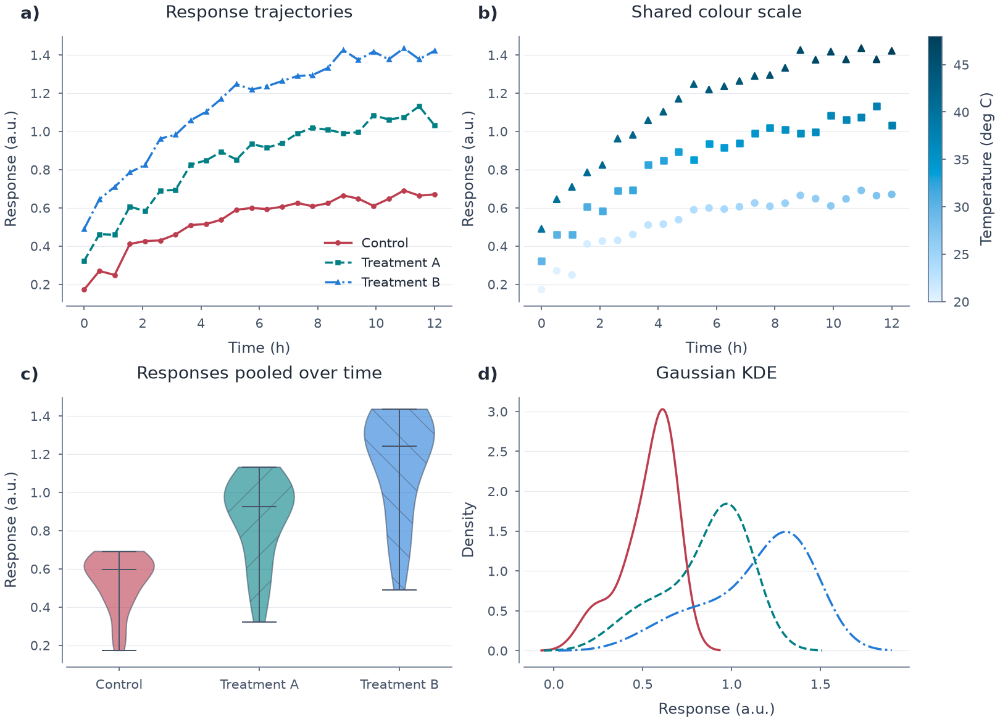

Generated by `python -m scripts.render_docs_demo` using a seeded pandas
DataFrame, not experimental measurements. Browse the **[plot gallery](docs/PLOT_GALLERY.md)**
for runnable code, real output and editable specs for each of the 66 registered
plot types. See the **[design demo gallery](docs/DEMO.md)**
for editing before/after, heatmap + 3-D output, **named colour-palette presets checked under documented CVD/greyscale proxy
conditions**, a fixed-size grouped-bar comparison after simulated black & white
printing, vector PDFs, editable JSON,
and runnable checks. Full demo regeneration requires pandas and the optional
`regression` extra in addition to `mudplot[render]` (included by `dev`).

## Usage

### Intuitive fluent builder

```python
import matplotlib.pyplot as plt
import mudplot as mp

fig = (mp.plot(data)                  # any of the formats below
    .line(x="voltage", y="current", group="order")
    .labels(x="Voltage (mV)", y="Current (μA)")
    .legend(title="Order")
    .theme("paper").journal("nature")
    .palette("qualitative", hue_start=30)
    .save("fig.pdf"))
plt.close(fig)
```

`save()` preserves the configured figure size; use `save("fig.pdf", tight=True)`
to crop to content instead. The returned Matplotlib figure remains open; close
it with `plt.close(fig)` when finished. `Plot.spec` and `Store.state` are isolated
snapshots: edit through builder methods/actions, not by mutating these snapshots.

### Publication-style bars: SD and 95% CI

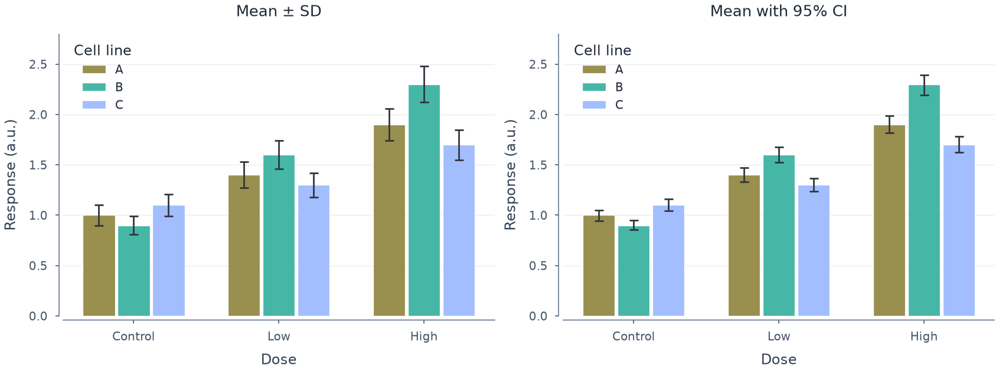

Bars now draw uncertainty at their own centers, including grouped bars:

```python
summary = {
    "condition": ["Control", "Treatment"],
    "mean": [1.0, 1.45], "sd": [0.12, 0.17],
    "ci_low": [0.93, 1.35], "ci_high": [1.08, 1.57],
}
(mp.plot(summary).theme("publication")
    .bar("condition", "mean", yerr="sd", bar_width=0.60)
    .labels(y="Response", title="Mean ± SD")
    .save("mean_sd.svg"))

# Absolute interval endpoints, NOT error magnitudes:
(mp.plot(summary).theme("publication")
    .bar("condition", "mean", y_lower="ci_low", y_upper="ci_high")
    .labels(y="Response", title="Mean with 95% CI")
    .save("mean_ci95.svg"))
```

`yerr` supplies symmetric nonnegative magnitudes. Alternatively, supply both
`y_lower` and `y_upper` as absolute endpoints containing the central value;
these also work with `errorbar()`. **These primitives do not compute statistics:**
SD describes observation spread, while a CI describes uncertainty in an
estimate. Choose and compute the CI method yourself; do not use `1.96 * SD`
as a mean's 95% CI. The small snippet uses illustrative supplied summaries.

Control bar outlines with `edge_color`/`line_width`, category span with
`bar_width` (default 0.8, divided between groups), and uncertainty with
`error_color`, `error_line_width`, `capsize`, and `capthick` (stroke/cap sizes
in points). `capsize=0` removes caps. The opt-in `publication` theme uses soft
fills, quiet spines and a subtle y-grid behind the marks; other themes and
existing no-error bars keep their defaults. Redundant hatch encoding remains
on by default. The gallery explicitly turns it off for clean fills; the soft
palette's measured safety guarantee is limited to five categories.

Reproduce the images with `uv run python examples/bar_uncertainty.py`. This
example generates seeded synthetic observations (12 per cell/dose), computes
sample SD with `ddof=1`, and estimates a 95% percentile-bootstrap CI of the
mean using 4,000 resamples **outside the renderer**.
[Original style](docs/images/bar_before.png) ·
[SD SVG](docs/images/bar_sd.svg) · [CI SVG](docs/images/bar_ci95.svg) ·
[Editable comparison](docs/images/bar_uncertainty.mplot.json).

### v1.1 development: raw-data statistical plots

For current coverage and release gates, see the [v2 workflow index](examples/README.md).
These source features are not a published 1.1 or 2.0 release.

```python
raw = {"dose": ["Control"] * 3 + ["High"] * 3,
       "response": [0.9, 1.0, 1.1, 1.7, 1.9, 2.1]}
(mp.plot(raw).theme("publication")
   .barplot("dose", "response", errorbar=("ci", 95), n_boot=1000, seed=42)
   .labels(y="Response", title="Mean with bootstrap CI")
   .save("raw_mean_ci.svg"))
# Alternatively: .pointplot("dose", "response", errorbar="se")
# Or: .countplot("dose") — no response column needed.
```

These builders store raw observations and a named `StatSpec`, not a precomputed
summary. Estimators: mean/median/sum/min/max/count. Choose `errorbar=None`,
`"sd"`, `"se"`, `"pi"`, `"ci"`, or `(method, level)`. SD/SEM use sample ddof=1
and default multiplier 1; PI/CI use coverage percent (default 95). SEM is the
sample-mean SE, not uncertainty for arbitrary estimators; count has no intervals.
Bootstrap uses original paired cases and a local stored seed. Weighted mean now
supports SD/SE/PI/CI; observed LEFT median/min/max support SD/PI/CI, weighted total
supports CI and count mass has no interval. SD is observation spread, SE is
mean-specific, PI observation quantiles and CI resampled-estimator uncertainty.
Weights are never sampling probabilities. `units=` requires paired two-stage CI,
not equal-unit means; physical-row reliability/Kish precedes ties.
Missing required x/y/group/weight/unit rows are dropped; fewer than two effective
observations or units omit intervals with a warning. General intervals are never
clipped to contain the point estimate.

`order`/`hue_order` select and order categorical levels, reserving empty slots
without invented estimates. `orient="h"` swaps geometry but keeps x categorical
and y the value. Bar `gap` is a fraction of its allocated span. Countplots support
`stat="probability"`/`"proportion"`/`"percent"`, normalized over all usable selected
rows, plus `stack=True`. Bar/count `value_labels=True` uses a bounded numeric
`label_format` such as `".2f"`. Conflicting shared-axis orders fail explicitly.
Bar/point now use actual primary/y2 targets in either orientation, with strict
SemanticSpec hue/size/style and explicit date/native/log units. SIZE is bar BODY
outline stroke pt versus point marker DIAMETER pt; connecting/error strokes are
independent. [Complete C07 contract](docs/STATISTICAL_WORKFLOW.md) includes exact
percent LEFT PI, canonical arithmetic, typed roles and explicit live-template edits.
NEW-only10000selected-row/256pointwise-cell/2Bactual-work limits do not attach to old
weightedmean/units/dense-line routes merely from those fields. This is not full
upstream parity or a latency/RSS promise.

Run `python examples/statistical_categories.py` for a weighted/unit CI,
horizontal SEM and stacked-percent comparison:
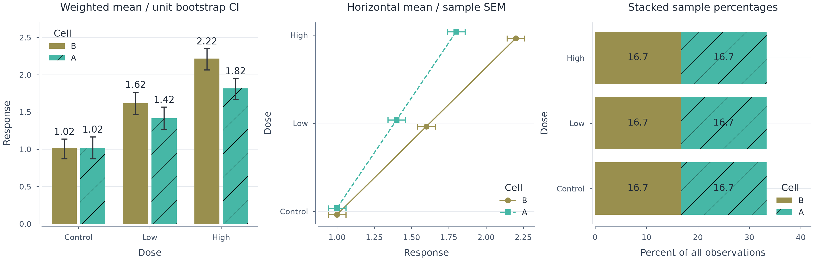
[Editable comparison](docs/images/statistical_categories.mplot.json).
[Bar preview](docs/images/plots/barplot.png) ·
[Point preview](docs/images/plots/pointplot.png) ·
[Count preview](docs/images/plots/countplot.png) ·
[Runnable code and editable specs](docs/PLOT_GALLERY.md).

### Explicit line inference and figure-owned guides

`LineSpec(resampling="unit", calibration="max_deviation")` resamples complete
original trajectories and calibrates a nominal finite-grid curve/layer family;
`calibration="percentile"` is pointwise, not simultaneous. Min/max complete-unit
results are explicitly nonregular empirical envelopes. Raw `.line()` gains
independent hue/stroke-size/marker-style without sorting, averaging, deduplicating
or bridging missing barriers. Numeric/real-clock/categorical, actual y2 and v/h
routes retain source identity and working/native units.

`Plot.shared_guides([SharedGuideSpec("scope")])` uses existing
`SemanticSpec.scale_id` as the sole membership authority. Actual mark-family
contexts/physical units remain truthful; local dataset legends and unrelated
scales stay. Both editors expose populated whole-list and live-template actions.
[Full scientific/API/resource contract](docs/LINE_WORKFLOW.md) ·
[Runnable synthetic examples](examples/line_workflow.py).
These additions do not close broader facet/grid parity or all-v2 acceptance.

### v1.1 development: statistical native/log axes

```python
p = (mp.plot(raw_numeric)
       .barplot("dose", "response", native_scale=True, stat_scale="axis",
                baseline=0.5, errorbar=("ci", 95), seed=7)
       .xscale("log").yscale("log"))
```

Bar/point/count support finite numeric native categories; declared date clocks
give canonical UTC-day slots, while bool/plain ordinal strings are not native.
Order selects/reserves physical locations; bar width/point dodge use minimum
selected/reserved spacing in axis coordinates (log10 for logs; singleton1).
Missing point cells break lines; large physical distances alone do not. Bar
width is (0,1], point dodge [0,1]; hatches/empty hue slots remain shared.

Log values keep raw-data estimates by default. Explicit `stat_scale="axis"`
fits mean/median/min/max and SD/SEM/PI/CI in log10, then inverse-maps centers/
endpoints; weights/units stay paired. Log-space mean is geometric, not arithmetic.
Axis/log sum and count are rejected, not interpreted as products/powers. Count
normalization uses all selected usable rows as before.

Nonstack bar/count `baseline` is a finite raw value, default0 on linear values;
log values require an explicit positive baseline. Bodies run baseline->estimate,
labels show estimates (not span length or baseline+estimate). C06 log stacks keep
explicit positive baselines/cumulative tops. Nonpositive derived log bounds/
inverse overflow fail, never clip. Bar/point have declared y2/v-h paths; line/count
retain their separately documented target subsets. No full parity claim.
[Runnable comparison](examples/statistical_scales.py):
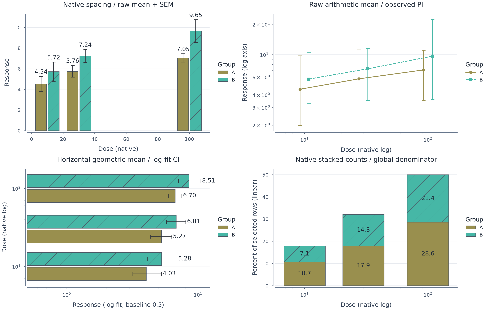
[Editable comparison](docs/images/statistical_scales.mplot.json).

### v1.1 development: independent lineplot semantics

```python
p = mp.plot(raw).lineplot("time", "response", errorbar="sd",
    semantics=mp.SemanticSpec(hue="method", size="dose", sizes=[1, 3],
                              style="batch", dashes=["-", "--"]))
```

Each distinct **raw hue/size/style tuple defines a curve**, with named estimates
and pointwise intervals per predictor/curve cell. Clipping numeric appearance
never combines curves; within-x weighted/unit CI stays pointwise, not whole-curve
resampling. Size interpolates **main line width in points**, not scatter areas or
interval widths. Style uses unique filled markers and optional distinct named
dashes; no scalar override silently replaces mapped roles. Missing roles and
missing/zero weights/units stay paired; numeric/horizontal/raw/log-fit/sorting/
missing bounds remain supported. Zero strokes retain markers/intervals/rows.
`scale_id` shares domains with lineplot/scatter; mixed geometry keeps separate
width-vs-diameter guide blocks, never extra data/limits. Pure core/JSON/editor/
export/RNG/legacy contracts,48tests. Limits10000rows/256raw curves/64levels/enough
markers/dashes; no raw-line/date/y2/colourbar/callable/simultaneous-CI parity claim.
[Runnable comparison](examples/line_semantics.py):
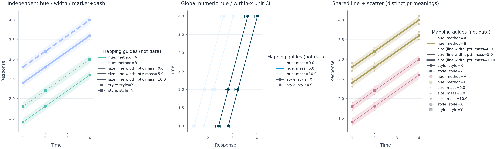
[Editable comparison](docs/images/line_semantics.mplot.json).

### v1.1 development: named figure-shared scatter scales

```python
mapping = mp.SemanticSpec(scale_id="study", hue="species", size="mass", style="batch")
p.scatter("left_x", "y", semantics=mapping, panel=0)
p.scatter("right_x", "y", semantics=mapping, panel=1)
```

`scale_id=None` preserves layer-local mappings. A name pools **unique selected
row IDs in original table order**, so missing coordinates in one panel do not
reset global colours/bounds/sizes/marker slots. Identical settings are required
(only legend may differ; numeric hue cmap must also match). Conflicts or pooled
row/level/marker limits fail before artists. Shared colour blocks precede legacy
entries; repeated layers do not consume the same colour block again. Guides
calibrate the **pooled scope**, never add observations/limits, and occur once per
panel even with multiple members; dataset labels remain separate. Different names
stay independent. This is the sharing foundation; use the separate
[automatic facet API](docs/FACETS.md) to materialize a grid;
lineplot semantics are described above. [Comparison](examples/shared_semantics.py):
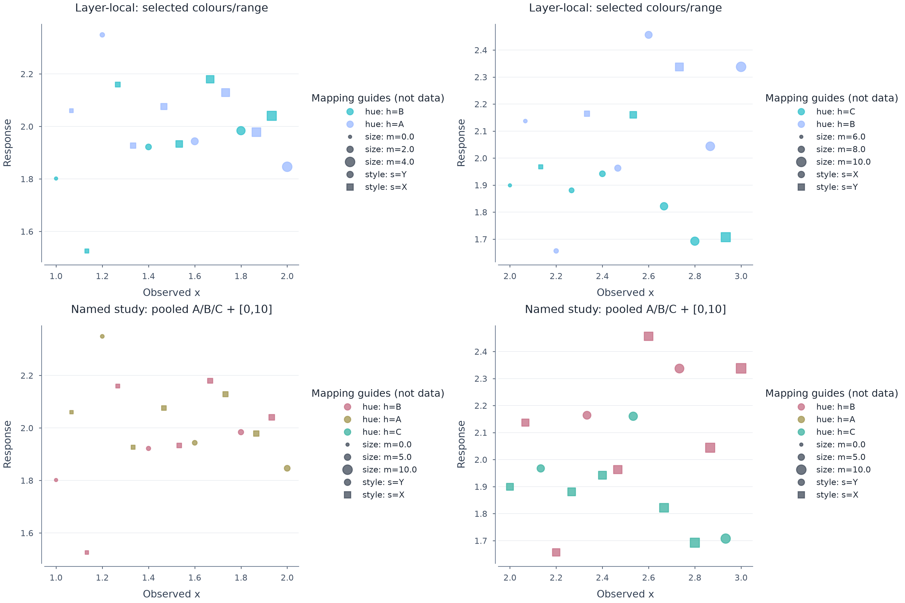
[Editable comparison](docs/images/shared_semantics.mplot.json).

### v1.1 development: independent scatter semantics

```python
p = mp.plot(raw).scatter("x", "y", hue="species", size="mass", style="batch")
# Advanced controls: semantics=mp.SemanticSpec(hue="score", hue_kind="numeric",
#     hue_norm=[0, 10], size="mass", size_norm=[0, 100], sizes=[2, 9], style="batch")
```

Strict `SemanticSpec`/dict separates roles; existing group/c/marker calls stay
unchanged. Hue is categorical by default (numeric explicit), size numeric by
default (categorical explicit), style always categorical. Orders select/reserve
slots; missing x/y/role rows drop listwise. Bounds map all selected rows globally,
**not each style subset**, and clip mapping only, never observations. `sizes`
are **diameters in points**, interpolated then squared to native marker areas.
Constant numeric variables map midpoint with one guide; stable differences handle
extreme scales/nearby low bits. Positive area underflow fails; exact zero sizes
keep invisible rows. Markers must be distinct filled named symbols, no recycling.
Legend shows observed categorical levels and **numeric mapping guides, not extra
data**; guides do not expand data limits. Global reference metadata uses an
explicit layer label. No group/c/role scalar override conflicts, colourbar,
outline/date/y2/line/facet semantics in this first scatter subset. Legacy c/
colourbar remains supported; broader workflows stay on the plan, no parity claim.
[Runnable comparison](examples/scatter_semantics.py):
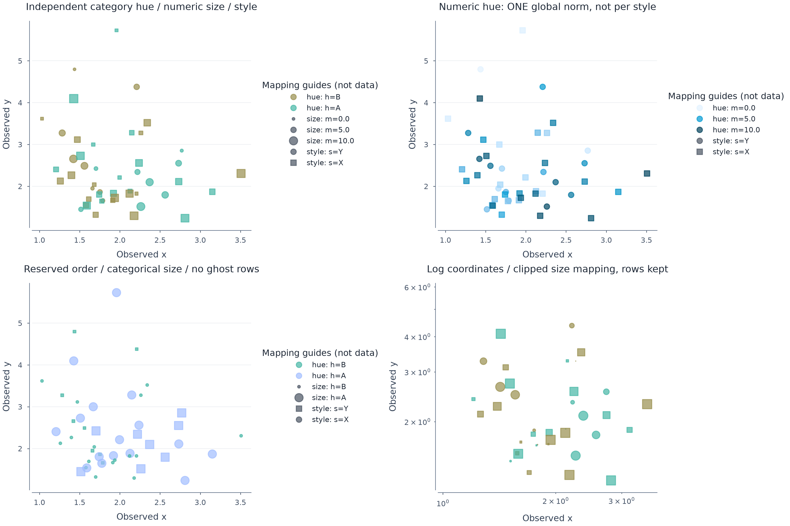
[Editable comparison](docs/images/scatter_semantics.mplot.json).

### v1.1 development: numeric-x line estimates

```python
p = mp.plot(raw).lineplot("time", "response", group="method", errorbar="ci",
                          n_boot=1000, seed=7, error_alpha=.25)
```

Separate from unchanged raw `.line()`. Numeric x cells use named estimators and
shared SD/SEM/PI/seeded CI, weighted mean/paired CI and within-x unit bootstrap.
**Intervals are pointwise, NOT simultaneous confidence bands or whole-curve
resampling.** Ribbons join observed-cell bounds for display, not model coverage
at unmeasured x. Missing bounds break ribbons without removing estimates.
Default sorts x ascending; `sort=False` uses per-hue first-observed x order.
Nonmonotonic ribbons fail (sort or choose `error_style='bars'`). Bands default
to `.2*line alpha`; `error_alpha` overrides exactly. Caps/stroke are bars-only.
Both orientations, positive log predictors and raw/explicit log10 response
fit are supported; invalid endpoints fail, never clip. Primary2D only; no
category/date predictors/y2/dodge/order/callables. Opt-in semantic maps are above.
[Runnable comparison](examples/line_estimates.py):
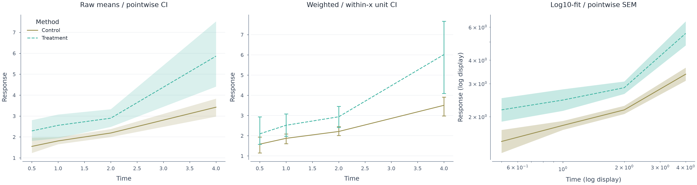
[Editable comparison](docs/images/line_estimates.mplot.json).

### v1.1 development: weighted violin

```python
p = mp.plot(raw).violin("dose", "response", group="method", weights="weight",
                        inner="quart", split=True, density_norm="count",
                        common_norm=True)
```

Paired nonnegative relative weights define unbiased Gaussian covariance and
effective sample size, not replicated rows. Missing/zero-weight rows are dropped
before positivity. Weighted quartiles/medians use **inverse weighted ECDF** with
all ties and no interpolation; even equal weights intentionally differ from
legacy linear quantiles. Means use weights in the declared data/log10 space;
points/sticks retain each positive row once. `count` width uses **total weight
mass, not row count or effective n**. Use comparable weight units across cells.
Cut/clip bound evaluation only, never fitting/inner rows or mass. Degenerate
observed bodies remain honest point masses, no invented bandwidth. Maximum
10000 usable rows/layer; bounded kernel chunks and clear derived failures.
Unweighted calls retain their old fits/marks. No new dependency or full-parity
claim. [Executable comparison](examples/weighted_violin.py):
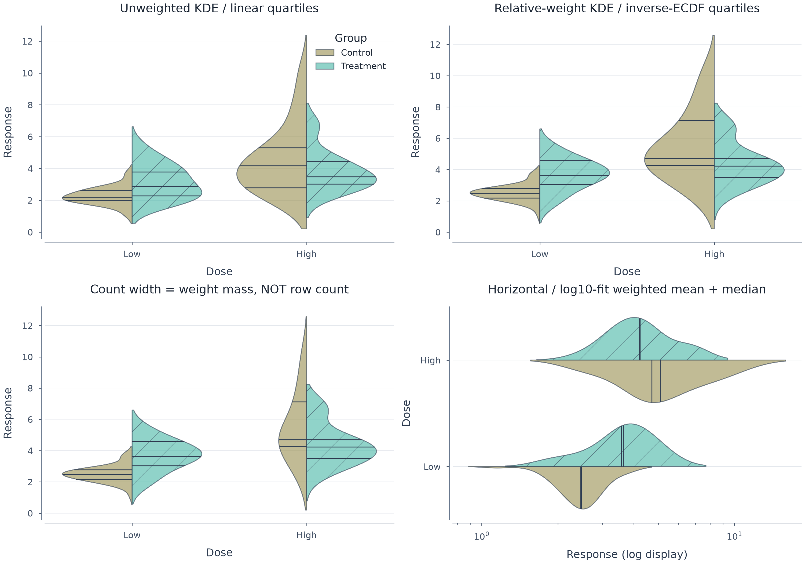
[Editable comparison](docs/images/weighted_violin.mplot.json).

### Paired density and empirical fields

Explicit `Histogram2DSpec`/`BivariateBinsSpec` adds weighted six-statistic cells
with true nonuniform areas and a KDE from the same **pre-tally** paired cohort.
Named Gaussian/product-Epanechnikov kernels, shared-grid 1D stack/composition,
true joint KDE CDF, explicit full-model HDR and `ecdf2d` strict OR complement keep
their different probability/normalization meanings. Actual primary/y2, v/h,
declared clocks and explicit log10-fit/Jacobian units retain literal source rows.
Full HDR is a bounded guaranteed-inside cell union, not a smooth contour or an
exact source-population guarantee; visible clipped mass is reported separately.

[Scientific/API/resource contract](docs/DENSITY_FIELDS.md) ·
[Executable workflow](examples/density_fields.py).
Finite NEW-figure admission and final coherent installed/DOM qualification remain
explicit; this section does not claim whole v2 completion.

### v1.1 development: weighted bivariate KDE contours

```python
p = mp.plot(raw).kde2d("x", "y", weights="weight", group="method",
                      levels=[.5, .8, .95], gridsize=80, fill=True, alpha=.5)
```

Strict `KDE2DSpec` uses full relative-weighted covariance/effective n; in 2D,
Scott/Silverman coincide at `n_eff**(-1/6)`. Cut/clip bound evaluation only, never
fit rows or density tail normalization. Common mass includes selected singular
hues; common grid uses pooled support with conditional covariance. Insufficient/
collinear/numerically rank-deficient data skip with optional warnings, no jitter
or fabricated Gaussian. Missing/zero-weight x/y rows stay paired.

**Without explicit HDRSpec or another level kind, levels enclose trapezoidal
highest-density mass conditional on the finite GRID.** Ties all count. This
retained default is approximate, **not a confidence interval/full-space guarantee**.
Clip/grid changes may change thresholds; density remains raw-normalized.
Native contours/fills use hue dash/
hatch and exact alpha/outline; raw-unit log display needs positive observations
and support, with default raw-data density units. Limits:10000 usable rows,
256 nodes/axis and16 levels; mass/CDF fractions are in(0,1), density levels positive.
The explicit kernel/CDF/full-HDR/clock/log-fit workflows above extend that retained
route without automatic regularization, 2D stack, arbitrary callbacks or a full
upstream-equivalence claim.
[Runnable comparison](examples/kde2d_semantics.py):
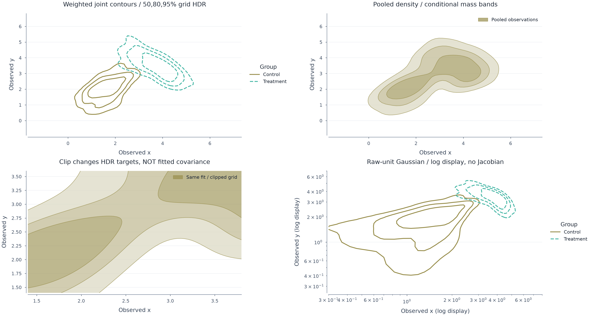
[Editable comparison](docs/images/kde2d_semantics.mplot.json).

### v1.1 development: configurable weighted Gaussian KDE

```python
p = mp.plot(raw).kde("value", weights="weight", group="method",
                    bw_method="scott", bw_adjust=.8, common_norm=False,
                    common_grid=True, cut=3, clip=(0, None), fill=True, alpha=.4)
# cumulative=True gives the analytic full Gaussian CDF, not an ECDF/grid sum.
```

New options store strict `KDESpec`; plain old calls retain their unweighted
1.06*sample-SD*n**(-1/5),200-point effect, including constant fallback. Typed
relative weights define unbiased covariance and effective n=1/sum(p**2),
p=w/sum(w); Scott=n_eff**(-1/5), Silverman=(3*n_eff/4)**(-1/5). A numeric method
is a covariance factor, not an absolute bandwidth. These weights are NOT
replicated sample counts. Missing required/zero weights and unselected hues drop
as paired rows; observations/weights are finite non-bool, weights nonnegative.

Common_norm=True uses all usable selected mass, INCLUDING skipped singular
hues; False uses the effective hue pool across raw size/style tuples.
Cut/clip restrict evaluation, never fit rows or renormalize tails. Full-line
areas/CDF endpoints are group shares or1; finite
support does not necessarily integrate to1 or end at1. Common_grid uses pooled
weighted support but each hue's own bandwidth. Singleton/constant curves are
skipped with a controllable warning: no fabricated Gaussian/CDF/legend.

Cumulative sums analytic Gaussian CDFs from -infinity, not from the first grid
point. Scaled weights/covariance, accurate positive sums and bounded evaluation
avoid huge matrix allocations and cancellation; invalid derived support/bandwidth/
heights fail. Actual primary/y2 line/fill/v-h and declared observation clocks,
exact alpha/width, hue dashes/hatches and reference metadata work. Default data
statistics retain raw density units on log displays; explicit stat_scale='axis'
uses log10 independent of display base, with declared data/fit Jacobian units.
Density/CDF ordinates stay linear. Named kernels and shared-grid layer/stack/fill
are documented above; no arbitrary kernel/callback/interval or parity claim.
Weighted violin KDE is supported separately through the violin options above.
[Runnable comparison](examples/kde_semantics.py):
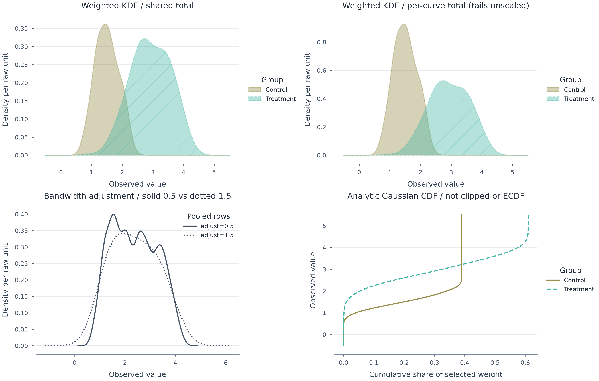
[Editable comparison](docs/images/kde_semantics.mplot.json).

### v1.1 development: weighted histogram statistics

```python
p = mp.plot(raw).hist("value", bins=[0, 1, 3, 6], weights="weight",
                     stat="density", group="method", multiple="stack",
                     element="step")
# Default element="bars" also supports multiple="dodge". Steps: layer/stack only.
# cumulative=True integrates mass; orient="h" swaps geometry, not x's role.
```

New options opt into typed `HistogramSpec`; old `.hist(..., density=...)`
remains unchanged, including per-group bins/normalization/default alpha.
Typed integer bins pool usable selected rows; explicit edges share raw widths.
Bins are [left,right), with the final edge closed. Missing required and zero-weight
rows are dropped, weights are finite/nonnegative (not bool). Outside-bin mass is
excluded from denominators. Common_norm=True uses pooled in-bin mass, False each
curve's mass. Count sums weights; frequency divides by raw width; probability/
proportion divides by mass; percent multiplies by100; density divides by mass
AND raw width. Density integrates to1, not sums heights to1.

Cumulative density integrates probability mass (a binned CDF, not exact ECDF);
no cumulative frequency. Scaled normalized weights avoid total overflow;
independent bin sums retain small mass and accurate row prefixes remain monotone.
Nonfinite raw totals/derived widths/heights fail, never silently clipped.
Primary2D v/h bars or unfilled steps; positive observation logs use raw bin widths,
height axes remain linear. Hue slots/hatches, exact alpha/edge/width and reference
metadata work. `multiple="stack"` adds heights in hue order; `"dodge"` splits
raw bin widths into equal hue slots, including reserved empty hues. Heights and
normalization do not change: density/frequency use the original bin width, so
dodging reduces drawn area without height correction. Stack overflow/lost nonzero
increments and collapsed dodge slots fail before drawing. `element="step"`
uses native stairs: layer closes to zero, stack outlines the absolute top and
previous baseline. Empty hues reserve theme dash/color slots; `edge_color`
overrides stroke color, and exact alpha/width (including zero) are retained.
Step with dodge, filled steps, fill/poly/discrete/auto-bin/date/bivariate/KDE/y2
and intervals remain outside this subset.
No full upstream parity claim.
[Runnable comparison](examples/histogram_statistics.py):
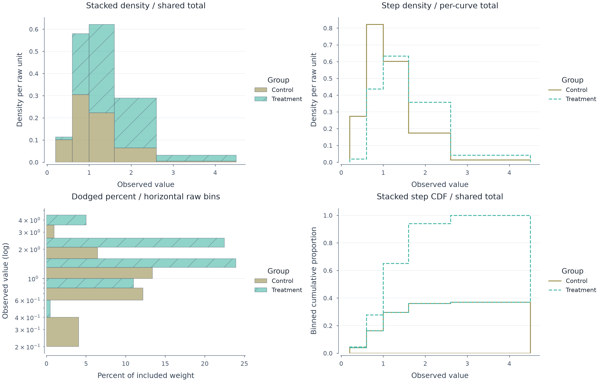
[Editable comparison](docs/images/histogram_statistics.mplot.json).

### v1.1 development: empirical cumulative distributions

```python
p = (mp.plot(raw)
       .ecdf("value", weights="weight", group="method", stat="percent")
       .labels(x="Value", y="Within-curve percent"))
# Or: .ecdf("value", complementary=True, orient="h") — strict upper tail.
```

ECDF stores raw values and typed `ECDFSpec`, not a fit/histogram/KDE. Default
`stat="proportion"` is F(t)=sum(w for X<=t)/sum(w); percent multiplies by 100,
count is cumulative weight mass (ordinary observation count without weights).
Each selected curve normalizes separately, unlike countplot's global denominator.
Complementary mass is strictly X>t, excluding all ties. Equal values jump together;
horizontal geometry keeps x as the observation argument. Curves show the full
minimum jump and stop at finite observed extrema, with no extrapolated tail.

Missing x/group/weight rows and zero weights are dropped before log positivity.
Values/weights must be finite numeric (not bool), weights nonnegative. Empty
hues have no curve/legend; `hue_order` selects/reserves color and dash slots.
Scaled sums avoid proportion/percent overflow, accurate unrounded prefixes keep
steps monotone, and right-to-left tails avoid loss from 1-F. Count overflow fails.

Primary Cartesian2D only; v/h, positive log observation axes, linear mass axes.
Named line/alpha styles and reference metadata work; bins, smoothing, intervals,
censoring/Kaplan-Meier, markers, date/2-D ECDF and y2 routing are unsupported.
This is a bounded subset, **not full upstream parity**.
[Runnable comparison](examples/ecdf_semantics.py):
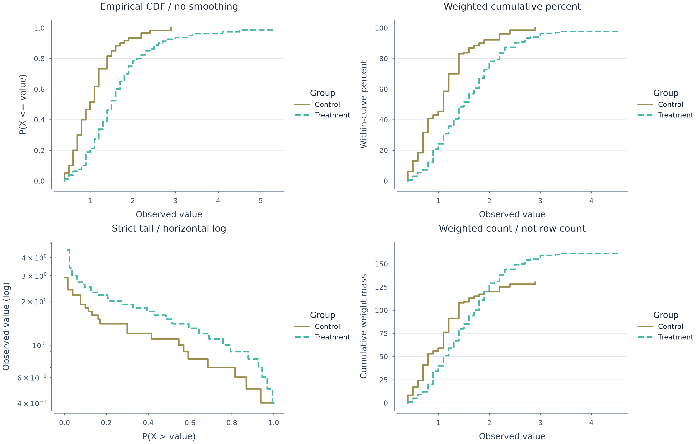
[Editable comparison](docs/images/ecdf_semantics.mplot.json).
[Gallery](docs/PLOT_GALLERY.md#ecdf--empirical-cumulative-distribution).

### v1.1 development: nested box/violin distributions

```python
# x stays categorical even with horizontal orientation.
p = mp.plot(raw).box("dose", "response", group="cell", whis=(5, 95),
                     order=["Control", "Low", "High"], gap=0.12,
                     showmeans=True, showfliers=False)
q = mp.plot(raw).violin("dose", "response", group="cell", orient="h",
                        bw_method="silverman", points=100,
                        showextrema=False, edge_color="#4b5563")
```

Legacy `.box("response", group="cell")` / `.violin("response", group="cell")`
still mean one value column split by group. New nesting supports order/hue order,
width/gap and numeric dodge (None auto, 0 overlays), shared hue colour/hatches,
listwise missing-row exclusion and empty reserved slots. Box whiskers follow
IQR/percentile rules, **not confidence intervals**; legacy notches use a deterministic
Gaussian approximation. Explicit raw median bootstrap CI is documented below.
Violin retains native Gaussian KDE, per-violin widths and observed min/max extent.
`showmeans`/`showmedians`/`showextrema` control its marks.
Named inner styles, two-hue split, area/count references, bandwidth adjustment
and cut/clip are supported below. Callable KDE and arbitrary inner
kwargs remain unsupported. Numeric native/log categories and positive log values
remain supported; C03 connects the documented box date/y2 combinations separately.
[Box example](examples/plots/box.py) · [Box preview](docs/images/plots/box.png) ·
[Violin example](examples/plots/violin.py) · [Violin preview](docs/images/plots/violin.png).

### v1.1 development: independent box/boxen components

```python
p = mp.plot(raw).box("dose", "response", showmeans=True, components={
    "body": {"alpha": 1},
    "median": {"color": "#b54b00", "line_width": 2},
    "mean": {"marker": "s", "face_color": "white", "edge_color": "black"},
    "flier": {"marker": "d", "marker_size": 3, "edge_color": "#0072b2"}})
```

`box` accepts body/whisker/cap/median/mean/flier; `boxenplot` only body/median/flier.
Typed `ComponentStyleSpec` / `DistributionComponentsSpec` work too. Missing styles
inherit native/layer/hue settings; named component properties override shorthand
without changing statistics/coordinates. Body colour keeps boxen tint tiers;
empty hatch disables redundant hatching. Component alpha is exact, including 1.
Marker stroke/fill use edge_color/face_color separately. Mean style requires
showmeans=True; explicitly hidden/unsupported/unknown settings fail before render.
Bounded basic/hex/cycle colours, named styles/markers and finite sizes only; no
arbitrary kwargs or boxen per-band/per-hue reinterpretation. For complete box
columnar `bxp`, seeded median CI, final-width caps, typed per-hue styles and
shared body-stroke/date/y2/live roles, see [C03 workflow](docs/BOX_WORKFLOW.md) and
[its executable comparison](examples/box_workflow.py). Raw no-new-request
defaults/JSON stay unchanged; this does not complete wider F01/F02/G01.
[Runnable comparison](examples/distribution_components.py):
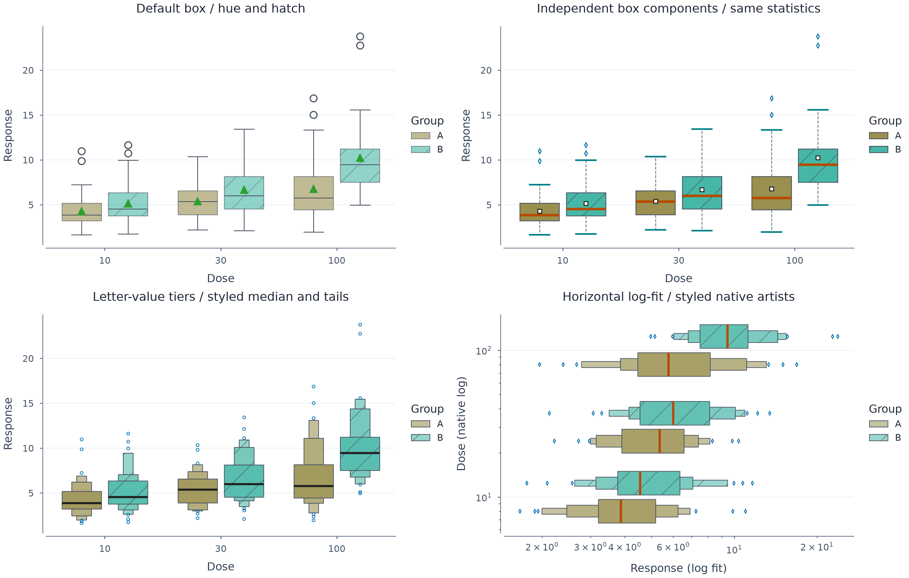
[Editable comparison](docs/images/distribution_components.mplot.json).

### Violin workflow: weighted profiles, paired halves and shared roles

```python
p = mp.plot(raw).violin(
    "dose", "response", group="cell", weights="weight", inner="quart",
    split=True, violin={"split_policy": "paired"},
    density_norm="area", bw_adjust=0.8, cut=1,
)
```

Omitted new controls retain the native/default route and JSON. The old split
without `ViolinSpec` still requires two hues; explicit paired policy supports
frozen multi-hue lanes, H=1 and an honest unpaired final left half. Named native
components and exact typed per-hue overrides share the existing component model.

Shared HUE owns body fill, SIZE body-outline stroke points, and STYLE body dashes
plus actual point/box-median glyphs only. Raw tuples partition fitting, but
normalization compares by effective hue (or globally), not size/style tuples.
Weighted Gaussian/ECDF definitions, finite bandwidth/support and untouched source
rows remain; no callable KDE, arbitrary kwargs or new nonlinear statistics.
Applicable date/native/log/v-h/y2/facet/live paths reuse the existing foundations.
New advanced bounds are10000 selected rows AND256 drawn profiles; categorical
levels64, continuous numeric hue/size values not capped at64, support points1000.
[Full scientific/ownership/lifecycle contract](docs/VIOLIN_WORKFLOW.md) ·
[Complete paired/shared-role/live executable](examples/violin_workflow.py).
Broader F01/F02/G01 and all-v2/product qualification remain separate.
[Runnable comparison](examples/violin_semantics.py):
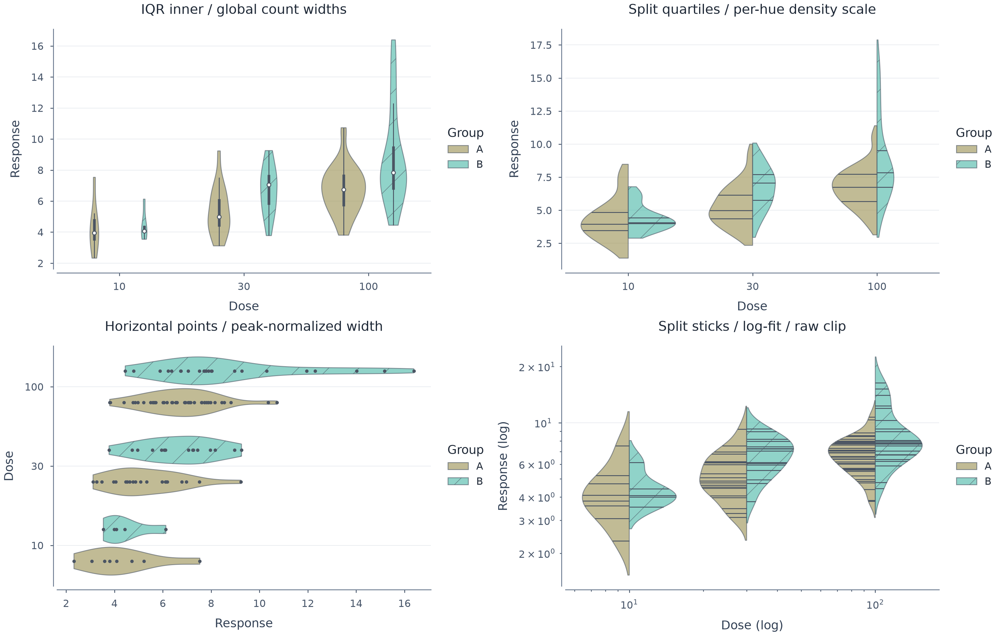
[Editable comparison](docs/images/violin_semantics.mplot.json).

### v1.1 development: display-space swarm observations

```python
p = (mp.plot(raw).swarmplot("dose", "response", group="cell",
                           order=["Control", "Low", "High"],
                           marker_size=5, warn_thresh=0)
     .yscale("log"))  # positive observations only
```

Circular markers repack at every draw using the actual layout/axis transform,
DPI, marker size and stroke width. Values stay unchanged; orientation, orders,
width/gap and numeric dodge are supported (None auto, 0 jointly packs hues).
Overcrowding **retains every row**, warns once per collection and reports
`crowded_count`; reduce marker size or enlarge the figure. Deterministic greedy
packing is bounded to 2000 usable observations/layer, not optimal packing.
Numeric native/log categories are now supported with `native_scale=True`.
Arbitrary marker shapes/size mappings and y2 are not supported. [Runnable comparison](examples/swarm_categories.py):
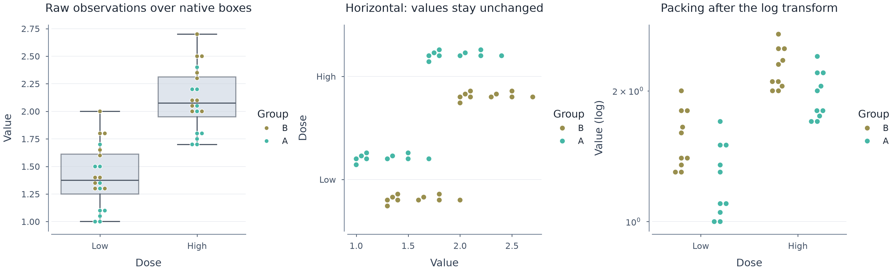
[Editable comparison](docs/images/swarm_categories.mplot.json).

### v1.1 development: letter-value distributions

```python
p = (mp.plot(raw).boxenplot("dose", "response", group="cell",
                           k_depth=4, width_method="exponential", gap=0.15)
     .theme("publication"))
```

`boxenplot` shows letter-value bands, **not confidence intervals**. No-weight
type7 quantiles now round finite interpolation once, including subnormal medians.
Explicit `weights="column"` uses LEFT inverse empirical CDF (not replicated
rows), exact empirical half-open/last-closed band masses and physical-row Kish
depth stopping (a non-CI heuristic). Named rules remain capped at32.
Canonical integer/float values are not rounded before interpolation/CDF work.
Unweighted strict tails use FINAL correctly-rounded type7 bounds; weighted LEFT
uses exact observed canonical bounds. Positive spans or actual requested tail
ordering lost at native conversion reject clearly, without an epsilon, rescale,
raw-min/max nonconstancy guard or blanket large-integer ban.


Typed `BoxenSpec`/`BoxenBandComponentsSpec`/`BoxenHueComponentsSpec` add stable
central/lower/upper rank overrides and exact raw-hue fieldwise ownership. Mapped
hue is never retinted; size means BODY outline stroke pt, style BODY dash and
actual observed flier glyphs. All positive strict-tail rows retain source order.
Matching shared raw domains also work across scatter/line/boxen; stroke and
diameter units/guides remain mark-specific. Scalar and flier-component glyphs
share registered legacy `+`/`x`/`.` and richer choices; filled semantic style
cycles remain separate and do not accept those unfilled scalar glyphs.

Primary/y2, v/h, numeric/date/native/log, selected shared scales, live cells and
N13 layouts use the same public declarative path. Both editors populate
collapsed `ReplaceLayer` JSON forms for authoritative existing-index edits.
Invalid previews retain prior spec/PNG/history; no remove/reappend or recipe detach.

Advanced source bounds are10000 selected positive rows/256 drawn raw-tuple cells
per layer; effect bounds are32768 actual band polygons/1000000 requested flier
instances per figure. Pure validation does not fit full summaries; render prepares
once before native admission. Repeated physical uses count, transparent/none
styling does not discount work. These are not SLA/RAM promises; legacy admission,
depth32/figure256panels/1024layers/40Mrenderpixels/version/schema remain unchanged.
See the [full mathematical/ownership/editor contract](docs/REFERENCE.md#letter-value-distributions)
and [weighted executable](examples/weighted_letter_values.py).
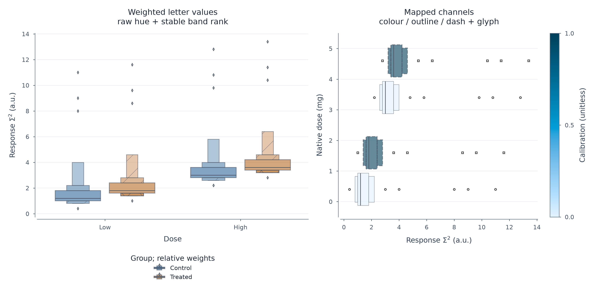

[Runnable comparison](examples/letter_value_categories.py):
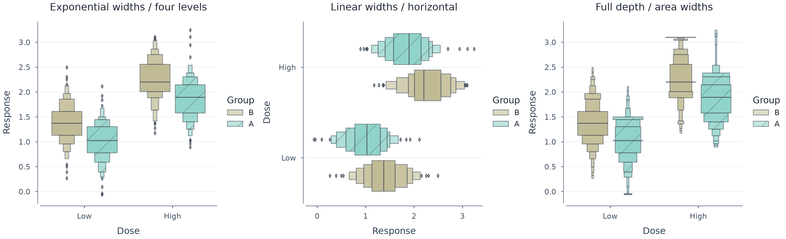
[Editable comparison](docs/images/letter_value_categories.mplot.json).

### v1.1 development: native/log categorical coordinates

Box, violin, boxenplot and swarmplot accept `native_scale=True` (default False)
for finite numeric category IDs, not strings/bools/dates. Order selects/reserves
locations, not their physical ordering. Width/dodge are relative to the minimum
selected/reserved spacing in axis coordinates (log10 on log category axes;
single level spacing 1). Legacy ordinal/one-based defaults stay unchanged.

Summary types default to `stat_scale="data"`, preserving raw-data estimates.
Explicit `stat_scale="axis"` opts into log10 summaries/KDE with inverse-mapped
artists; swarm always keeps raw values. Log values/categories must be positive.
Shared axes reject native/ordinal mixtures and conflicting scale declarations.
Statistical bar/point/count use this spacing in their documented subset above;
broader mappings remain unsupported.
[Runnable comparison](examples/native_categorical_scales.py):
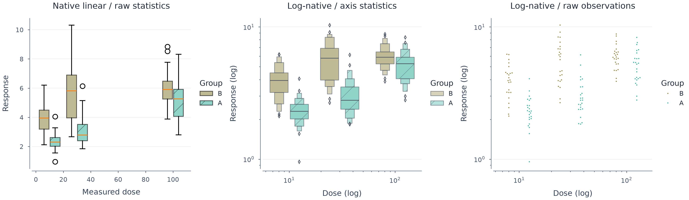
[Editable comparison](docs/images/native_categorical_scales.mplot.json).

### Supported plot types

| category | types | notes |
| --- | --- | --- |
| basic | `line`, `regplot`, `scatter`, `bar`, `errorbar`, `band`, `stackplot` | `group=` for multiple series; line supports `drawstyle="steps-post"` (and pre/mid/steps); bars auto-dodge when grouped; categorical or numeric x |
| raw-data statistics | `barplot`, `pointplot`, `countplot` | named estimation and explicit intervals; countplot needs x only; ordinal default or explicit numeric native/log primary axes; log bars need baseline |
| distributions | `hist`, `box`, `boxenplot`, `violin`, `kde`, `kde2d`, `ecdf`, `rug`, `stripplot`, `swarmplot` | legacy effects retained; explicit weighted named-kernel density/CDF/composition and full-model HDR; rug marks actual x/y/y2 observations with axes-fraction height |
| 2-D fields | `heatmap`, `contour`, `contourf`, `hist2d`, `hexbin`, `ecdf2d` | heatmap/contours use registered matrices; histogram/hexbin/joint-ECDF use paired raw columns and declared statistics; native mappables retain their real units |
| vector fields | `quiver` | numeric x/y positions plus u/v components; optional continuous colour and explicit scale/shaft-width controls |
| polar | `line`, `scatter`, `bar` | call `.projection_polar()`; angles are x values in radians |
| 3-D | `scatter3d`, `line3d`, `surface`, `wireframe` | panel needs `.projection3d()` first; mixable with 2-D panels in the same figure |
| annotations | `hline`, `vline`, `text`, `annotate` | |
| other | `pie` | |

`regplot("x", "y", degree=2, confidence=95)` opts into a normal-approximation
confidence band for the **mean fit**, not a prediction interval; omit
`confidence` to draw only observations and the fitted line.

Most types support a continuous colour mapping (`c=` + `colorbar=True`),
a secondary y-axis (`axis="y2"`), multi-panel layouts, and redundant
marker/line-style encoding for series (see `mp.capabilities()` for the
exact, always-up-to-date field list per type).

```python
# distributions side by side
(mp.plot(data).layout(1, 2)
    .violin("value", group="condition", panel=0)
    .kde("value", group="condition", panel=1))

# a 3-D scatter, colour-mapped by a fourth variable
(mp.plot(data).projection3d()
    .scatter3d("x", "y", "z", c="temperature", colorbar=True))

# a scalar field as a heatmap + contour
(mp.plot({}).matrix("field", grid_values)
    .heatmap("field").contour("field", levels=8))
```

### Save/load a spec (the same format used by the Rust editor)

```python
p = mp.plot(data).line("x", "y")
json_text = p.to_json()               # .mplot.json
p2 = mp.Plot.from_json(json_text)     # lossless round-trip
fig = p2.render()
```

### TeX WYSIWYG preview

```python
# Preview at the exact size/font it will have in the paper (mock text
# column + caption)
fig = (mp.plot(data).line("voltage", "current", group="order")
         .labels(x="Voltage (mV)", y="Current")
         .preview(tex="ieee", caption="Figure 1. ..."))
```

### Sizing the actual figure for a one- or two-column layout

`.tex_size(...)` applies the same column-width/font sizing as `.preview()`,
but to the figure you actually `.render()`/`.save()` — not just a mock
preview. Every layer (long titles, outside legends) is then laid out to fit
that exact size without clipping or overlap (see "Layout" below).

```python
p.tex_size("ieee", columns=1)   # a single column's width
p.tex_size("nature", columns=2) # spans the full text width (figure*)
```

### Layout: no clipped or overlapping text, at the exact configured size

`render()`/`save()` never crop or rescale the figure to fit its content —
the physical size you set (directly, via `.size()`, or via `.tex_size()`) is
what you get, which matters for TeX placement. Instead, before returning the
figure it:

- wraps titles/suptitle that would otherwise overflow the figure width
  (matplotlib's native text wrapping, measured against the real renderer —
  not a hand-rolled estimate);
- reserves exact canvas space for a named `"outside ..."` legend location so
  it's fully visible, never overlapping the axes or clipped at the edge.

An explicit `bbox_to_anchor=[x, y]` (see below) is trusted as-is and isn't
auto-adjusted, since overlapping the plot may be a deliberate placement
choice. This uses matplotlib's own layout engine and text-measurement
renderer throughout (no custom layout system) and is a no-op for figures
that already fit — font sizes stay exactly as configured unless something
would otherwise be clipped. 3-D panels fall back to `tight_layout()` for now
since matplotlib's constrained layout doesn't support 3-D Axes well.

### Citations and links inside the figure (LaTeX-native)

A legend entry or panel title can carry a BibTeX key and/or a URL. Nothing
is baked into the image: the *paper* resolves it at compile time, so the
number in the figure is the same `[1]` as in its References list.

```python
(mp.plot(data)
    .line("x", "y", label="RANSAC",
          citation="fischler1981",             # BibTeX key
          href="https://doi.org/10.1145/358669.358692")
    .labels(title="Robust fitting")
    .title_reference(citation="hartley2003")
    .tex_size("ieee", columns=1)
    .save("fig.pgf"))                          # .pgf -> LaTeX-native export
```

```latex
\input{preamble.tex}   % or paste mudplot.PREAMBLE once
\begin{figure}\centering
  \input{fig.pgf}
  \caption{Errors of two estimators.}
\end{figure}
```

The export emits `\figcite{fischler1981}`, not `\cite{...}` directly, so the
document decides what a figure citation means:

```latex
\providecommand{\figcite}[1]{\cite{#1}}   % mudplot.PREAMBLE; \citep, \autocite, ...
```

Each backend does what it can with the same spec:

| format | citation | href |
| --- | --- | --- |
| `.pgf` | `\figcite{key}` — numbered by the paper's bibliography | `\href{url}{...}` via hyperref |
| `.svg` | dropped (nothing to resolve against) | the text becomes a clickable link |
| `.png`/`.pdf` | dropped | dropped |

Metadata is substituted into LaTeX source verbatim, so `validate()` rejects
braces/backslashes in these two fields. Links must be absolute `http`, `https`,
or `mailto` URIs; active/file/data/custom schemes, relative links, controls,
and whitespace are rejected before SVG/PGF export. Ordinary URL punctuation
like `_`/`:`/`-`/`&`/`#`/`%` remains valid.

A `group=`-ed layer can cite a *different* paper per series via
`references=` (a `{group_value: mp.Reference(...)}` dict); a group value
not in the dict gets no citation/link:

```python
(mp.plot(data).line("snr", "bler", group="method", references={
    "RANSAC": mp.Reference(citation="fischler1981", href="https://doi.org/..."),
    "J-Linkage": mp.Reference(citation="toldo2008"),
}))
```

Pull citation/href straight out of an existing `.bib` file instead of typing
keys/URLs by hand with `mp.ReferenceCatalog` (a minimal, dependency-free
reader for the common BibTeX subset real `.bib` files use -- not a full
bibliography manager):

```python
refs = mp.ReferenceCatalog.from_bib("references.bib")
ref = refs["fischler1981"]   # -> ReferenceSpec(citation=..., href=...)
# href is resolved (offline, no network access) via mp.resolve_reference_href:
# a doi field (bare, "doi:"-prefixed, or a full doi.org URL -- all normalised
# the same way) -> https://doi.org/...; else an arXiv id (eprint +
# archiveprefix/eprinttype == "arxiv", the shape arXiv's own "export bibtex"
# produces) -> https://arxiv.org/abs/...; else a plain url field; else None.
p.line("x", "y", label="RANSAC", citation=ref.citation, href=ref.href)
```

By default, PGF layout is measured against a compact numeric citation style
(`"[12]"`); pass `.reference_style(measure_text="(Author, Year)")` if your
bibliography style is longer (e.g. author-year), so legend sizing predicts
the final compiled width instead of assuming the compact default.

### Placing the legend, title, or an annotation at an exact spot

```python
p.legend(bbox_to_anchor=[0.8, 0.5])   # figure-fraction [x, y], overrides location
p.legend(location="upper left")       # bbox_to_anchor=None restores named locations
p.title_position([0.1, 0.85])         # axes-fraction [x, y]; None restores default
p.set_layer_at(layer_index, [3, 0.5]) # move a text/annotate layer (data coords)
```

This is also what the interactive editor's draggable handles use (mouse or
arrow keys, right on the preview) — see `dashboard/README.md`.

### Figure lint / publication preflight

`validate()` only checks structural correctness ("is `axis='y2'` legal
here"); `.lint()` checks publication-quality *heuristics* instead — does
this actually work as a readable, greyscale/CVD-safe paper figure at its
configured size — as non-blocking findings to review, not hard failures:

```python
report = p.lint(journal="ieee")
print(report)
# ✓ width fits ieee single column (3.49in <= 3.49in)
# ✓ dpi (300) meets ieee recommendation (300 DPI)
# ✓ all text >= 6pt
# ⚠ palette does not pass the measured CVD-safety threshold for 9 series -- see Palette.report()
# ⚠ palette colours become ambiguous in true greyscale
# ✓ grouped series have redundant marker/line-style/hatch encoding
# ⚠ 9 series in one group exceeds the marker/line-style cycle length (4) -- ...
# ⚠ legend contains 9 entries (> 8) -- consider splitting into panels or using direct labelling
# ✓ citation/href metadata is well-formed

report.ok   # False only if an error-level finding exists (e.g. doesn't fit the page)
```

Checks: page-width fit and raster DPI against the named journal's profile,
minimum text size, palette CVD/greyscale safety (reusing `Palette.report()`),
redundant encoding for grouped series, marker/line-style cycle exhaustion,
legend size, and reference-metadata validity. Thresholds default to the
journal's own profile (see below) and can be overridden per call
(`min_font_pt=`, `max_legend_entries=`). Omitting `journal=` picks it up from
`.journal(...)` if you already set it. `mp.lint_figure(spec, ...)` is the
side-effect-free/agent-facing equivalent, needing only the `color` extra (numpy) — no
matplotlib required, since nothing is actually rendered.

### Journal profiles (publication constraints, not just a style sheet)

Each supported journal is one `JournalProfile` bundling its *style* (fonts,
line widths, conventional figure size), its *TeX geometry* (column/text
width, column count), and its *preflight constraints* (minimum font size,
recommended raster DPI, legend budget, greyscale policy) — so `.journal()`,
`.tex_size()`, and `.lint()` all agree on one definition instead of three
separate lookups:

```python
mp.AVAILABLE_JOURNALS          # ('nature', 'ieee', 'acm', 'revtex')
prof = mp.get_journal_profile("acm")
prof.columnwidth_pt            # 241.0
prof.min_font_pt               # 6.0
prof.recommended_dpi           # 300

# a profile object works anywhere a journal name does
p.journal(prof).tex_size(prof, columns=1).lint(journal=prof)
```

`mp.capabilities()["journal_profiles"]` exposes all of it as plain JSON for
agents.

### For AI agents (drive everything via JSON)

The engine is designed to be machine-friendly: an agent can explore, build,
and render entirely through text/JSON (the human-facing side is
`dashboard/`):

```python
import mudplot as mp

caps = mp.capabilities()   # layers/themes/journals/TeX presets/action vocabulary
schema = mp.json_schema()  # full FigureSpec JSON Schema

spec = mp.apply([          # build from JSON actions without render/I/O effects
    {"type": "SetData", "columns": {"x": [1, 2, 3], "y": [1, 4, 9]}},
    {"type": "AddLayer", "layer": {"type": "line", "x": "x", "y": "y"}},
    {"type": "SetAxisLabel", "axis": "x", "text": "X"},
    {"type": "SetTheme", "name": "paper"},
])
issues = mp.validate(spec)  # side-effect-free pre-render agent feedback
mp.save(spec, "fig.pdf")   # effect (calls assert_valid internally)

# build history (replay/undo)
p = mp.plot(data).line("x", "y").theme("paper")
log = p.action_log         # [{"type": "SetData", ...}, ...]
assert mp.apply(log).to_dict() == p.spec.to_dict()   # reproducible
```

### CLI (for agent/shell automation)

```bash
python -m mudplot capabilities                    # print engine capabilities as JSON
python -m mudplot schema --out s.json              # save the FigureSpec JSON Schema
python -m mudplot validate fig.mplot.json          # validate a saved spec
python -m mudplot render fig.mplot.json out.pdf    # render PNG/PDF/SVG/PGF by suffix
python -m mudplot apply fig.mplot.json action.json -o next.mplot.json
```

### Using the reducer / store directly

```python
from mudplot import Store, actions as A

store = Store()
store.subscribe(lambda spec, action: print("changed:", type(action).__name__))
store.dispatch(A.SetTheme("paper"))
store.dispatch(A.SetPalette(kind="qualitative", params={"hue_start": 30}))
spec = store.state          # defensive snapshot; mutate through actions
```

### Supported input data formats

`mp.plot(data)` auto-detects all of the following (the dependency-free core
never imports numpy/pandas directly — it uses duck typing):

```python
mp.plot({"x": [1, 2], "y": [3, 4]})           # dict of columns
mp.plot([{"x": 1, "y": 3}, {"x": 2, "y": 4}]) # records (list[dict])
mp.plot([[1, 3], [2, 4]])                     # 2-D rows -> auto-named c0, c1
mp.plot(df)                                   # pandas / polars DataFrame
mp.plot(np_structured_array)                  # numpy structured array
mp.plot(np_2d_array)                          # numpy 2-D -> c0, c1, ...
mp.plot(arrow_table)                          # pyarrow Table
mp.plot(cursor)                               # an executed DB-API cursor
mp.plot(conn, query="SELECT x, y FROM t WHERE run = ?", params=(run_id,))
                                              # parameterized DB-API query (sqlite)
```

Input adapters normalize common missing sentinels (`NaN`, `pd.NA`, `NaT`) to
JSON `null`, date/time values to ISO 8601 strings, and NumPy scalars to their
plain Python equivalents. Infinity and unsupported objects still fail strict
JSON validation instead of being silently rewritten. Column names must be
unique after string conversion; collisions are rejected rather than overwritten.

### Using palettes directly

```python
pal = mp.color_palette(5, "qualitative")   # lightness jitter + hue contrast
print(pal.hex, pal.min_delta_e())
print(pal.report())      # includes final HEX metrics and explicit evaluation conditions
cmap = mp.color_palette(256, "sequential").to_cmap()

# Named, pre-verified presets (measured CVD-safe + true-greyscale-safe up to
# a documented category count -- see mp.capabilities()["palette_presets"]):
pal = mp.color_palette(6, "qualitative", preset="paper")   # or "vivid" / "soft"
p = mp.plot(data).line("x", "y", group="g").palette(preset="paper")

# Bar/box/violin fills also cycle a hatch pattern per group by default
# (ThemeSpec.hatches). Patterns repeat after their finite cycle; inspect the
# actual print size rather than treating colour/hatch count as a guarantee.
p2 = mp.plot(data).bar("category", "value", group="g")  # colour + hatch
p3 = p2.encoding(redundant_encoding=False)               # colour only
```

`Palette.report()` measures exported **8-bit HEX sRGB**, including quantization;
its `evaluation` records normal vision, selected CVD types, Machado 2009 full
severity, and existing ΔE00 ≥ 8 / L* gap ≥ 3 thresholds. The float `srgb` metric
methods can differ slightly. These are measured flags, not accessibility/print
certification; outside the preset's pre-verified count, inspect a fresh report.
`hue_start` seeds deterministic sampling; there is no random-seed option.

### Dashboard (human-facing docs + design gallery)

`dashboard/` is a separate source-tree package from the engine (a one-way
`dashboard → engine` dependency). It reuses the engine's `capabilities()` /
`reference_markdown()` and its renderer directly, producing a static site
where the **docs and the actual figures always stay in sync with the
engine**.

```bash
python -m dashboard --out dashboard/site_build
# open dashboard/site_build/index.html -> a Markdown reference of the
# engine's capabilities plus a design gallery (palette safety, redundant
# encoding, TeX preview, secondary axes, heatmaps, etc.)
```

### Rust editor (local v1.1 candidate)

```bash
MUDPLOT_PYTHON="$PWD/.venv/bin/python" \
  cargo run --locked --manifest-path mudplot-editor/Cargo.toml
```

It shares the Python action/reducer contract instead of duplicating its
semantics. Its unauthenticated server rejects non-loopback binds/HTTP Hosts
and cross-origin browser mutations; scope and routes are documented in [`mudplot-editor/README.md`](mudplot-editor/README.md).

## Development

```bash
uv sync --locked --extra dev --extra browser
uv run pytest -q -m "not browser"
uv run python scripts/check_schema_sync.py
uv run python scripts/check_wheel.py
cargo test --locked --manifest-path mudplot-editor/Cargo.toml
```

See [`CONTRIBUTING.md`](CONTRIBUTING.md) for the full Python, browser, TeX,
and Rust preflight. Report vulnerabilities privately as described in
[`SECURITY.md`](SECURITY.md).
