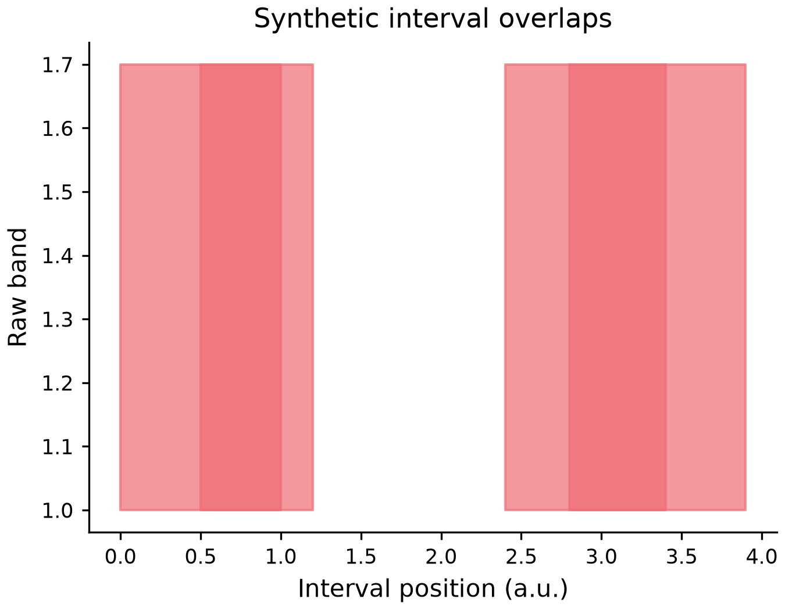

# 네이티브 구간 띠

*[English](BROKEN_BARH.md)*



[실행source](../examples/plots/broken_barh.py) · [편집spec](images/plots/broken_barh.mplot.json)

```python
p = (mp.plot({"start": [3, 1, 3], "duration": [1, 2, 0.5]})
       .broken_barh("start", "duration", bottom=1, height=1)
       .labels(x="Interval position", y="Raw band"))
```

각 원본 행의 X 구간은 `[start, start + duration]`, Y/Y2 띠는 `bottom`부터
`bottom + height`까지입니다. `LayerSpec.x/y`는 시작·기간 열이고,
`baseline`과 `width`는 띠의 하단과 높이입니다. 생략 또는 JSON `null`은
0/1입니다. 겹치거나 반복된 구간도 병합하지 않으며 그룹이 달라도 원본 행
순서대로 그립니다.

`group`과 선택적 `hue_order`로 띠의 슬롯과 색 순서를 정합니다. 슬롯 `i`의
하단은 `bottom + i * lane_step`입니다. 간격을 지정하면 실제 그룹 열과
유한한 양수가 필요합니다. 생략하면 같은 하단에 겹칩니다. 고정·라이브 패싯은
원본 행을 선택하며 빈 예약 슬롯에는 띠나 범례 항목을 그리지 않습니다.
선택 구간 상한 10,000개는 그룹 전체에 적용됩니다.

날짜 X의 숫자 시작점에는 명시한 입력 단위와 원점을 적용하지만 기간은 같은
단위에서 **원점을 더하지 않습니다**. ISO 시작점의 기간은 일 단위입니다.
날짜 Y/Y2의 띠 하단은 UTC 1970 기준 절대 일 좌표이며 높이·간격은 일 단위
차이입니다. 로그는 양 끝점이 모두 양수여야 하고 logit은 열린 구간을
검사합니다. 넘치거나 구별할 수 없는 끝점을 무시하지 않습니다.

실제 다각형 꼭짓점으로 축 범위를 계산하며 이전 아티스트와 독립 보조축을
보존합니다. 색·윤곽·점선·불투명도는 띠의 모양만 바꿉니다. 의미 매핑,
가중치, 추정은 지원하지 않습니다. [실행 예제](../examples/native_lane_workflow.py)를
참고하세요.

```json
{"type":"AddLayer","layer":{"type":"broken_barh","x":"start","y":"duration","baseline":1,"width":1,"group":"band","lane_step":2}}
```
