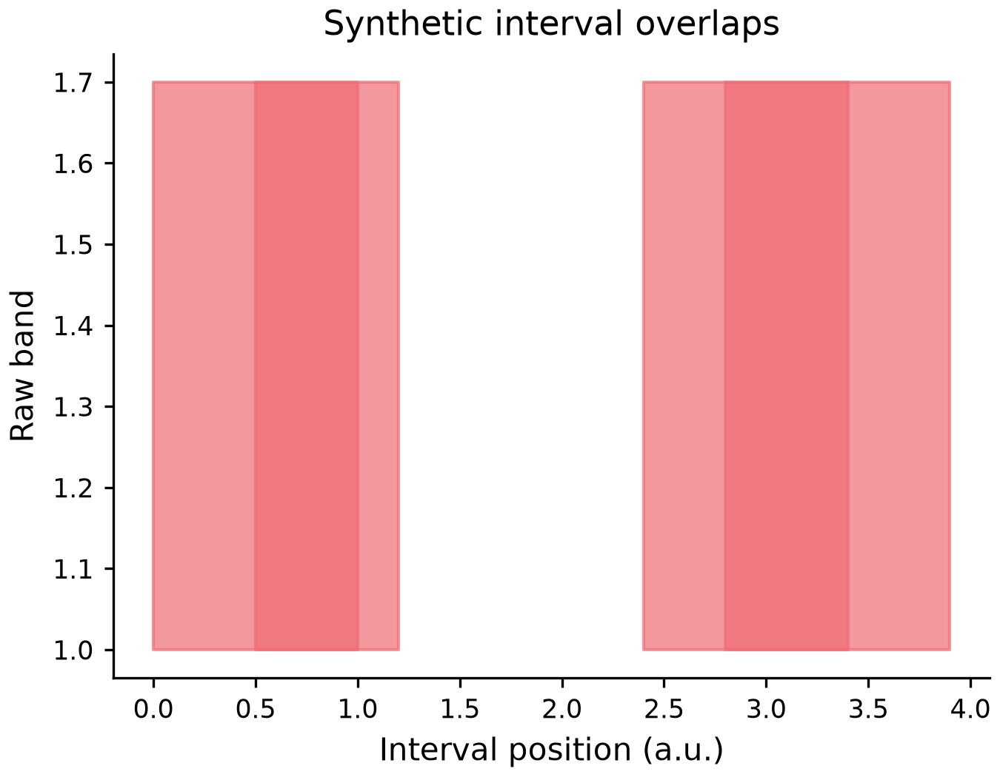

# Native interval bands

*[한국어 / Korean](BROKEN_BARH.ko.md)*



[Executable source](../examples/plots/broken_barh.py) ·
[Editable spec](images/plots/broken_barh.mplot.json)

```python
p = (mp.plot({"start": [3, 1, 3], "duration": [1, 2, 0.5]})
       .broken_barh("start", "duration", bottom=1, height=1)
       .labels(x="Interval position", y="Raw band"))
```

Each row describes `[start, start + duration]`; its raw Y/Y2 band spans
`bottom` to `bottom + height`. `LayerSpec.x/y` name start/duration columns;
`baseline` and `width` hold the band bottom and height. Omission or JSON null
uses 0/1. Intervals may overlap or repeat. The original row order is also
the paint order, including across groups. Nothing is merged, sorted or estimated.

Use `group` with optional typed `hue_order` for stable lane colours and slots.
Slot `i` begins at `bottom + i * lane_step`; `lane_step` is optional but must
be finite and positive with a real group column when given. With no step the
bands overlay at the authored bottom. Fixed/live facets select original rows.
Reserved empty lanes occupy slots without drawing a band or a legend entry.
The 10,000 selected interval cap is across all groups.

On an explicit date X axis, numeric starts use the declared unit and origin;
durations use the same input unit **without** adding the origin. With ISO
starts, durations are in days. A date Y/Y2 lane uses a literal UTC-1970 day
bottom and day differences for height and spacing. Log axes require both
actual endpoints to be positive in each plotted dimension. Logit requires
the corresponding open domain; symlog and asinh preserve native geometry.
Overflow or float-coordinate collapse rejects before export or preview.

Use a configured `axis="y2"` for the independent twin. Grouped/log views use
the actual raw polygon vertices for limits and preserve prior artists.
Colour, edge colour, alpha, dash and physical outline width style each band;
zero-width outlines stay zero. No mapped semantics, weights or estimation.
See the [native lane example](../examples/native_lane_workflow.py).

```json
{"type":"AddLayer","layer":{"type":"broken_barh","x":"start","y":"duration","baseline":1,"width":1,"group":"band","lane_step":2}}
```
