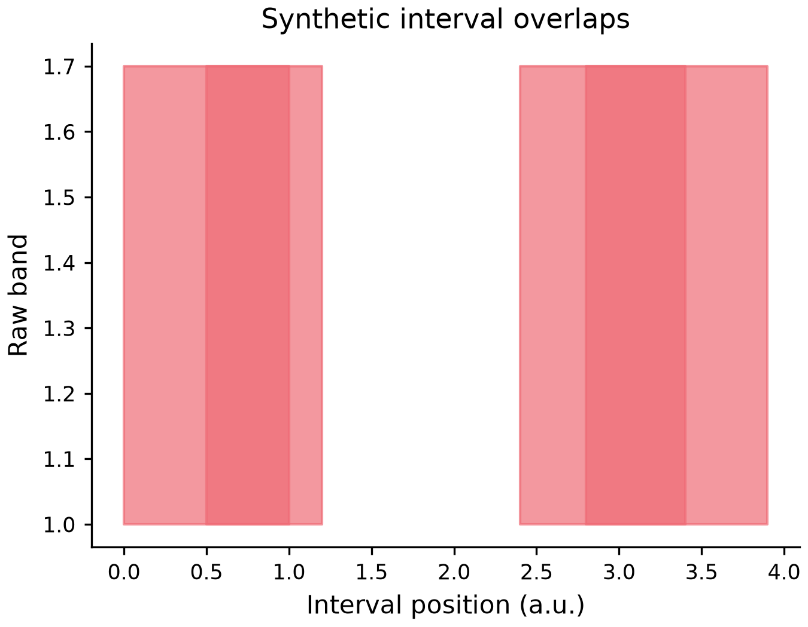

# Numeric interval band

*[한국어 / Korean](BROKEN_BARH.ko.md)*



[Executable source](../examples/plots/broken_barh.py) ·
[Editable spec](images/plots/broken_barh.mplot.json)

```python
p = (mp.plot({"start": [3, 1, 3], "duration": [1, 2, 0.5]})
       .broken_barh("start", "duration", bottom=1, height=1)
       .labels(x="Interval position", y="Raw band"))
```

Each source row describes `[start, start + duration]` in one y band from `bottom`
to `bottom + height`. Rows may overlap or repeat and are not merged, sorted, binned
or estimated. Source values, JSON/actions and SetData remain unchanged. This is a
numeric interval primitive, not a categorical bar estimator or date timeline.

Existing LayerSpec.x/y store start/duration column names; baseline stores bottom
(default zero) and width stores band height (default one). Raw JSON None selects
those defaults. Require 1..10,000 row-aligned finite numeric intervals, not bool,
missing, dates or categories. Duration/height must be strictly positive and finite.
Endpoints are checked in the float coordinates used by rendering: overflow and
indistinguishable starts/ends, including large integers losing a unit width, reject
before artists rather than being silently inverted, truncated or clamped.

The first subset supports one filled band on linear Cartesian primary/y2 axes.
Colour/edge colour/dash/alpha and explicit finite line width [0,1000] style it.
Zero-width outlines remain zero; their invisible dash pattern is removed for
Matplotlib3.8 legend compatibility, with source style and positive-width dashes
preserved. Returned successful Figures are caller-owned and must be closed.

Group/hue/facet/dropna/semantic/weight/date/log/polar/3-D mappings are explicitly
unsupported. Bounds are not a total CPU/RAM/sandbox guarantee. This synthetic
example is not independent human readability/AT certification.

```json
{"type":"AddLayer","layer":{"type":"broken_barh","x":"start","y":"duration","baseline":1,"width":1}}
```
