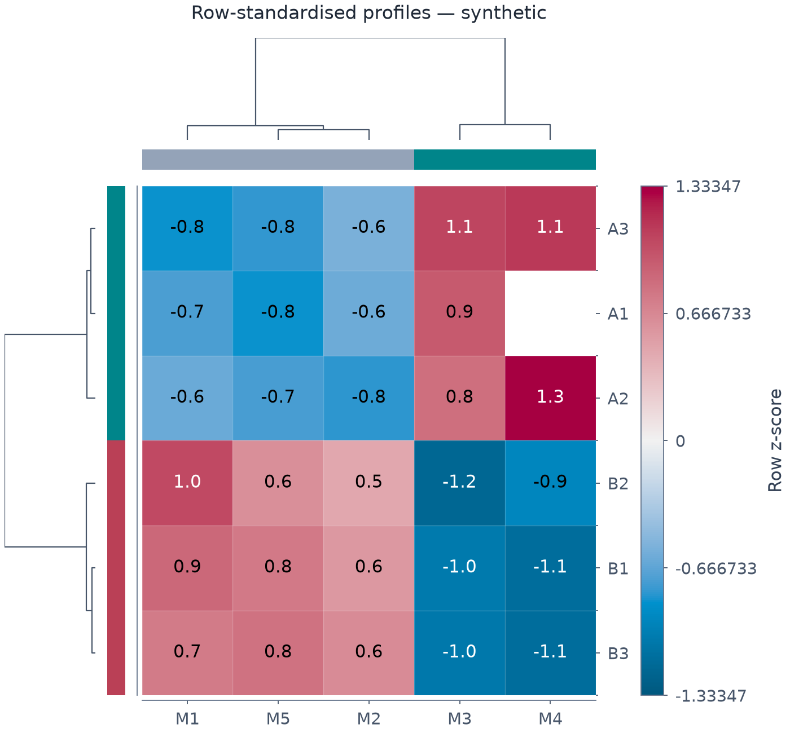

# 계층 군집 heatmap

*[English](CLUSTERMAP.md)*

Unreleased source-tree의 `clustermap`은 계층 군집 effect가 있는 matrix layer입니다.
JSON의 원래 행렬은 유지하며 변환값/leaf 순서는 렌더 시 계산하고 오래된 파생 열로
저장하지 않습니다.



[편집 spec](images/clustered_profiles.mplot.json) ·
[SVG](images/clustered_profiles.svg) · [PDF](images/clustered_profiles.pdf) ·
[소스](../examples/clustered_profiles.py)

합성 profile을 데스크톱 700px에서 확인한 예제입니다. 색/주석은 원래 response가
아닌 **행별 sample z-score**이며 숨긴 셀도 표준화/군집에는 참여합니다. 트리/색이
유의성·인과 구조·보편 가독성 인증을 뜻하지 않습니다.

```bash
# Source checkout 기준이며 이미 공개한 v1.0.0 wheel의 기능이 아닙니다.
pip install '.[cluster]'  # render + SciPy>=1.10; 기본 필수 의존성은 그대로 비어 있음
```

```python
p = (mp.plot().matrix("m", values)
       .clustermap("m", cluster={"method": "average", "metric": "euclidean",
                    "row_cluster": True, "col_cluster": True},
                   heatmap={"xlabels": columns, "ylabels": rows},
                   clabel="Response")
       .size(7, 6))
```

Pure 구성/검증/schema/action/JSON은 NumPy/SciPy를 import하지 않습니다. Cluster/
heatmap은 strict ClusterSpec/HeatmapSpec 또는 dict이며 unknown key는 거부합니다.
All/dev extra에 군집을 포함하지만 필수 core 의존성·package/editor/spec version·
release 배포를 바꾼 것은 아닙니다.

## 순서·트리·직접 제공한 linkage

Method는 single/complete/average/weighted/centroid/median/ward, metric은
euclidean/cityblock/cosine/correlation입니다. Ward/centroid/median은 Euclidean만
허용합니다. 유한 vector라도 cosine/correlation이 정의되지 않으면 jitter/imputation
없이 실패합니다. 거리 계산 시 불필요한 큰 단위 overflow를 방지하고 필요한 단위로
복원하며 표현 불가 높이는 거부합니다.

row_cluster/col_cluster=False는 원래 순서를 유지합니다. 원소 하나인 축은 트리를
만들지 않습니다. optimal_ordering=True는 계산/제공 linkage 모두 표시 행렬 거리로
적용합니다. Lock한 SciPy 안에서 재현되지만 같은 거리 tie의 version 간 순서를
보장하지는 않습니다.

row_linkage/col_linkage는 `[left,right,distance,count]`의 `(n-1) × 4` JSON
배열입니다. 아직 소비하지 않은 서로 다른 이전 cluster를 가리켜야 하며 높이는
유한/음수 아님, count는 합친 leaf 수와 같아야 합니다. 불투명 SciPy object나
callable을 저장하지 않습니다. 직접 제공한 linkage는 데이터 갱신 뒤에도 그대로여서
의미는 사용자가 책임져야 합니다.

축별 하나의 leaf 순서로 행렬/mask/tick label/색상 표식을 함께 이동합니다. 트리
leaf는 cell centre와 맞춥니다. row_colors/col_colors는 축당 선택적 범주 색 strip
하나이며 자동 legend 범주가 아닙니다. Tree_color/tree_width와 본체 대비
비율인 dendrogram_ratio로 표시를 조절합니다.

## 표시 변환과 mask

아래 중 하나만 선택합니다.

- z_score='row'/'col': 평균을 빼고 sample SD(ddof=1)로 나눔.
- standard_scale='row'/'col': min-max [0,1].
- 둘 다 없음: 원래 값을 표시.

상수 축은 표준화할 수 없습니다. Fit-time scaling은 큰 단위 overflow를 방지할
뿐 잘못된 데이터를 대체하지 않습니다. Masked 셀까지 유한 숫자인 비어 있지 않은
직사각 행렬이 필요하며 NaN/null/bool 변환이나 결측 보간은 하지 않습니다. 거리
계산 자원을 제한하도록 행/열 각각 최대 512개입니다.

Mask는 표시 전용이고 군집/표준화의 행을 제외하지 않습니다. 재정렬 뒤에는
HeatmapSpec처럼 hidden 셀을 숨기며 색상 범위/주석에서 제외합니다. 주석은 변환된
표시값이므로 원래 단위로 오인하지 않도록 clabel/fmt를 지정하세요. Log 색상 norm과
z-score/min-max 변환은 함께 사용할 수 없습니다.

## 배치와 편집

각 clustermap은 별도 unfiltered primary Cartesian 패널을 쓰며 추가 layer/y2/
공유 축/crop 좌표 limits는 허용하지 않습니다. 독립 멀티패널 구성은 가능합니다.
Label이 없으면 원래 숫자 index를 표시하고 제목은 맨 위 보조 axes 위에 둡니다.

Nested GridSpec과 정렬된 보조 axes로 트리/색 strip/colourbar를 지정한 그림 안에
둡니다. Vector clip ID 재현성을 위해 계산 뒤 배치를 고정하므로 크기/DPI는 spec에서
바꿔 다시 렌더하고 직접 Figure resize가 군집 배치를 재생성한다고 기대하지 마세요.

기존 editor에서도 같은 AddLayer 설정을 사용합니다. 선택 effect 누락/잘못된
linkage/metric/새 spec은 기존 editor 상태·출력을 보존합니다. 행렬 모양을 바꾸면
mask/label도 갱신해야 합니다.

```bash
uv run python -m examples.clustered_profiles
uv run pytest -q tests/test_clustermap.py tests/test_heatmap_options.py
```

독립 SciPy 순서/optimal leaf·표시 변환·기하/metadata·잘못된 입력·동적 갱신·
effect 누락·schema/action/editor와 PNG/PDF/SVG 정확 재생·global RNG 비사용을
검사합니다. 여러 색상 track/자동 strip legend·결측·임의 metric·interactive cut·
더 넓은 clustering layout은 이번 범위 밖입니다.
