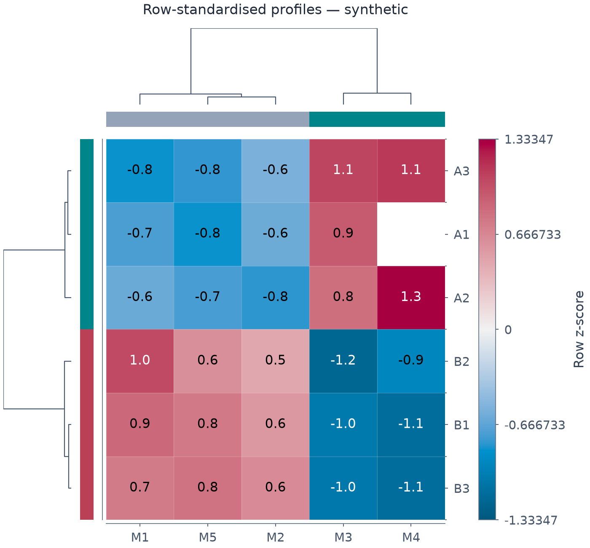

# Hierarchical clustered heatmaps

*[한국어 / Korean](CLUSTERMAP.ko.md)*

Unreleased source-tree `clustermap` is a matrix layer with optional hierarchical
clustering effects. The original matrix stays in JSON; transformed values and
leaf orders are computed when rendering, never stored as stale derived columns.



[Editable spec](images/clustered_profiles.mplot.json) ·
[SVG](images/clustered_profiles.svg) · [PDF](images/clustered_profiles.pdf) ·
[Source](../examples/clustered_profiles.py)

The example uses synthetic profiles, reviewed at 700px desktop width. Colour and
annotations show **row sample z-scores**, not original response units. The hidden
cell still participates in standardization/clustering. Neither tree nor colour
implies significance, causal structure or a universal readability certificate.

```bash
# From this source checkout, not the already-published v1.0.0 wheel:
pip install '.[cluster]'  # render plus SciPy>=1.10; base dependencies stay empty
```

```python
p = (mp.plot().matrix("m", values)
       .clustermap("m", cluster={"method": "average", "metric": "euclidean",
                    "row_cluster": True, "col_cluster": True},
                   heatmap={"xlabels": columns, "ylabels": rows},
                   clabel="Response")
       .size(7, 6))
```

Pure construction, validation, schema, actions and JSON do not import NumPy or
SciPy. `cluster`/`heatmap` accept strict ClusterSpec/HeatmapSpec or dict. Unknown
fields fail. All/dev extras include clustering; no required core dependency,
package/editor/spec-version bump or release publication is implied.

## Orders, trees and supplied linkage

Supported methods: single/complete/average/weighted/centroid/median/ward.
Metrics: euclidean/cityblock/cosine/correlation. Ward/centroid/median require
Euclidean distances. Finite vectors with undefined cosine/correlation distances
fail without jitter or imputation. Distances are computed in scaled units and
restored when appropriate; unrepresentable linkage heights fail.

`row_cluster=False`/`col_cluster=False` retain that original order. A one-item
axis has no invented tree. `optimal_ordering=True` applies to computed or supplied
trees using distances from the display matrix. Results are deterministic within
the locked SciPy version; equal-distance ties are not a cross-version guarantee.

Optional row_linkage/col_linkage use checked `(n-1) × 4` JSON arrays of
`[left,right,distance,count]`. Nodes must refer to distinct unconsumed previous
clusters, heights must be finite/nonnegative, and counts must equal merged leaf
counts. No opaque SciPy object or callable is serialized. Explicit linkages stay
explicit on data refresh; the caller is responsible for their meaning.

One leaf permutation controls each axis's matrix values, mask, tick labels and
colour strip. Dendrogram leaf positions match heatmap cell centres. One optional
categorical colour strip per axis uses row_colors/col_colors; these are colour
codes, not automatically inferred legend categories. tree_color/tree_width and
dendrogram_ratio (relative to body) control tree display.

## Display transformation and masks

Choose one of:

- `z_score='row'|'col'`: subtract mean and divide by sample SD (ddof=1).
- `standard_scale='row'|'col'`: min-max to [0,1].
- Neither: display original values.

Constant axes cannot be standardized. Fit-time scaling prevents unnecessary
overflow; it does not replace invalid data. By default every matrix cell must
be finite numeric, including masked cells. Dimensions remain capped at 512
rows and columns. The explicit missing policy below accepts true `null` only,
never NaN, infinity or booleans.

Mask is display-only: it does not exclude values from clustering/standardization.
After reordering, masked cells remain hidden and do not affect colour bounds or
annotations, following HeatmapSpec. Text shows the transformed display value,
not a falsely relabelled original unit. Use a truthful clabel/format. Log colour
normalization cannot combine with z-score/min-max transformations.

## Geometry and editing

Each clustermap needs its own unfiltered primary Cartesian panel, without extra
layers, secondary axes, shared axes or cropped coordinate limits. Multiple
independent panels remain possible. Cell labels default to original numeric
indices if not supplied. The title sits above the topmost auxiliary axes.

Nested GridSpec and aligned auxiliary axes keep trees/colour strips/colorbar
inside the configured figure. Layout is frozen after fitting for deterministic
vector clip IDs; change size/DPI/config through the spec and rerender rather than
expecting direct Figure resizing to rebuild the clustered layout.

The same AddLayer config works in existing editors. A missing optional effect,
invalid linkage, metric failure or bad prospective spec preserves previous editor
state/output. Mask and labels must be updated when matrix shape changes.

```bash
uv run python -m examples.clustered_profiles
uv run pytest -q tests/test_clustermap.py tests/test_heatmap_options.py
```

## Missing values, distances and interactive cuts

`missing="complete_features"` accepts literal `None`/JSON `null` for this
clustermap. A null can be staged with `SetMatrix`, but cannot feed an unopted
heatmap, clustering, contour or surface. Standardization uses each vector's
observed entries, including display-masked numbers, without filling nulls.
Each named fit uses only the **same original features observed in every item
of that axis**; no leaves are dropped and no pairwise substitution is made.
Empty common features and undefined cosine/correlation distances fail.
All visible nulls get a slash and a labelled key, not a numeric hue or annotation.

`row_distances`/`col_distances` accept `CondensedDistanceSpec(label, values)` in
the original SciPy condensed order (`d01,d02,…,d12,…`) with exactly `n(n−1)/2`
finite nonnegative values; the label states the metric and its units. Use
single/complete/average/weighted to build from such distances. Ward/median/
centroid need Euclidean input; external distances can only order a supplied
tree when `optimal_ordering=True`. Supplied distances and links are caller-owned
geometry. Same-shape matrix refresh does not recompute or invalidate them.
Redeclare them if the identities at those positions or the metric meaning
change; shape loss and incompatible uses fail validation.
Newly computed joins for explicit missingness, dissimilarities or cuts reject
if a positive height cannot be represented after restoring its units. Real
zero heights and supplied raw linkage heights remain unchanged.

`row_cut`/`col_cut` accept `ClusterCutSpec(height, anchor=None)`. A group is
a maximal subtree whose **largest descendant merge height** is at most `height`.
Equal-height merges are inclusive; inverted trees keep their raw heights.
Choose an optional original zero-based index to highlight its group. Both
editors provide height/index controls and show the actual selected indices;
edits are `ReplaceLayer` actions in ordinary history. No item is filtered.

## Multiple tracks and bounded layout

Each `row_tracks`/`col_tracks` entry has a stable per-axis `id`, `title`,
original-order `values`, ordered `{key, label, color}` `levels`, optional `ratio`
and `legend`. The innermost legacy strip has no legend. Declared categories
are displayed in order; continuous tracks and automatic bins are not inferred.
`row_dendrogram_ratio`/`col_dendrogram_ratio` override the shared ratio.
`track_legend_side` is `right` or `bottom`; clustered heatmaps reuse the scalar
colourbar options. Run `python -m examples.matrix_workflow /path/to/output`.
In a nested layout that uses advanced matrix options and only Cartesian panels,
the native constrained engine reserves space for rotated labels and guides.
Legacy, polar and 3-D layout routes are unchanged.

New matrix options reserve work and addressable managed storage **per figure**;
838,860,800 work credits, 96 MiB planned storage, and one separate serial SciPy
frame reservation up to 16 MiB. Credits account for shape and requested fits
(including ordering), not CPU time; bytes are reservations, not an RSS or
opaque-provider peak promise. The existing canvas, dimensions, annotation and
editor limits still apply. If necessary, use a larger export size or reposition
the guide; invalid requests preserve the prior preview/output.
