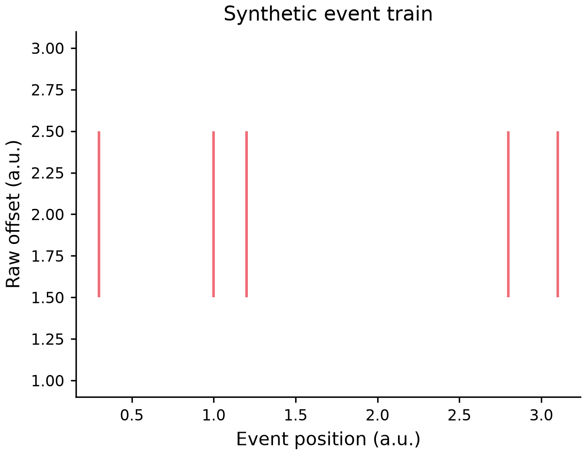

# Numeric event train

*[English](EVENTPLOT.md)*



[실행source](../examples/plots/eventplot.py) · [편집spec](images/plots/eventplot.mplot.json)

```python
p = (mp.plot({"event": [2, 1, 2]})
       .eventplot("event", offset=0.5, length=0.4)
       .labels(x="Event position", y="Raw offset"))
```

첫범위는한train의수직표식입니다. Event는x위치이고끝점은rawy좌표offset±length/2입니다.
축비율transform의rug와다르며binning/density/rate추정/집계는없습니다. 반복event도각표식으로
남습니다. NativeEventCollection은내부위치를정렬하므로artist순서는원래순서가아니지만
원본table/행/중복/JSON/actions는변경하지않습니다.

기존LayerSpec.x열/baselineoffset/widthlength필드를재사용하고기본offset0/length1이며rawJSONNone도
같은기본입니다. Bool/결측/날짜/범주가아닌1..10,000유한숫자event와유한offset·양수유한length/
유한하고서로다른표현가능끝점이필요합니다. Overflow/끝점붕괴는artist전에실패하고clamp하지않습니다.

LinearCartesianprimary/y2만지원하고SetData는events를갱신합니다. Colour/dash/alpha/유한[0,1000]
line_width를train에적용하며명시0도보존합니다. 0폭은보이지않는dash패턴만제거해Matplotlib3.8의
legenddegenerate-dash오류를피하고source설정/0stroke를유지합니다. 양수폭dash는보존합니다.
성공Figure는호출자가소유하므로close하세요.
이상한은전체CPU/RAM/sandbox보장이아닙니다.

Horizontal/group/hue/semantic/weight/facet/dropna/log/polar/3D는명시미지원입니다. 합성예제는
실험값/독립사람가독성/AT인증이아니고기존rawaction에새필드없이구성합니다.

```json
{"type":"AddLayer","layer":{"type":"eventplot","x":"event","baseline":0.5,"width":0.4}}
```
