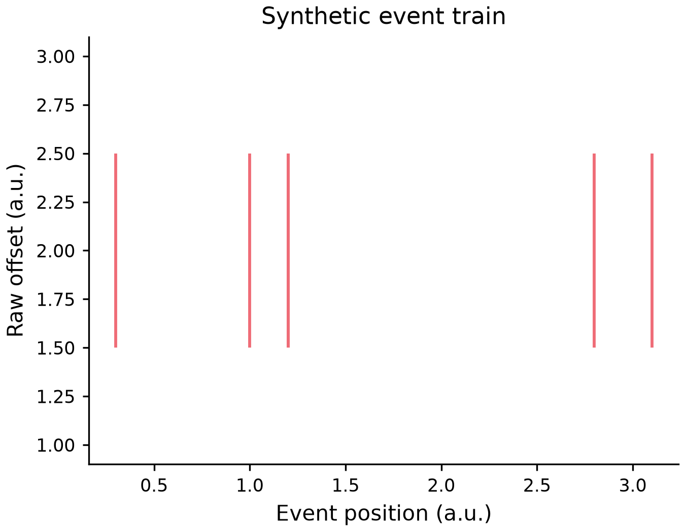

# 네이티브 이벤트 표시

*[English](EVENTPLOT.md)*



[실행source](../examples/plots/eventplot.py) · [편집spec](images/plots/eventplot.mplot.json)

```python
p = (mp.plot({"event": [2, 1, 2]})
       .eventplot("event", offset=0.5, length=0.4)
       .labels(x="Event position", y="Raw offset"))
```

이벤트는 X의 지정 위치마다 수직 표식 하나로 표시됩니다. 중복도 각각 남습니다.
`offset`은 중심, `length`는 데이터 단위의 **전체** 길이입니다(중심 ± 길이/2).
생략 또는 JSON `null`의 기본값은 0/1입니다. 기본 EventCollection은 내부에서
위치를 정렬할 수 있지만 원본은 그대로입니다. 그룹 또는 매핑을 사용하면
중복 위치에서도 원본 행 순서대로 그립니다. 비닝이나 발생률 추정은 하지 않습니다.

`group`과 선택적 `hue_order`로 고정 슬롯을 지정합니다. 슬롯 `i`의 중심은
`offset + i * lane_step`입니다. 간격을 지정하면 실제 그룹 열과 유한한 양수가
필요합니다. 생략하면 같은 위치에 겹쳐 그립니다. 고정·라이브 패싯은 원본 행을
선택하고 예약된 빈 그룹은 자리를 유지하되 그림과 범례 항목을 만들지 않습니다.
선택 이벤트 상한 10,000개는 그룹 전체에 적용됩니다.

날짜 X는 명시한 시계를 따릅니다. 날짜 표시 Y/Y2의 중심은 UTC 1970 기준
절대 일 좌표이며 길이·간격은 일 단위 차이입니다. 로그 축은 실제 위치와
끝점이 양수여야 합니다. Logit은 열린 구간을 검사하며 symlog/asinh도 지원합니다.
실제 끝점으로 축 범위를 계산하고 범위를 넘거나 구별할 수 없는 끝점은 거부합니다.

기존 `SemanticSpec`은 범주·수치 색, 포인트 단위 **선 두께**, 점선 패턴을
매핑합니다. 두께는 길이와 위치를 바꾸지 않습니다. 색을 매핑해도 `group`은
슬롯을 정하고 색상표·공유 범례는 기존 범위를 사용합니다. 가짜 마커를 넣지
않습니다. 가로 방향, 가중치, 추정은 지원하지 않습니다.
[실행 예제](../examples/native_lane_workflow.py)를 참고하세요.

```json
{"type":"AddLayer","layer":{"type":"eventplot","x":"event","baseline":0.5,"width":0.4,"group":"train","lane_step":1}}
```
