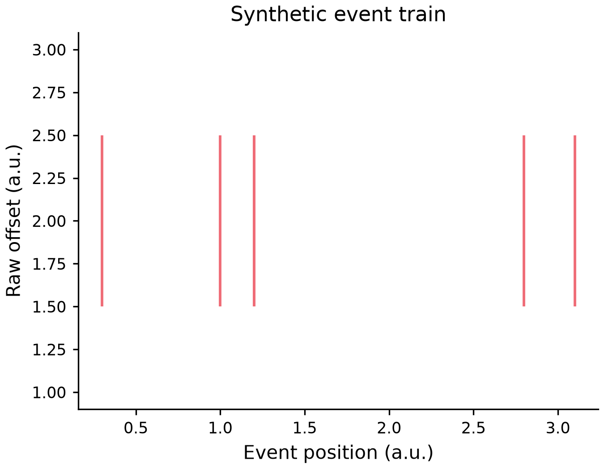

# Native event trains

*[한국어 / Korean](EVENTPLOT.ko.md)*



[Executable source](../examples/plots/eventplot.py) ·
[Editable spec](images/plots/eventplot.mplot.json)

```python
p = (mp.plot({"event": [2, 1, 2]})
       .eventplot("event", offset=0.5, length=0.4)
       .labels(x="Event position", y="Raw offset"))
```

Each event is a disconnected vertical mark at its supplied X position; duplicates
remain separate. `offset` is the center and `length` is the **full** raw lane span
(`center ± length/2`), not an axes fraction. Omitted or null geometry uses 0/1.
The simple native `EventCollection` may sort its artist positions, but the saved
table never changes. Grouped or mapped ticks paint in original row order, even
when positions coincide; no binning or rate estimation is implied.

Use a typed `group` and optional `hue_order` to fix lane slots. Slot `i` is centered
at `offset + i * lane_step`; `lane_step` is optional and must be finite and
positive when provided with a group. Without it, groups overlay at the same
offset. Fixed and live facets retain row selection; reserved empty levels occupy
their slots without an artist or legend entry. The 10,000 selected event cap is
across all groups. Invalid or indistinguishable endpoints fail before publication.

Explicit date X positions use the declared clock. A date-formatted lane uses an
absolute UTC-1970 day center and day differences for length and spacing,
regardless of the declared numeric input clock. Use a configured `axis="y2"` for
the independent twin. Log X requires positive event positions; log Y/Y2 requires
both actual lane endpoints positive. Logit uses its open domain; symlog and asinh
remain supported. Grouped/log views use actual mark extents, not a full-length
autoscale hint.

The existing `SemanticSpec` can map categorical or numeric row hue, physical
stroke width in **points**, and named dash style. Size does not change center,
span or event position. `group` still chooses the lane when hue is mapped; only
the hue mapping chooses colour in that case. Numeric colourbars and figure-scope
guides use the existing owner. Zero stroke keeps its geometry invisible; there
is no fake marker. Horizontal geometry, weights and estimators are unsupported.

See the [native lane example](../examples/native_lane_workflow.py). Successful
figures belong to the caller. The existing raw action admits the lane options:

```json
{"type":"AddLayer","layer":{"type":"eventplot","x":"event","baseline":0.5,"width":0.4,"group":"train","lane_step":1}}
```
