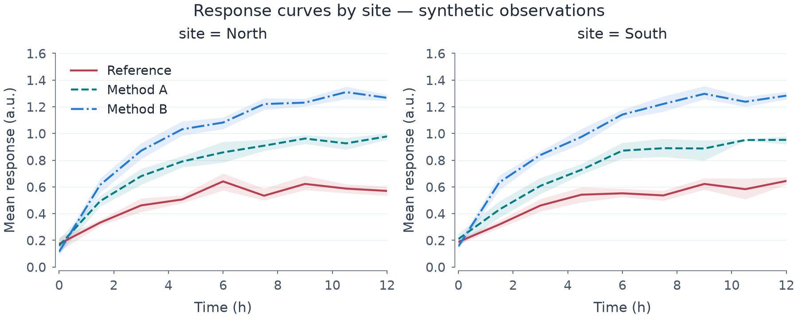

# 자동 facet과 제한된 figure 빌더

*[English](FACETS.md)*

Facet은 같은 원자료를 나누어 **동일한 질문**을 비교하는 기능입니다. 서로 다른
그래프를 모으는 기능이나 Seaborn figure-level 전체 동등성이 아닙니다.



[편집 spec](images/faceted_responses.mplot.json) ·
[SVG](images/faceted_responses.svg) · [PDF](images/faceted_responses.pdf) ·
[실행 코드](../examples/faceted_responses.py)

이 예제의 목표 표시는 데스크톱 900px이며 임의의 모바일 축소판이 아닙니다.
모든 값은 합성이며 site마다 방법/시점당 독립 관측 6개입니다. 음영은 평균의
점별 95% percentile-bootstrap CI로, SD·동시 신뢰대·site를 합친 추정값이 아닙니다.

## 공개 빌더

`relplot`, `displot`, `catplot`, `lmplot`은 원자료와 논리 `x`(짝지은 mark는 `y`도)를
받습니다. 같은 이름의 `Plot` 메서드는 비어 있는 패널 하나에서 시작하므로
시계·y2·표시 척도를 미리 선언할 수 있습니다. 빌더 이름이나 숨은 자료는
저장하지 않고 기존 mark와 facet action을 사용합니다.

| 빌더 | 지원하는 `kind` |
|---|---|
| `relplot` | `scatter`, `line`, `lineplot` (추정) |
| `displot` | `hist`, `kde`, `ecdf`, `rug`, `hist2d`, `kde2d`, `ecdf2d` |
| `catplot` | `strip`, `swarm`, `box`, `boxen`, `violin`, `bar`, `point`, `count` |
| `lmplot` | `regplot`, `residplot` |

`row`나 `col`을 주면 기본은 `live=True`입니다. 순서·줄바꿈·축 공유는
`facet()`과 같고 통계는 셀마다 적합합니다. facet 차원이 없으면 mark 하나를
그립니다. 나머지 인자는 기존 mark 옵션이며 잘못된 조합은 plot과 이력을
바꾸지 않고 거부합니다.

`displot(rows, "dose", col="site")`는 선택된 관측에서 공통 20빈 경계를 한 번
정하고 저장합니다. 변환 히스토그램은 작업 좌표의 경계를 명시합니다.
빈 데이터 전체의 경계나 과학적으로 고정된 경계도 명시합니다.

의미 매핑과 지원되는 원시 그룹 line/scatter/bar의 실제 핸들을 figure guide로
모을 수 있습니다. 예약 순서는 유지하되 빈 슬롯에 가짜 범례를 만들거나
텍스트가 같은 다른 범례를 없애지 않습니다. 자동 역할 범례는 `guide=False`로
끄세요. facet의 `scatter(c=...)`는 기존 팔레트의 P01 공통 원시 숫자 범위를
사용합니다. x/y2 시계가 `c`를 변환하지 않습니다. `colorbar=True`는 하나의
figure 색상 막대, `False`는 색상 막대 없는 동일 매핑입니다. 명시 P01의 로컬
막대는 유지됩니다. 그림 전체에 모을 때는 `kind="scalar"`의
`ScalarDisplaySpec.scale_id`, `kind="raw"`의 `LayerSpec.raw_guide_id`를
사용합니다. `kind` 생략은 기존 SemanticSpec 경로입니다.
[실행 예제](../examples/facet_builders.py)도 참고하세요.

## 먼저 템플릿을 만든 뒤 분할

```python
p = (mp.plot(raw)
       .lineplot("time", "response", group="method", errorbar=("ci", 95),
                 n_boot=399, seed=17)
       .labels(x="Time (h)", y="Mean response (a.u.)")
       .legend(False)
       .suptitle("Response by site")
       .facet(col="site", col_order=["North", "South"])
       .size(9, 3.6))
p.legend(location="upper left", panel=0)
```

`facet()`은 완성된 단일 unfiltered 패널을 복사합니다. Layer·축·제목·reference·
명시적 panel label을 유지하며 셀 제목에 facet key를 추가합니다. 전체 그림 크기는
자동으로 늘리지 않으므로 직접 정하세요. 전체 질문은 suptitle에 두면 긴 제목이
셀마다 반복되지 않습니다. 범례도 복사하므로 예제처럼 반복을 명시적으로 숨깁니다.

명시적 semantic scale에는 `p.shared_guides([{"scale_id": "scope"}])`로 실제
mapping guide를 figure마다 한 번 모을 수 있습니다. Dataset label과 다른 scale은
유지하며 label/panel ID에서 membership을 추측하지 않습니다.

```python
p.facet(row="batch", col="site", row_order=["B", "A"],
        col_order=["North", "South"], share_x="all", share_y="row")
# 또는 새 단일 템플릿에서:
p.facet(col="site", col_wrap=2)
```

같은 plot에 연속 호출하는 코드가 아니라 대안입니다. Row/col은 row-major이며
wrap은 col-only에만 적용되고 마지막 줄의 빈 칸에 padding 패널을 만들지 않습니다.
공유 축은 기본 all이며 기존 `none`/`all`/`row`/`col` 규칙을 따릅니다. Order로
선택하거나 빈 셀까지 예약할 수 있고 최대 64셀/level입니다. Key는 빈 값이 아닌
JSON 문자열·bool·유한 숫자이며 bool/숫자는 구분합니다. 표시 이름이 중복되면
오류이고 결측 facet key의 행은 제외합니다.

## 원자료와 통계

원래 `FigureSpec.data`는 그대로 두고 셀에 정확한 선택을 저장합니다.

```json
{"filters": {"batch": "A", "site": "North"}}
```

선택한 뒤 좌표와 셀별 통계를 처리합니다. 가중 행 쌍·x별 unit 재표본화·count·
정규화·KDE fit도 해당 셀 안에서 계산합니다. 축/semantic 공유가 셀 간 추정값을
합친다는 뜻은 아닙니다.

Typed category/hue 자리는 선택된 셀 전체의 level을 예약합니다. 독립 scatter/
lineplot semantic은 이름 있는 공통 domain을 사용하며, 셀 안의 index가 아니라
**원래 행 ID**의 합집합을 사용합니다. Layer가 반복돼도 중복 집계하지 않고 선택
밖 facet은 mapping 범위에서 제외합니다. 범례의 pooled mapping guide는 추가 관측이 아닙니다.

현재 방식은 **materialized grid**입니다. 이후 layer/label/축 편집은 기존 수동
layout처럼 명시적 panel index를 따릅니다. `SetData`는 저장된 selector/order
안의 관측을 갱신하지만 새로운 facet/hue/category level을 추가하지 않습니다.
Grid 구성을 바꾸려면 새 단일 템플릿에서 다시 만드세요. `.facet(...).scatter(...)`
방식의 mapping API가 아니므로 layer를 먼저 추가해야 합니다.

## Raw 그룹의 의미를 유지

`line`/`scatter`/`bar`/`errorbar`/`band`/`stripplot`/`regplot`/`rug`의 group 기반
facet을 지원합니다. Facet은 선택한 셀의 hue 자리를 자동 예약합니다. 명시적
`hue_order=[...]`도 좌표 변환·오차 검증·회귀 fit 전에 raw 그룹을 선택/재정렬/
예약합니다. 결측 group key는 제외하고 최대 64개의 구분 가능한 비어 있지 않은
JSON 문자열·bool·유한 숫자만 허용합니다.

Raw line의 입력 순서·중복/비단조 x·좌표의 결측 구간을 그대로 유지합니다. 미리
계산한 막대와 연결된 오차 열도 다시 추정하지 않습니다. 빈 그룹도 색/선/marker/
hatch·막대 dodge 자리는 소비하지만 가짜 artist나 범례를 만들지 않습니다. 실제
회귀 그룹에는 여전히 충분한 유한/서로 다른 x가 필요하고 빈 예약 그룹은 fit하지
않습니다. `hue_order=None`인 기존 raw 기본 동작은 그대로입니다.

```python
raw = {"x": [2, 1, 1, 1, 2], "y": [8, 4, 5, 2, 3],
       "method": ["B", "B", "B", "A", "A"],
       "site": ["North"] * 3 + ["South"] * 2}
p = (mp.plot(raw).line("x", "y", group="method", hue_order=["B", "A"])
       .facet(col="site").size(8, 3))
# North의 x=[2,1,1], y=[8,4,5]를 두 점의 평균으로 바꾸지 않습니다.
```

## 원본 선과 complete-unit 추론

[Line workflow](LINE_WORKFLOW.ko.md)는 numeric/real-clock native 및 선언한
categorical predictor, 실제 primary/y2와 v/h geometry를 지원합니다. Raw hue/size/style은
원본 순서·중복 predictor·결측 장벽을 유지하고 lineplot 평균을 호출하지 않습니다.
Native 추정 grid는 해당 raw curve의 것이며 다른 hue의 관측 x를 합쳐 가짜 gap을
만들지 않습니다. 선언 categorical slot은 pooled 상태입니다. Complete-unit은 실제
선택 cell 안의 typed unit 합집합을 사용하며 curve/layer 동시 family도 facet panel을
넘는 coverage를 주장하지 않습니다.

`facet(live=True)`는 고정 selector와 그리지 않는 template을 보존합니다. Local 편집은
권위 있는 saved view이고 SetData/reopen은 재확장하지 않습니다. 명시적 whole-template은
override를 대체하되 N13 ID/nesting/placement·선택 행·scale_id guide membership을
보존합니다. ID reorder/rename에 중복 guide-panel 참조를 고칠 필요가 없습니다.
Live cell을 제거하면 saved materialized view로 남습니다. 두 editor에는 채워진
whole-template·figure-wide shared-guide action이 있으며 `examples/line_workflow.py`를
직접 실행할 수 있습니다.


## 지원 밖 조합은 변환하지 않고 거부

- Cartesian 2-D 행 기반 layer입니다. Line/lineplot·swarm·box·violin·boxen·
  barplot·pointplot은 실제 primary/y2 경로를 지원합니다. 다른 보조축 guard는
  유지하며 행렬/3-D/polar/pie/stackplot/vector/count-map facet을 추측하지 않습니다.
- Raw 그룹 궤적이나 미리 계산한 막대를 자동으로 lineplot/barplot으로 바꾸지
  않습니다. 중복 x 원자료와 평균 추정의 의미는 다릅니다. Stackplot/vector/
  count-map facet은 아직 미지원입니다.
- Facet의 `scatter(c=...)`만 위 P01 원시 숫자 예외를 사용합니다. 다른 `c`
  사용이나 SemanticSpec hue로 자동 변환하는 동작은 없습니다.
- Hist는 typed 통계와 공통 경계를 사용하고 KDE는 typed 옵션으로 셀마다
  적합합니다.
- Source layer 자체가 먼저 유효해야 합니다. 임의 query 문자열·callable·runtime
  predicate·암묵적인 live template callback은 없습니다.
  [Numeric pair matrix](PAIR_GRID.ko.md)는 별도 데이터 구성 작업입니다.
  [Joint 구성](JOINT_GRID.ko.md)은 별도 constructor입니다. N13 공개
  [배치 API](PANEL_LAYOUTS.ko.md)로 materialized grid를 nest하고 outer 형제를
  선언하며 저장 selector/원자료를 보존합니다. Pair와 Joint의 구성 규칙은 별개입니다.

## JSON/action/에디터

```json
{"type": "SetFacets", "col": "site", "share_x": "all", "share_y": "all"}
```

기존 reducer/Store 경로의 dependency-free action이며 Python·CLI·에디터 raw-action
폼에서 재생할 수 있습니다. 먼저 단일 템플릿과 해당 열이 있어야 합니다. 또는 위의
편집 spec을 에디터에서 열어 셀 선택·기존 panel control로 편집할 수 있습니다.
Spec version이나 layer 종류를 추가한 것은 아닙니다.

```bash
uv run python -m examples.faceted_responses
uv run pytest -q tests/test_facets.py tests/test_raw_group_order.py tests/test_shared_semantics.py
```

선택 행 ID·독립 셀·셀별 가중 CI·공통 mapping·빈 자리·잘못된 action의 상태/이력
보존·기존 spec·JSON/action/schema/editor·PNG/PDF/SVG 재현성·global RNG 비사용을
검사합니다. 모든 facet 배치의 가독성 인증은 아니므로 [읽기 기준](VISUAL_QUALITY.ko.md)으로
최종 크기·라벨·guide·빈/특이 셀을 확인해야 합니다.
