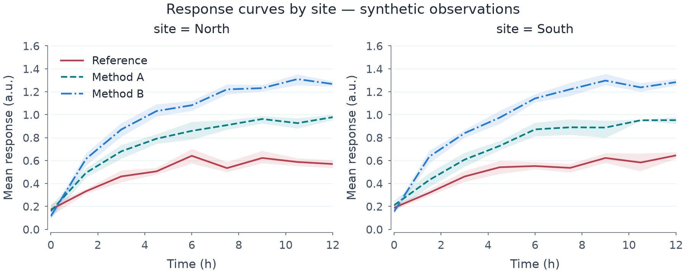

# Automatic facets and finite figure builders

*[한국어 / Korean](FACETS.ko.md)*

A facet repeats **one question** across subsets of the same source table. It is
not a collection of unrelated charts and not full Seaborn figure-level parity.



[Editable spec](images/faceted_responses.mplot.json) ·
[SVG](images/faceted_responses.svg) · [PDF](images/faceted_responses.pdf) ·
[Runnable source](../examples/faceted_responses.py)

The example is designed for a 900px desktop display, not an arbitrary mobile
thumbnail. All data are synthetic: each site contains six independent observations
per method/timepoint. Bands are pointwise 95% percentile-bootstrap CIs for means,
not SD, simultaneous bands or a pooled cross-site estimate.

## Public builders

`relplot`, `displot`, `catplot` and `lmplot` accept a table followed by logical
`x` (and `y` for paired marks). The same names on `Plot` start from one empty
configured panel; declare clocks, y2 and display scales before calling them.
Each builder calls one existing mark and then `facet`; it stores the resulting
ordinary actions, not a builder name or hidden data table.

| Builder | Explicit `kind` values |
|---|---|
| `relplot` | `scatter`, `line`, `lineplot` (estimated) |
| `displot` | `hist`, `kde`, `ecdf`, `rug`, `hist2d`, `kde2d`, `ecdf2d` |
| `catplot` | `strip`, `swarm`, `box`, `boxen`, `violin`, `bar`, `point`, `count` |
| `lmplot` | `regplot`, `residplot` |

With `row=` or `col=`, builders default to `live=True`, accept the same
orders/wrap/sharing controls as `facet`, and fit each cell independently. Without
a facet dimension they build the single mark. The remaining keywords follow
that mark's own typed options; unsupported combinations reject without
changing the original plot or action history.

```python
p = mp.displot(rows, "dose", col="site", col_order=["A", "B", "Reserved"])
q = (mp.plot(rows).secondary_yaxis("Response")
     .date_axis("x", timezone="UTC")
     .relplot("date", "response", axis="y2", c="temperature",
              colorbar=True, col="site"))
```

Typed univariate histogram integer bins (default 20) resolve once from the
selected usable values and save literal common edges. Supply explicit
working-coordinate edges for transformed histograms, empty pools, or when
scientific thresholds are fixed. KDE still fits within each cell.

Semantic mappings can share one actual figure guide; eligible raw grouped
line/scatter/bar builders also consolidate native handles in authored typed hue
order, without turning reserved slots into entries or deleting other legends
with the same text. Use `guide=False` to disable automatic role-legend
consolidation. A legacy scatter `c` inside a facet becomes one named P01 scalar
range using the legacy palette. Raw `c` is not converted by the x/y2 clock or
treated as a group. `colorbar=True` requests one actual figure calibration;
`colorbar=False` keeps the same mapping with no bar. Existing explicitly
configured P01 local bars remain local unless a scalar figure guide is requested.
An intentional `SharedGuideSpec(kind="scalar")` uses `ScalarDisplaySpec.scale_id`;
`kind="raw"` uses `LayerSpec.raw_guide_id`. Omitted `kind` retains semantic
`scale_id` membership. See [the runnable example](../examples/facet_builders.py).

## Build the template first

```python
p = (mp.plot(raw)
       .lineplot("time", "response", group="method", errorbar=("ci", 95),
                 n_boot=399, seed=17)
       .labels(x="Time (h)", y="Mean response (a.u.)")
       .legend(False)
       .suptitle("Response by site")
       .facet(col="site", col_order=["North", "South"])
       .size(9, 3.6))
p.legend(location="upper left", panel=0)
```

`facet()` consumes one completed, unfiltered source panel. It copies its layers,
axis settings, titles, references and explicit panel label into independently
editable cells. Cell titles add facet keys. Figure size is **not** multiplied:
set an appropriate total size explicitly. Use a suptitle for the overall question
rather than a long template title repeated in every cell. Legends are copied;
hide repeats explicitly, as above.

For explicit semantic scale membership, `p.shared_guides([{"scale_id": "scope"}])`
consolidates matching actual mapping guides once per figure while keeping dataset
labels and unrelated scales. It does not infer membership from labels or panel IDs.

```python
p.facet(row="batch", col="site", row_order=["B", "A"],
        col_order=["North", "South"], share_x="all", share_y="row")
# Or, on a fresh single-panel template:
p.facet(col="site", col_wrap=2)
```

These are alternatives, not two facet calls on the same plot. Row/column grids
are row-major; wrapping is col-only and adds no empty padding panel. Defaults
share x/y across the grid; `none`, `all`, `row` and `col` follow existing axis
sharing. Explicit orders select/reserve levels, including empty cells. At most
64 cells/levels are supported. Keys are nonempty JSON strings, bools or finite
numbers; bool and numeric identities differ. Ambiguous display labels fail.
Missing facet keys drop rows.

## Data and statistics

The original `FigureSpec.data` is unchanged. Cells serialize exact selections:

```json
{"filters": {"batch": "A", "site": "North"}}
```

Selection precedes coordinate validation and all cell-level statistics, including
paired weights, per-x unit resampling, counts, normalization and KDE fits. Sharing
an axis or semantic mapping does **not** pool estimates across cells.

Typed category/hue slots reserve levels pooled across selected cells. Independent
scatter/lineplot semantics receive named shared scale domains; domains pool unique
**original** source row IDs, not cell-local indices. Repeated layers do not double
count rows, and deselected facets do not enter mapping bounds. Legends may show
pooled mapping guides; these are not additional observations.

This is a **materialized grid**. Later `.labels()`, layer or axis operations use
explicit panel indices, just like manual layouts. `SetData` refreshes observations
inside the stored selectors/orders; it does not add new facet/hue/category levels.
Rebuild a fresh template to change grid membership. `.facet(...).scatter(...)` is
not a mapping API; add the layers before faceting.

## Raw groups keep raw meaning

`line`, `scatter`, `bar`, `errorbar`, `band`, `stripplot`, `regplot` and `rug`
now support group-based facets. Faceting reserves pooled hue slots automatically.
An explicit `hue_order=[...]` also selects/reorders/reserves raw groups before
coordinate mapping, error validation and fitting. Missing group keys drop; values
must be unambiguous nonempty JSON strings, bools or finite numbers (up to 64 levels).

Raw line input order, duplicate/nonmonotonic x and coordinate gaps remain intact.
Supplied bars and paired uncertainty columns are not re-estimated. Empty reserved
groups consume colour, line/marker/hatch and bar-dodge slots but add no fictional
artists or legend entries. Regression still needs enough finite/distinct x values
in every observed group; reserved empty groups are not fitted. Raw defaults with
`hue_order=None` retain the previous observed-only behavior.

```python
raw = {"x": [2, 1, 1, 1, 2], "y": [8, 4, 5, 2, 3],
       "method": ["B", "B", "B", "A", "A"],
       "site": ["North"] * 3 + ["South"] * 2}
p = (mp.plot(raw).line("x", "y", group="method", hue_order=["B", "A"])
       .facet(col="site").size(8, 3))
# North still draws x=[2,1,1], y=[8,4,5]; it is not averaged to two points.
```

## Supplied lines and complete-unit inference

The [line workflow](LINE_WORKFLOW.md) supports numeric/real-clock native and
declared categorical predictors, actual primary/y2 targets and v/h geometry.
Raw hue/size/style keeps supplied order, duplicate predictors and missing barriers;
it never calls lineplot averaging. A native estimate grid belongs to its raw curve,
not the observed-x union of unrelated hues. Declared categorical slots remain pooled.
Complete-unit inference selects the typed unit union inside each actual cell.
Curve/layer simultaneous families never promise coverage across facet panels.

`facet(live=True)` retains fixed selectors and an undrawn template. Local edits
remain authoritative saved views; SetData and reopening never rematerialize them.
Explicit whole-template replacement supersedes overrides while retaining N13
IDs/nesting/placements, selected rows and scale_id guide membership. Reordering or
renaming IDs needs no guide-panel-reference rewrite. Removing a live cell leaves
saved materialized views. Both editors expose populated whole-template and
figure-wide shared-guide actions; see the runnable `examples/line_workflow.py`.


## Limits are rejected, not silently converted

- Cartesian 2-D row-based layers only. Line/lineplot, swarm, box, violin, boxen,
  barplot and pointplot support their actual primary/y2 routes. Unrelated
  secondary-axis guards remain; no matrices, 3-D, polar or pie/stackplot/vector/
  count-map faceting is inferred.
- Raw groups are **not** silently converted into estimated lineplots or
  barplots: duplicate-x trajectories and precomputed bar values retain their
  different meanings. Stackplot/vector/count-map faceting is still unsupported.
- Scalar `scatter(c=...)` is the native P01 exception described above; other
  legacy `c` uses are not implicitly admitted. Numeric SemanticSpec hue remains
  an independent alternative, not a conversion of scalar data.
- Histograms need typed statistics and common edges; the integer-bin builder
  resolves them once. KDE needs typed options and uses cell-local fits.
- Source layers must be valid before faceting. There are no arbitrary query
  strings, callables, runtime predicates or implicit live template callbacks.
  [Numeric pair matrices](PAIR_GRID.md) are a separate data-construction workflow.
  [Joint histogram composition](JOINT_GRID.md) retains its separate constructor.
  N13 can nest materialized grids and declare outer siblings through the public
  [layout API](PANEL_LAYOUTS.md), preserving saved selectors and source rows.
  Pair and joint workflows keep their own constructor and ownership rules.

## JSON, actions and editors

```json
{"type": "SetFacets", "col": "site", "share_x": "all", "share_y": "all"}
```

The action follows the existing reducer/Store path, is dependency-free, and can
be replayed from Python, CLI or the editor's raw-action form. It requires an
existing single-panel template and the named source columns. Alternatively open
the editable example above in either editor; cell selection and existing panel
controls still work. No spec version bump or new layer type is involved.

```bash
uv run python -m examples.faceted_responses
uv run pytest -q tests/test_facets.py tests/test_raw_group_order.py tests/test_shared_semantics.py
```

Tests cover selected-row identities, independent cells, cell-local weighted CIs,
shared mappings, empty slots, invalid actions preserving state/history, old specs,
JSON/actions/schema/editor paths, repeatable PNG/PDF/SVG and no global RNG use.
This does not certify arbitrary facet layouts as readable: review final size,
labels, guides and empty/singular cases using the [reading criteria](VISUAL_QUALITY.md).
