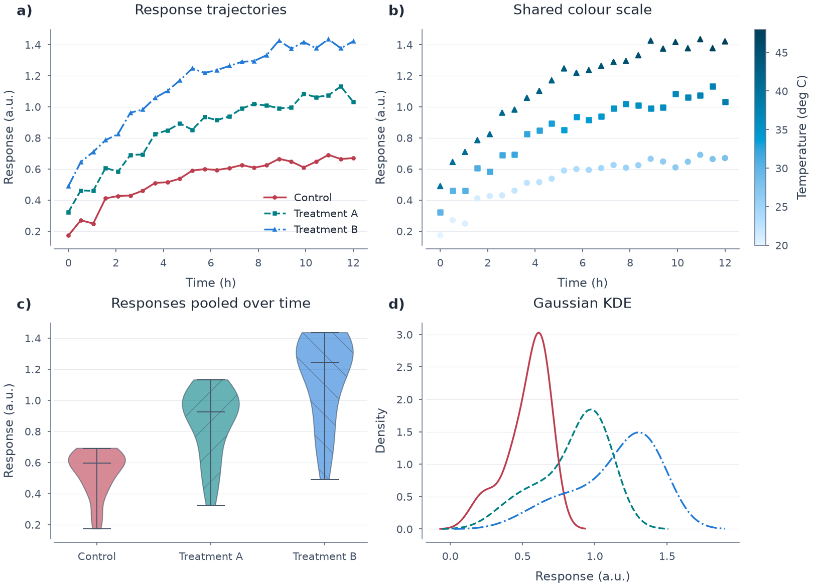

# mudplot 가이드

Matplotlib 기반의 논문용 Python 플로팅 라이브러리입니다. [설치와 첫 PDF 만들기](INSTALL.ko.md)로 시작한 뒤 [실행 가능한 워크플로](../examples/README.ko.md) 또는 [플롯 갤러리](PLOT_GALLERY.md)에서 원하는 레이어를 찾아보세요.

고정 난수 시드의 합성 DataFrame으로 렌더링한 그림이며, 실제 실험 결과가 아닙니다. [디자인 데모](DEMO.md)에 편집 가능한 spec과 재생성 방법이 있습니다.

## 데이터에 맞는 플롯 고르기

- **관측값이나 요약값 직접 사용:** [선과 추론](LINE_WORKFLOW.ko.md), [제공한 SD 또는 CI를 그리는 막대](UNCERTAINTY.ko.md), [box 원자료와 요약값](BOX_WORKFLOW.ko.md), [네이티브 도형](NATIVE_GEOMETRY.ko.md).
- **원자료 통계:** [가중 추정과 구간](STATISTICAL_WORKFLOW.ko.md), [가중 도수](WEIGHTED_COUNTS.ko.md), [회귀와 진단](REGRESSION.ko.md), [히스토그램·도수 막대의 공통 역할](SEMANTIC_BODIES.ko.md), [바이올린](VIOLIN_WORKFLOW.ko.md), [짝지은 밀도·경험분포](DENSITY_FIELDS.ko.md).
- **패널·축 비교:** [패싯](FACETS.ko.md), [pair grid](PAIR_GRID.ko.md), [joint plot](JOINT_GRID.ko.md), [패널 배치](PANEL_LAYOUTS.ko.md), [시간축](TEMPORAL_AXES.ko.md), [저장 가능한 유한 축 제어(영어)](REFERENCE.md#finite-axis-controls-n12).
- **행렬 비교:** [타입이 지정된 heatmap](HEATMAP.ko.md), [계층 군집 heatmap](CLUSTERMAP.ko.md).
- **옵션과 기본값:** [엔진 레퍼런스(영어)](REFERENCE.md), [Matplotlib/Seaborn 기능 지원 범위](FEATURE_COVERAGE.ko.md). 등록된 레이어 66종이 두 라이브러리 전체와 동등하다는 뜻은 아닙니다.

[플롯 비교 예제](COMPARISONS.ko.md)에는 실행할 스크립트와 실제 출력, 편집 가능한 spec이 함께 있습니다.

## 출판용 그림 만들고 점검하기

[출판 가이드](PUBLICATION.ko.md)에서 논문 컬럼 폭, PGF 인용, 팔레트 측정과 사전 검사를 확인하세요. 팔레트 엔진은 CIELAB 극좌표인 LCH를 사용하며 CIEDE2000 색차와 선택된 색각 조건을 평가합니다. [이름이 지정된 프리셋](DEMO.md#4-colour-palette-presets-measured-not-assumed)과 [흑백 막대 비교](DEMO.md#5-grouped-bar-chart-readable-after-black--white-printing)는 측정 조건과 유한한 해칭 주기를 보여 주며 접근성 인증이 아닙니다.

[읽기 중심 그래프 검토](VISUAL_QUALITY.ko.md)는 합성 조건과 평균의 점별 95% 신뢰구간을 사용합니다. [시간에 따른 반응](images/visual_response_mobile.png)과 [별도 종료점 그림](images/visual_endpoint.png)을 보거나 [출판 예제](../examples/publication_showcase.py)를 실행하세요. [선택형 과학 그림 구성과 QA(영어)](SCIENTIFIC_QUALITY.md)는 FigureSpec과 기본 렌더링을 바꾸지 않습니다.

## 저장·자동화·편집

Fluent 빌더는 `Store`에 action을 전달합니다. Reducer는 입력을 변경하거나 I/O를 수행하지 않습니다. Spec 그래프 자체는 변경 가능하며 공개 스냅샷은 방어적 복사본입니다. 렌더링·미리보기·파일 I/O는 reducer 외부의 effect입니다. [설계 문서](../DESIGN.ko.md), [FigureSpec·CLI·로컬 편집기](AUTOMATION.ko.md), [성능 가이드](PERFORMANCE.ko.md)를 참고하세요.

## 버전과 호환성

현재 소스 버전은 **v2.0.0**입니다. 저장 포맷은 FigureSpec **0.1**을 유지하며 표준 렌더러는 Matplotlib입니다. 릴리스 워크플로는 산출물과 TeX 검증을 거친 뒤 게시합니다. 소스의 버전 표기만으로 산출물의 게시를 확인할 수는 없습니다. [변경 기록](../CHANGELOG.md), [호환성 정책](COMPATIBILITY.ko.md), [로드맵](../ROADMAP.ko.md), [보안 정책](../SECURITY.ko.md)을 참고하세요.
