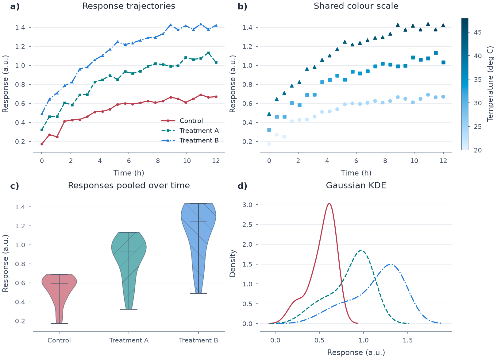

# mudplot guide

A Python plotting library for scientific papers, built on Matplotlib. Start with [installation and a first PDF](INSTALL.md), then choose an [executable workflow](../examples/README.md) or a registered mark in the [plot gallery](PLOT_GALLERY.md).

This is actual output from a seeded synthetic DataFrame, not experimental measurements. The [design demos](DEMO.md) include editable specs and regeneration instructions.

## Choose a plotting workflow

- **Supplied observations or summaries:** [lines and inference](LINE_WORKFLOW.md), [bars with supplied SD or CI](UNCERTAINTY.md), [box observations and summaries](BOX_WORKFLOW.md), and [native geometry](NATIVE_GEOMETRY.md).
- **Raw-data statistics:** [weighted estimates and intervals](STATISTICAL_WORKFLOW.md), [weighted counts](WEIGHTED_COUNTS.md), [regression and diagnostics](REGRESSION.md), [histogram and count body roles](SEMANTIC_BODIES.md), [violins](VIOLIN_WORKFLOW.md), and [paired density and empirical fields](DENSITY_FIELDS.md).
- **Compare panels or axes:** [facets](FACETS.md), [pair grids](PAIR_GRID.md), [joint plots](JOINT_GRID.md), [panel layouts](PANEL_LAYOUTS.md), [temporal axes](TEMPORAL_AXES.md), and [finite saved axis controls](REFERENCE.md#finite-axis-controls-n12).
- **Compare matrices:** [typed heatmap controls](HEATMAP.md) and [hierarchical clustermaps](CLUSTERMAP.md).
- **Look up options and defaults:** [engine reference](REFERENCE.md) and the [Matplotlib/Seaborn feature coverage](FEATURE_COVERAGE.md). The 66 registered layer types do not establish full parity with either library.

The [worked comparisons](COMPARISONS.md) pair runnable scripts with the actual figures and editable specs.

## Prepare and review a publication figure

Use the [publication guide](PUBLICATION.md) for actual-size TeX sizing, PGF citations, palette measurements and preflight. The palette engine works in LCH (polar CIELAB), uses measured CIEDE2000 distances, and evaluates selected colour-vision simulations. The [named presets](DEMO.md#4-colour-palette-presets-measured-not-assumed) and [black-and-white bar comparison](DEMO.md#5-grouped-bar-chart-readable-after-black--white-printing) show the measured conditions and finite hatch cycles, not accessibility certification.

The [reading-first chart review](VISUAL_QUALITY.md) uses synthetic conditions and pointwise 95% confidence intervals of the mean. View the [time-course chart](images/visual_response_mobile.png) and [separate endpoint chart](images/visual_endpoint.png) or run the [publication showcase](../examples/publication_showcase.py). [Opt-in scientific composition and QA](SCIENTIFIC_QUALITY.md) do not change the FigureSpec or rendering defaults.

## Save, automate and edit

The fluent builder dispatches actions to a `Store`. The reducer does not mutate its inputs or perform I/O; the spec graph itself remains mutable and public snapshots are defensive copies, not zero-copy state. Rendering, preview and file I/O are effects outside the reducer. See the [architecture](../DESIGN.md), [FigureSpec, CLI and local editors](AUTOMATION.md), and [performance guidance](PERFORMANCE.md).

## Version and compatibility

The source version is **v2.0.0**. The wire format remains FigureSpec **0.1** and Matplotlib is the canonical renderer. The release workflow publishes only after artifact and TeX verification; the version in source is not proof that release artifacts have been published. See the [changelog](../CHANGELOG.md), [compatibility policy](COMPATIBILITY.md), [roadmap](../ROADMAP.md), and [security policy](../SECURITY.md).
