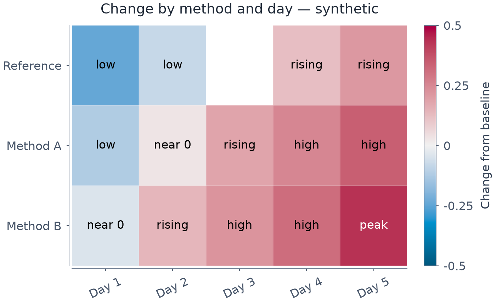

# Typed heatmap 표시 옵션

*[English](HEATMAP.md)*

`HeatmapSpec`은 원래 숫자 행렬을 바꾸지 않고 표시 옵션을 켭니다.
`heatmap=None`인 기존 imshow 기본 동작은 유지합니다.

## 명시적 네이티브 격자

`imshow`, `pcolor`, `pcolormesh`, `spy`는 `GridFieldSpec`을 사용합니다.
`contour`와 `contourf`에서는 생략하면 기존 단위 격자를 유지합니다.
`.matrix(name, rows)`로 등록한 원본과 좌표는 관측 열과 별도로 저장되므로
`SetData`가 바꾸지 않습니다.

- `imshow`는 `[왼쪽, 오른쪽, 아래, 위]`와 `origin="upper"|"lower"`를 받습니다.
  이름 있는 스칼라 행렬 또는 채널 범위 `[0,1]`인 인라인 RGB(A) `pixels` 중
  하나만 지정합니다. 픽셀 알파에 레이어 알파를 한 번 곱합니다. 마스크는
  픽셀을 투명하게 만들며 RGB(A)에는 스칼라 색 매핑이나 색상 막대가 없습니다.
- 격자는 `position="edges", shading="flat"`(X 경계 N+1, Y 경계 M+1) 또는
  `position="centers", shading="nearest"`(X 중심 N, Y 중심 M, 각각 최소 2)를
  명시합니다. X는 열, Y는 행입니다. `pcolor`는 마스킹된 다각형을 제외하고,
  `pcolormesh`는 격자를 유지한 채 해당 면만 투명하게 표시합니다. 마스킹된
  `pcolormesh`에는 보이는 윤곽선을 지정할 수 없습니다.
- 불리언 `mask`는 데이터와 같은 형태입니다. 스칼라 null도 마스킹하며 0으로
  바꾸지 않습니다. 표시되는 원시 값의 선형 색 범위를 사용합니다. 상수는
  원본을 바꾸지 않고 양쪽으로 5%를 늘립니다(0이나 극소 표시 범위는 ±0.5).
  안전하게 표시할 수 없는 원시 색상 막대 범위는 거부합니다.
- `spy`는 `abs(value) > threshold`를 만족하는 값을 원본 행 순서대로 0부터
  시작하는 열·행 인덱스에 표시합니다. `origin`으로 행 방향을 정합니다.
- 등고선은 최소 2×2 샘플, 중심 좌표와 오름차순 `levels`를 지정합니다.
  `corner_mask=False`이면 마스크와 맞닿는 사각형 전체를 제외합니다.
  선 라벨에는 `label_levels`, `label_format`(`g`, `.1f`, `.2f`, `.3f`),
  `label_inline`을 사용할 수 있습니다. 빈 레벨도 그대로 유지하되 선이나
  라벨을 만들지 않습니다. 선 색상 막대에는 레벨이 두 개 이상 필요합니다.
  채운 등고선은 `(하한, 상한]`이며 가장 낮은 구간만 하한을 포함합니다.
  `extend`로 범위 밖의 띠를 지정할 수 있습니다.

기본 선형 숫자 직교 축에서만 동작합니다. 새 경로의 상한은 원본 10,000
셀·픽셀, 명시 레벨 512개, 예상 라벨 4,096개, 예상 경로 꼭짓점 2,000,000개와
그림 단위 행렬 작업·메모리 예약입니다. 기존 경로나 P01은 변경하지 않습니다.
[PNG/SVG/PDF 실행 예제](../examples/grid_field_workflow.py).




[편집 spec](images/heatmap_controls.mplot.json) ·
[SVG](images/heatmap_controls.svg) · [PDF](images/heatmap_controls.pdf) ·
[소스](../examples/heatmap_controls.py)

합성 변화량 예제의 검토 폭은 데스크톱 700px입니다. Mask는 셀을 숨긴 것이지
원자료가 실제 결측이었다는 증거가 아니며 독립 가독성/접근성 인증도 아닙니다.

```python
p = (mp.plot().matrix("m", [[-2, 0, 3], [1, 4, 8]])
       .heatmap("m", cmap_kind="diverging", clabel="Change",
                heatmap={"annot": True, "fmt": ".1f", "center": 0,
                         "mask": [[False, True, False], [False, False, False]],
                         "xlabels": ["A", "B", "C"], "ylabels": ["N", "S"]},
                line_width=0.5, edge_color="#ffffff")
       .size(6, 4))
```

기존 layer의 `heatmap` 필드에 strict `HeatmapSpec` 또는 dict를 넣습니다.
알 수 없는 key는 거부하며 API/AddLayer action/JSON/editor가 같은 spec/reducer/
validator를 사용합니다. 새 layer 종류·필수 의존성·spec version을 추가하지 않습니다.

## Mask와 원래 값

- `mask`는 선택적인 같은 모양의 bool 행렬입니다. True는 해당 셀을 숨기고
  색상 범위/robust percentile/log 양수 조건/주석에서 제외합니다.
- 행렬은 masked 셀까지 유한 숫자여야 합니다(bool/NaN/null 불가). Mask가 잘못된
  입력을 정리하거나 원자료를 고치는 기능은 아닙니다.
- 빈/jagged 행렬, 모양이 다른 mask, 모두 숨긴 view는 일찍 거부합니다.
- `xlabels`/`ylabels`는 열/행마다 문자열 하나(최대 512자)가 필요합니다. 좌표축은
  선형 cell index이며 색상 log scale과 다릅니다.

## 색상 척도

기본 `norm="linear"`, `norm="log"`는 보이는 값과 경계가 양수여야 합니다.
`vmin`/`vmax`는 추론 범위를 덮어쓰는 유한값이며 둘 다 주면 증가해야 합니다.
범위 밖 값도 원자료/주석을 유지하므로 색상 clipping은 데이터 삭제가 아닙니다.

`robust=True`는 보이는 값의 2/98 percentile을 사용한 뒤 명시 경계를 적용합니다.
행이나 통계/관측을 다시 추정하지 않습니다.

`center`는 linear norm과 diverging palette에서만 사용합니다. 없는 경계는 중심
주변 대칭으로 추론하고 명시 경계는 유지하며 중심을 사이에 둬야 합니다.
TwoSlopeNorm이며 순차 척도의 이름만 바꾸는 것이 아닙니다. 상수 범위는 안전하게
확장하고 표현 불가능한 계산 span은 조용히 overflow하지 않고 오류로 처리합니다.
실패 시 기존 출력 파일을 바꾸지 않습니다. Typed colourbar는 명시 경계/값을 써서
아주 큰 유한값과 아주 작은 log 범위에서도 계산을 안정적으로 유지합니다.

## 주석·경계·모양

`annot=True`는 정규화/log 비율이 아닌 **원래** 보이는 숫자를 표시합니다. `fmt`는
기존 bounded 숫자 whitelist인 `g`/`.0f`/`.1f`/`.2f`/`.3f`/`.1%`/`e`/`.2e`만
지원하며 최대 4096개의 보이는 셀에 주석을 달 수 있습니다. 큰 grid는 주석을 빼거나
작은 view를 선택하세요.

선택 `annot_data`는 숫자 대신 표시할 같은 모양의 문자열 행렬입니다.
`annot=True`가 필요하며 masked 셀도 포함해 셀마다 최대 512자이고 빈 문자열도
유효합니다. 숫자 행렬·색 정규화·clustering 적합 값을 대체하지 않습니다.
Mask는 여전히 주석을 숨깁니다. Clustermap은 원래 행/열 ID에 따라 text/mask/
label을 함께 재배열하며 사용자 문자열을 표준화된 값에서 다시 계산하지 않습니다.
선택 `xrotation`/`yrotation`은 [-360,360] 유한 각도(degree)로 명시/자동 tick
label 모두에 적용합니다. 생략하면 기존 JSON·기본 artist를 보존합니다.

글자색은 이 이미지의 colormap과 alpha가 적용된 axes 배경에서 검정/흰색 중 대비가
강한 쪽을 선택합니다. 임의 overlay·글꼴 판독·모든 접근성 조건을 평가하는 것은 아닙니다.

`square=True`는 셀의 x/y aspect를 같게 하며 전체 그림이 정사각형일 필요는 없습니다.
기존 `line_width`/`edge_color`는 point 단위 셀 경계이며 무시되지 않도록 HeatmapSpec이
있을 때만 허용합니다. `colorbar`/`clabel`·font/theme·크기와 기존 패널 설정은 유지합니다.

## 재현·편집

```bash
uv run python -m examples.heatmap_controls
uv run pytest -q tests/test_heatmap_options.py tests/test_layers.py
```

편집 예제를 에디터에서 열거나 advanced 폼으로 heatmap layer를 추가합니다. 행렬과
설정은 그대로 왕복합니다. 행렬 모양을 바꾸면 mask/label도 갱신해야 하며 잘못된
import/action은 기존 원자적 검증/렌더 경로로 현재 상태를 보존합니다.

기존 선형/log 및 중심형 `TwoSlopeNorm`에 `symlog`(양수 `linthresh`, 밑 10,
linscale 1), `power`(양수 `gamma`, native clipping), `boundary`(엄격히 증가하는
경계 2–512개, 반열린 구간마다 동일한 표시 폭의 색 하나)를 추가합니다. 마지막 경계는
초과 범위에 속하며 범위 밖 값도 그대로 보존하고 양끝 색으로 표시합니다.
`boundary`는 `robust`, `center`, `vmin`/`vmax`와 함께 쓰지 않습니다.

`ColorbarOptionsSpec` 또는 `heatmap={"colorbar_options": {...}}`로 위치(`left`,
`right`, `top`, `bottom`), 표시값 단위의 증가하는 `ticks`, 숫자 형식 목록의
`tick_format`을 지정합니다. `boundary`에서는 경계만 눈금으로 사용합니다.
`fraction`은 두께, `pad`는 글자 여백과 별도의 최소 간격이며 색상표에 수직한
본체 길이에 대한 비율(기본 `.05`, `.04`)입니다. 실제 이미지 norm과 색을 공유합니다.
`SetColorbar`로 숨겨도 옵션은 유지되며 `ReplaceLayer`로 수정합니다.

글자나 색상표가 들어가지 않으면 그림/패널을 키우거나 글자를 줄이거나 회전합니다.
이미 있는 고정 `TickSpec`으로 원하는 위치를 직접 지정할 수도 있습니다. 렌더러는
자동으로 글자를 버리거나 그림을 키우지 않습니다.
`python -m examples.matrix_workflow /path/to/output`으로 PNG/SVG/PDF/편집용
JSON을 생성합니다. 소스 기능의 예이며 설치본이나 P01 검증을 뜻하지 않습니다.
