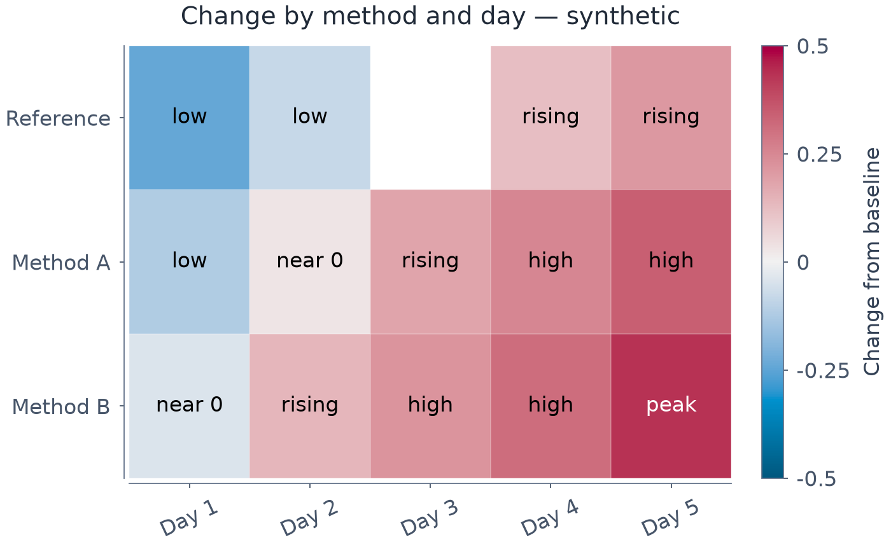

# Typed heatmap display controls

*[한국어 / Korean](HEATMAP.ko.md)*

`HeatmapSpec` opts into matrix display controls without changing the original
numeric matrix. `heatmap=None` retains the existing imshow defaults.

## Explicit native grid fields

`GridFieldSpec` is required for `imshow`, `pcolor`, `pcolormesh`, and `spy`;
omitting it on `contour` or `contourf` retains the old unit-grid behavior.
Register scalar input via `.matrix(name, rows)`. The original rows and
coordinates are saved separately from the observation table and survive `SetData`.

- `imshow` accepts `[left, right, bottom, top]` and `origin="upper"|"lower"`.
  Use a named scalar matrix **or** inline `pixels` with uniform RGB or RGBA
  depth and channels in `[0,1]`. RGBA opacity is pixel alpha times layer alpha;
  masks make pixels transparent. RGB(A) has no scalar mapping or colourbar.
- Meshes require `position="edges", shading="flat"` (X has N+1 edges and Y has
  M+1), or `position="centers", shading="nearest"` (N and M centers, both at
  least two). X indexes columns and Y rows. Native `pcolor` omits masked
  polygons; `pcolormesh` keeps mesh extent and transparent masked faces, so
  visible edge strokes are rejected on masked meshes.
- The boolean `mask` must exactly match the data shape. Scalar nulls are also
  masked, not zero. Scalar colour uses visible raw values with a linear norm.
  A constant is padded by 5% on either side (half a unit at zero or at
  subnormal display scale), without changing the sample. An unrepresentable
  raw bar domain rejects rather than silently expanding on the backend.
- `spy` marks visible entries satisfying `abs(value) > threshold` in original
  row order. Coordinates are zero-based column/row indices; origin controls
  row direction. No scalar colourbar or sparse `present` inference.
- Explicit contours require center vectors, at least 2×2 scalar samples and
  increasing `levels`. `corner_mask=False` omits every quad touching a masked
  vertex. Line `label_levels` chooses a declared subset; `label_format` is
  `g`, `.1f`, `.2f` or `.3f`, and `label_inline` controls gaps where a label
  fits. Outside or empty levels retain their identity without inventing
  lines or labels. A line colourbar requires two levels. Filled levels are
  boundaries: intervals are `(low, high]`, with the lowest also including
  its lower bound. `extend` declares whether to include under/over bands.

Grid layers require a primary linear numeric Cartesian target. The opt-in
limits are 10,000 raw cells/pixels, 512 explicit levels, 4,096 prospective
labels, and aggregate matrix work/storage and 2,000,000 prospective path
vertices. No legacy budget or broad P01 control changes.
[Example exporting PNG/SVG/PDF](../examples/grid_field_workflow.py).




[Editable spec](images/heatmap_controls.mplot.json) ·
[SVG](images/heatmap_controls.svg) · [PDF](images/heatmap_controls.pdf) ·
[Source](../examples/heatmap_controls.py)

The example uses synthetic changes, reviewed at 700px desktop width. A masked
cell is hidden, not evidence that its stored value was missing. No independent
readability/accessibility certification is claimed.

```python
p = (mp.plot().matrix("m", [[-2, 0, 3], [1, 4, 8]])
       .heatmap("m", cmap_kind="diverging", clabel="Change",
                heatmap={"annot": True, "fmt": ".1f", "center": 0,
                         "mask": [[False, True, False], [False, False, False]],
                         "xlabels": ["A", "B", "C"], "ylabels": ["N", "S"]},
                line_width=0.5, edge_color="#ffffff")
       .size(6, 4))
```

Use a strict `HeatmapSpec` or dict in the existing layer's `heatmap` field.
Unknown keys fail. The API, AddLayer actions, JSON and editors all use the same
spec/reducer/validator path. No new layer type, mandatory dependency or spec
version is introduced.

## Mask and source values

- `mask` is an optional same-shaped boolean matrix. True hides the cell and
  excludes it from colour bounds/robust percentiles/log positivity and annotations.
- Matrix values themselves remain finite numeric values, not bool, NaN or null,
  including masked cells. Masks do not sanitize malformed input or rewrite data.
- Empty/jagged matrices, mismatched masks and an entirely masked view fail early.
- `xlabels`/`ylabels` require one string per column/row, at most 512 characters
  each. Coordinate axes remain linear cell indices; colour log scale is separate.

## Colour scale

`norm="linear"` is the default; `norm="log"` requires positive unmasked values
and positive bounds. `vmin`/`vmax` override inferred bounds and must be finite,
increasing when both supplied. Values outside explicit bounds keep their stored
values and annotations; clipping of colour is not data deletion.

`robust=True` uses the visible-value 2nd/98th percentiles before explicit bound
overrides. No rows, statistics or observations are re-estimated.

`center` requires linear norm and the diverging palette. Missing bounds are
inferred symmetrically around the center; supplied bounds remain unchanged and
must straddle it. This uses TwoSlopeNorm, not a relabelling of a sequential scale.
Constant ranges are expanded safely; an unrepresentable derived span fails with
a useful error, not silently overflowing or replacing existing output files.
The typed colourbar uses stable explicit boundaries/values, including extreme
finite and subnormal log ranges.

## Labels, borders and shape

`annot=True` formats **original** unmasked matrix values, not normalized/log
fractions. `fmt` uses the existing bounded numeric whitelist:
`g`, `.0f`, `.1f`, `.2f`, `.3f`, `.1%`, `e`, `.2e`. At most 4096 visible
annotation cells are supported. For larger grids, omit text or select a view.

Optional `annot_data` supplies a same-shaped matrix of strings instead of
formatting scalar values. It requires `annot=True`; each cell is at most 512
characters, including masked cells, and an empty string is valid. It never
replaces the numeric matrix, colour normalization or clustering fit values.
Masks still suppress text. Clustermap permutes text/masks/labels together using
the original row/column identities; custom strings are not recomputed from a
standardized display matrix. `xrotation`/`yrotation` are optional finite degrees
in [-360,360] and apply with explicit or automatic tick labels. Omitted fields
preserve legacy JSON and default artists.

Text chooses the stronger black/white contrast from this image's colormap and
alpha-composited axes background. It does not evaluate arbitrary overlay layers,
font legibility or every accessibility requirement.

`square=True` uses equal x/y cell aspect; the whole figure need not be square.
Existing `line_width`/`edge_color` control cell borders in points, but require
HeatmapSpec so they are never silently ignored. `colorbar`/`clabel`, font/theme,
size and existing panel controls remain available.

## Reproduce and edit

```bash
uv run python -m examples.heatmap_controls
uv run pytest -q tests/test_heatmap_options.py tests/test_layers.py
```

Open the editable example in either editor, or add a checked heatmap layer via
its advanced form. Stored matrix and config round-trip unchanged. If a matrix
shape changes, update mask/labels too; invalid prospective imports/actions keep
existing editor state under the normal atomic validation/rendering path.

In addition to linear/log and centered diverging `TwoSlopeNorm`, opt into
`symlog` (positive `linthresh`, base 10 and linscale 1), `power` (positive `gamma`,
native clipping), or `boundary` (2–512 strictly increasing limits, one equally
spaced swatch per half-open interval). The last boundary is the over-range edge;
outside cells keep their stored values and use the extreme swatches.
Boundary mode excludes `robust`, `center` and explicit `vmin`/`vmax`.

`ColorbarOptionsSpec` (or `heatmap={"colorbar_options": {...}}`) independently
sets `location` (`left`, `right`, `top`, `bottom`), increasing raw-unit `ticks`,
and `tick_format` from the numeric format whitelist. Boundary ticks must be
declared edges. `fraction` controls thickness; `pad` reserves a minimum blank
gap before native text margins (relative to the body perpendicular to the bar;
defaults `.05` and `.04`). A visible guide uses the image's actual normalization
and swatches; masked data, annotations and axis indices remain independent.
`SetColorbar` can hide it without losing options; edit options with `ReplaceLayer`.

If dense labels or guides do not fit, change the figure/panel size, rotate or
shorten labels, or use existing fixed `TickSpec` for explicitly chosen positions.
The renderer does not silently discard labels or resize the figure. Run
`python -m examples.matrix_workflow /path/to/output` for a PNG/SVG/PDF and editable
JSON. These source features are not a claim of installed or P01 qualification.
