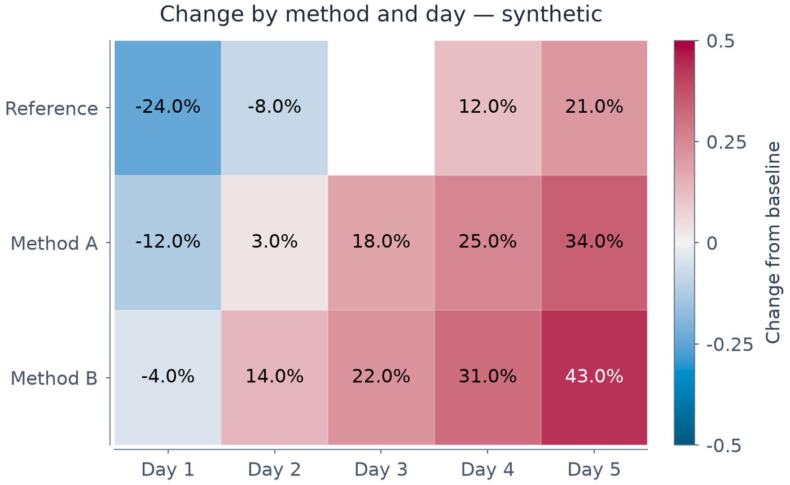

# Typed heatmap display controls

*[한국어 / Korean](HEATMAP.ko.md)*

`HeatmapSpec` opts into matrix display controls without changing the original
numeric matrix. `heatmap=None` retains the existing imshow defaults.



[Editable spec](images/heatmap_controls.mplot.json) ·
[SVG](images/heatmap_controls.svg) · [PDF](images/heatmap_controls.pdf) ·
[Source](../examples/heatmap_controls.py)

The example uses synthetic changes, reviewed at 700px desktop width. A masked
cell is hidden, not evidence that its stored value was missing. No independent
readability/accessibility certification is claimed.

```python
p = (mp.plot().matrix("m", [[-2, 0, 3], [1, 4, 8]])
       .heatmap("m", cmap_kind="diverging", clabel="Change",
                heatmap={"annot": True, "fmt": ".1f", "center": 0,
                         "mask": [[False, True, False], [False, False, False]],
                         "xlabels": ["A", "B", "C"], "ylabels": ["N", "S"]},
                line_width=0.5, edge_color="#ffffff")
       .size(6, 4))
```

Use a strict `HeatmapSpec` or dict in the existing layer's `heatmap` field.
Unknown keys fail. The API, AddLayer actions, JSON and editors all use the same
spec/reducer/validator path. No new layer type, mandatory dependency or spec
version is introduced.

## Mask and source values

- `mask` is an optional same-shaped boolean matrix. True hides the cell and
  excludes it from colour bounds/robust percentiles/log positivity and annotations.
- Matrix values themselves remain finite numeric values, not bool, NaN or null,
  including masked cells. Masks do not sanitize malformed input or rewrite data.
- Empty/jagged matrices, mismatched masks and an entirely masked view fail early.
- `xlabels`/`ylabels` require one string per column/row, at most 512 characters
  each. Coordinate axes remain linear cell indices; colour log scale is separate.

## Colour scale

`norm="linear"` is the default; `norm="log"` requires positive unmasked values
and positive bounds. `vmin`/`vmax` override inferred bounds and must be finite,
increasing when both supplied. Values outside explicit bounds keep their stored
values and annotations; clipping of colour is not data deletion.

`robust=True` uses the visible-value 2nd/98th percentiles before explicit bound
overrides. No rows, statistics or observations are re-estimated.

`center` requires linear norm and the diverging palette. Missing bounds are
inferred symmetrically around the center; supplied bounds remain unchanged and
must straddle it. This uses TwoSlopeNorm, not a relabelling of a sequential scale.
Constant ranges are expanded safely; an unrepresentable derived span fails with
a useful error, not silently overflowing or replacing existing output files.
The typed colourbar uses stable explicit boundaries/values, including extreme
finite and subnormal log ranges.

## Labels, borders and shape

`annot=True` formats **original** unmasked matrix values, not normalized/log
fractions. `fmt` uses the existing bounded numeric whitelist:
`g`, `.0f`, `.1f`, `.2f`, `.3f`, `.1%`, `e`, `.2e`. At most 4096 visible
annotation cells are supported. For larger grids, omit text or select a view.

Text chooses the stronger black/white contrast from this image's colormap and
alpha-composited axes background. It does not evaluate arbitrary overlay layers,
font legibility or every accessibility requirement.

`square=True` uses equal x/y cell aspect; the whole figure need not be square.
Existing `line_width`/`edge_color` control cell borders in points, but require
HeatmapSpec so they are never silently ignored. `colorbar`/`clabel`, font/theme,
size and existing panel controls remain available.

## Reproduce and edit

```bash
uv run python -m examples.heatmap_controls
uv run pytest -q tests/test_heatmap_options.py tests/test_layers.py
```

Open the editable example in either editor, or add a checked heatmap layer via
its advanced form. Stored matrix and config round-trip unchanged. If a matrix
shape changes, update mask/labels too; invalid prospective imports/actions keep
existing editor state under the normal atomic validation/rendering path.

Custom annotation matrices, clustering, categorical/date cell coordinates and
more normalization kinds remain out of scope. Review the final size and layout;
automated font/bounds checks are not aesthetic scores.
