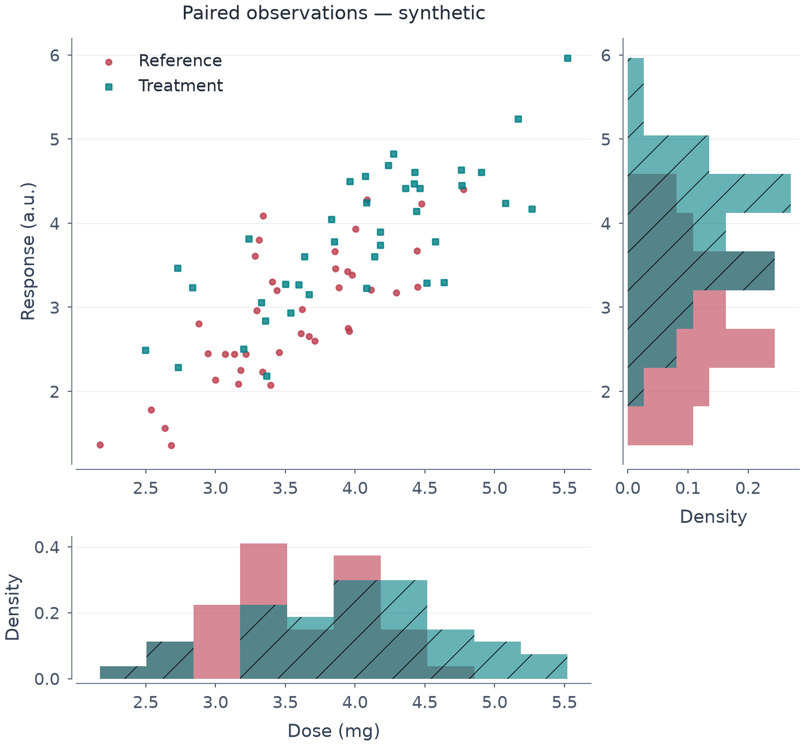

# 같은 관측 행을 쓰는 joint plot과 주변 히스토그램

*[English](JOINT_GRID.md)*

Joint-grid는raw scatter/regression 또는ungroupedhist2d/hexbin과x/y주변histogram/KDE를
연결합니다. Seaborn의모든jointkind를구현한것은아닙니다.



[편집 spec](images/joint_observations.mplot.json) ·
[SVG](images/joint_observations.svg) · [PDF](images/joint_observations.pdf) ·
[실행 코드](../examples/joint_observations.py)

80개 값은 모두 독립 합성 관측입니다. 데스크톱 700px를 확인한 예제로,
모바일 배치나 독립적인 가독성 인증이 아닙니다.

## 본 그래프를 만든 뒤 구성

```python
p = (mp.plot(raw)
       .scatter("dose", "response", group="condition", marker_size=3.5)
       .labels(x="Dose (mg)", y="Response (a.u.)", title="Paired observations")
       .joint(bins=10, ratio=3, marginal_stat="density")
       .size(7, 6.5))
```

- Panel 0: 왼쪽 위 본 그래프. 스타일·제목/reference와 선택적인 hline/vline/
  text/annotation layer를 유지합니다.
- Panel 1: 오른쪽의 가로 y 히스토그램.
- Panel 2: 아래의 세로 x 히스토그램.
- 오른쪽 아래에는 **네 번째 axes를 만들지 않습니다.**

템플릿은 primary Cartesian 2-D의 raw `scatter`/`regplot`/`hist2d`/`hexbin` 하나와 선택적인
참조/주석 layer여야 합니다. 비어 있는 축 이름은 열 이름으로 채웁니다. 본 그래프의
x 이름은 아래 주변 분포로 옮기고 오른쪽 y 이름은 반복하지 않습니다. 주변 범례는
숨기며 raw group 색상/자리는 본 그래프와 일치합니다.

`ratio`는 본 그래프와 주변 분포의 가로/세로 비율로 유한한 [1,10]입니다. `bins`는
기존 히스토그램 상한 안의 양의 정수이며 변수마다 자기 경계를 만들되 그룹끼리는
공유합니다. `marginal_stat`은 `count`/`density`/`probability`/`percent`입니다.
Density는 한 주변 분포의 그룹 전체 면적 합이 1이고 probability/percent 합은
1/100, count 합은 선택한 쌍 관측 수입니다.

전체 그림 크기는 자동으로 늘리지 않으므로 직접 지정하세요. X는 열, y는 행을
공유하여 측정값 위치를 맞춥니다. Density/count 축은 본 측정값 축과 별개입니다.
표시 limits가 추가 데이터 필터를 뜻하지도 않습니다.

## Binned중심

```python
p = (mp.plot(raw).hist2d("dose", "response", bins=12, colorbar=False)
       .joint(bins=10, marginal_stat="count").size(7, 6.5))
# 또는hexbin("dose", "response", gridsize=20, colorbar=False)
```

Binned중심은ungrouped/unweightedrawnumericx/y와명시colorbarFalse를요구합니다. 중심의
bins/gridsize/density는유지하고jointbins는주변hist에만적용합니다. Pairedselector는중심/주변
validation·render전에적용되고SetData뒤갱신됩니다. Hist/KDE주변모두지원하지만일반binnedfacet
filter/hue_order/group/암묵colorbar제거는지원하지않습니다.

## KDE 주변 분포

```python
p = (mp.plot(raw).scatter("dose", "response", group="condition")
       .joint(marginal_kind="kde", kde={"bw_method": "silverman",
              "bw_adjust": 0.8, "gridsize": 128, "cut": 0})
       .size(7, 6.5))
```

[예제](images/kde_joint.png) · [편집 spec](images/kde_joint.mplot.json) ·
[소스](../examples/kde_grids.py). 같은 관측 쌍과 값축 방향을 유지합니다. Strict
KDESpec/dict로 bandwidth·grid·cut/clip·공통 정규화/grid·fill을 설정하며 각 주변
분포에 독립 복사합니다. 위 histogram 합/면적 규칙은 유한 support KDE에 그대로
적용되지 않습니다. Cut/clip은 fit 행을 버리지 않고 평가 범위를 제한하므로 보이는
면적이 1보다 작을 수 있습니다. 단일값/특이 그룹은 기존처럼 경고 후 건너뛰고
가짜 fit을 만들지 않습니다. Common norm에는 건너뛴 그룹의 유효 질량도 포함합니다.

KDE는 density만 지원합니다. 사용하지 않는 bins는 기본 20으로 두고 count/
probability/percent·weights·cumulative CDF는 요청할 수 없습니다. 같은 설정을
변수별로 복사하므로 clip 경계는 두 변수의 단위 모두에 맞아야 합니다. Histogram
기본 동작은 그대로입니다.

## 같은 관측 집합과 보존된 원자료

모든 패널에 같은 완전 관측 선택을 저장합니다.

```json
{"dropna": ["dose", "response", "condition"]}
```

X/y 또는 매핑한 group이 결측인 행을 세 그림 모두에서 제외합니다. 관계없는 열의
결측값은 제외 조건이 아닙니다. 명시적 raw `hue_order` 선택도 좌표 검증·주변 통계
전에 적용합니다. 좌표는 bool/범주가 아닌 유한 숫자여야 하고 선택한 완전 쌍이
없으면 state/history를 바꾸지 않고 오류로 처리합니다.

전체 원자료는 `FigureSpec.data`에 남으며 오래된 파생 열을 복사해 저장하지
않습니다. `SetData` 뒤 완전 관측 선택은 동적으로 갱신합니다. Group order는
[facet](FACETS.ko.md)처럼 materialized snapshot이므로 새로운 그룹을 포함하려면
새 템플릿에서 다시 만드세요. 이후 편집은 panel index를 따릅니다. 주변 분포에
본 그래프에서 빠진 x/y 단독 행을 섞지 않습니다.

## JSON/에디터

```json
{"type": "SetJointGrid", "bins": 10, "ratio": 3, "marginal_stat": "density"}
```

`.joint()`와 같은 pure reducer/Store action이며 구성·검증·직렬화에는 optional
숫자/렌더링 의존성이 필요 없습니다. 예제 spec을 에디터에서 열거나 준비한 raw
scatter/regplot에 raw-action 폼으로 적용할 수 있습니다. 예전 spec은 `dropna`를
생략하면 빈 선택으로 동작하며 spec version은 0.1을 유지합니다.

## 명시적인 제한

- Semantic role·legacy c/colorbar·보조축·가중 주변 분포·group/weightedbinned중심·
  facet/joint 중첩 구성은 아직 미지원입니다. [Numeric pair matrix](PAIR_GRID.ko.md)는
  별도 구성 API입니다.
- Raw line/band를 scatter/평균 곡선으로 바꾸지 않습니다. 쌍 결측을 제외하면서
  경로의 빈 구간을 바꿀 수 있으므로 명시한 본 그래프 종류만 허용합니다.
- 기존 histogram의 계산 bin/log 검사는 유지합니다. 아주 작은 양의 상수 log
  변수에서 자동 bin 경계가 거부될 수 있으며 가짜 양의 경계로 대체하지 않습니다.
- 쌍 선택 뒤에도 기존 회귀의 표본 수/서로 다른 x 조건을 검사합니다.

```bash
uv run python -m examples.joint_observations
uv run pytest -q tests/test_joint_grid.py tests/test_facets.py tests/test_raw_group_order.py
```

쌍의 원래 행 ID·동적 갱신·원자료 보존·축 공유·정규화·빈/잘못된 요청·metadata·
JSON/action/schema/editor와 PNG/PDF/SVG 재현성·global RNG 비사용을 검사합니다.
자동 검사가 최종 표시 크기의 검토를 대체하는 것은 아닙니다.
