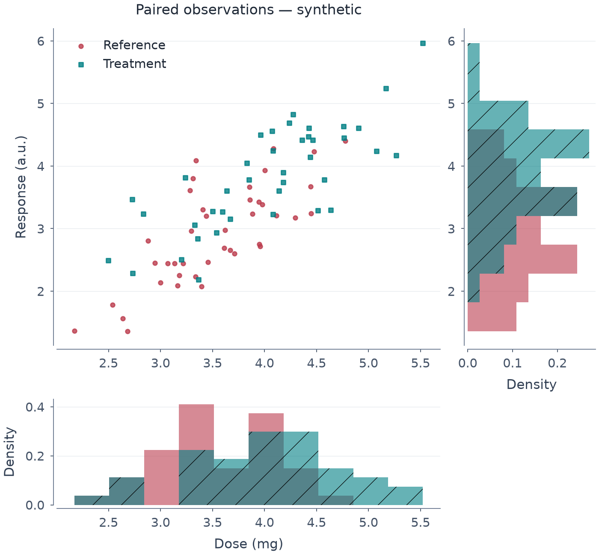

# Joint plot with paired histogram marginals

*[한국어 / Korean](JOINT_GRID.ko.md)*

Joint grids link one scatter, regression, hist2d or hexbin center to x/y
histogram/KDE/ECDF marginals. They do not implement every Seaborn joint kind.



[Editable spec](images/joint_observations.mplot.json) ·
[SVG](images/joint_observations.svg) · [PDF](images/joint_observations.pdf) ·
[Source](../examples/joint_observations.py)

All 80 observations are synthetic and independent. The example is checked at a
700px desktop display; this is not mobile or independent readability certification.

Declare template date axes with `date_axis()` before `joint()` to preserve
ISO timestamps and propagate each clock only to its observation marginal.
Density axes remain numeric. See the [temporal contract](TEMPORAL_AXES.md).

## Build a main view, then compose

```python
p = (mp.plot(raw)
       .scatter("dose", "response", group="condition", marker_size=3.5)
       .labels(x="Dose (mg)", y="Response (a.u.)", title="Paired observations")
       .joint(bins=10, ratio=3, marginal_stat="density")
       .size(7, 6.5))
```

- Panel 0: main graph at top-left, preserving its styles, title/references and
  optional hline/vline/text/annotation layers.
- Panel 1: horizontal y histogram on the right.
- Panel 2: vertical x histogram below the main graph.
- There is **no fourth axes** in the unused bottom-right corner.

The template must contain exactly one raw `scatter`, `regplot`, `hist2d` or `hexbin`, optionally
with reference/annotation layers on Cartesian 2-D axes. Axis labels
fall back to column names when empty. The main x label moves to the lower
marginal; the repeated right-side y label is hidden. Marginal legends are hidden,
and raw group colours/slots match the main view.

`ratio` is the main-to-marginal width/height ratio, finite in [1,10]. `bins` is a
positive integer within the existing histogram cap; each variable derives its
own bins, common across its groups. `marginal_stat` is `count`, `density`,
`probability` or `percent`. With density, total area over all groups is one per
marginal; probability/percent total one/100 and count totals paired observations.

Total figure size is unchanged: set it explicitly. X is shared by column and y
by row. Consequently measurement values align, while density/count axes remain
independent of the main measurement axes. Display limits remain display limits,
not additional data filtering.

## Binned centers

```python
p = (mp.plot(raw).hist2d("dose", "response", bins=12, colorbar=False)
       .joint(bins=10, marginal_stat="count").size(7, 6.5))
# Or: hexbin("dose", "response", gridsize=20, colorbar=False)
```

Center bins/gridsize remain independent of `joint(bins=...)`, which only sets
marginal histogram bins. Typed grouped `hist2d` uses the existing shared edges
and actual paired field colourbars. Its optional KDE overlay fits the complete
paired cohort before explicit bin-range exclusions; neither clipping nor out-of-bin
mass changes marginal membership. A statistic colourbar is not a raw-hue guide.

```python
p = (mp.plot(raw).size(10, 7)
     .hexbin("Dose", "Response", gridsize=5, mincnt=2)
     .joint(group="Arm", weights="Weight", bins=5, marginal_stat="count"))
```

Each group's real hexagons use the same lattice and pooled extent, on linear
numeric or declared calendar axes. `mincnt` is a minimum number of *positive
physical rows*, not weight: one row with mass 100 cannot clear `mincnt=2`.
Empty/under-occupied cells disappear from the center, not the marginals. The
group uses native outlines; one optional bar reports count (unweighted) or
weighted mass per hexagon. `hue_order=` optionally selects/reserves raw groups
for this hexbin adapter; there is no custom reducer or log-hexbin mode.

## KDE marginals

```python
p = (mp.plot(raw).scatter("dose", "response", group="condition")
       .joint(marginal_kind="kde", kde={"bw_method": "silverman",
              "bw_adjust": 0.8, "gridsize": 128, "cut": 0})
       .size(7, 6.5))
```

[Example](images/kde_joint.png) · [Editable spec](images/kde_joint.mplot.json) ·
[Source](../examples/kde_grids.py). KDE keeps the same paired cohort and value-axis
orientation. The strict KDESpec/dict controls bandwidth, grid, cut/clip, common
normalization/grid and fill; each marginal receives its own copy. The histogram
stat totals described above apply to histograms, not finite-support KDE curves.
Cut/clip bound evaluation without dropping fit rows, so displayed KDE area can
be less than one. Singular/singleton groups warn and skip without invented fits;
common normalization still includes their usable mass under existing KDE rules.

KDE supports density only: leave bins at its unused default 20 and do not request
count/probability/percent or cumulative CDF. Use one named shared weight with KDE
across variables: shared clip bounds must make sense for both units. Histogram
remains the default and is unchanged.

## Empirical cumulative marginals

```python
p = (mp.plot(raw).scatter("dose", "response", group="condition")
       .joint(marginal_kind="ecdf", marginal_stat="probability").size(7, 6.5))
```

ECDF supports `count`, `probability` (proportion), or `percent`, not density. Leave
unused `bins=20` and omit KDE options; other bins/configs are rejected, not ignored.
Each curve uses its own paired group's mass, aggregates ties and draws its full
jump at the minimum, without fabricated infinite tails or KDE fitting. Vertical x
marginals use steps-post; horizontal y marginals swap coordinates/use steps-pre.
The statistic axis stays linear/independent even with positive log observations.
`complementary=True` reports strictly greater mass at each observed knot.

## One cohort, original data intact

Every panel serializes the same complete-case selector:

```json
{"dropna": ["dose", "response", "condition"]}
```

Rows missing x/y or the mapped group are excluded from all three views. Missing
unrelated columns do not exclude observations. Explicit raw `hue_order` selection
also applies before coordinate validation and marginal calculation. Coordinates
must be finite numeric, not bool or category labels. No complete selected pair
fails without changing plot state/history.

The full original table stays in `FigureSpec.data`; no duplicated/stale derived
columns are stored. `SetData` refreshes complete cases dynamically. Group orders
are materialized snapshots like [facets](FACETS.md): rebuild a fresh template to
include newly introduced group levels. Later edits are panel-scoped. Histograms
are not estimates from extra unpaired x/y rows.

The extended path additionally uses the same named weight (zero/missing excluded;
negative, nonfinite or Boolean selected weights rejected) and typed raw roles before
coordinate conversion. `scatter(c=..., colorbar=...)` adds `c` to complete-case
requirements in all three views. Raw c values colour only the center; they are
not weights or categorical groups. `SemanticSpec` instead maps the same raw
channels in applicable scatter, regression and histogram-field workflows, using
the native roles of each mark. Raw semantic legends and statistic bars are separate.

With an actual `axis="y2"` center, the right y joins that value scale, while
the center primary y and marginal count/density/CDF axes stay independent.
Changing the y2 label retains its clock and link. A `SetLimits` or `SetAxisScale`
on either member edits both; incompatible unilateral clock/tick changes reject.
Calendar limits use the existing numeric display units (Matplotlib epoch days).
Reopening keeps ordinary stored panels, not a separate grid/cohort result.

## JSON and editors

```json
{"type": "SetJointGrid", "bins": 10, "ratio": 3, "marginal_stat": "density"}
```

The action uses the same pure reducer/Store path as `.joint()`, with no optional
numeric/render dependency in construction, validation or serialization. Open the
example spec in either editor, or apply the action to a ready raw scatter/regplot
via its raw-action form. Old specs omit `dropna` and remain unselected by default;
spec version is still 0.1.

## Explicit limits

- N13 supports nesting, empty outer cells and stable sibling placements without
  rebuilding the data. See [layouts](PANEL_LAYOUTS.md) and the separate
  [pair constructor](PAIR_GRID.md).
- Extended paired regression excludes residual and train/query-split centers;
  those centers would not describe the same raw observations as both marginals.
- Raw lines/bands are not converted into scatter or mean curves: dropping pairs
  could otherwise change path gaps. Only the stated main kinds are accepted.
- Existing histogram derived-bin/log guards still apply. For example, an
  automatic bin range for a tiny constant positive log variable can be rejected;
  no fabricated positive edges are substituted.
- Existing regression sample/distinct-x requirements remain active after pairing.

```bash
uv run python -m examples.joint_observations
uv run pytest -q tests/test_joint_grid.py tests/test_facets.py tests/test_raw_group_order.py
```

Tests check paired row IDs, dynamic refresh, source preservation, sharing,
normalization, empty/invalid requests, copied metadata, JSON/actions/schema/editor
paths and deterministic PNG/PDF/SVG without global RNG consumption. Automated
checks do not replace review at the intended final size.
