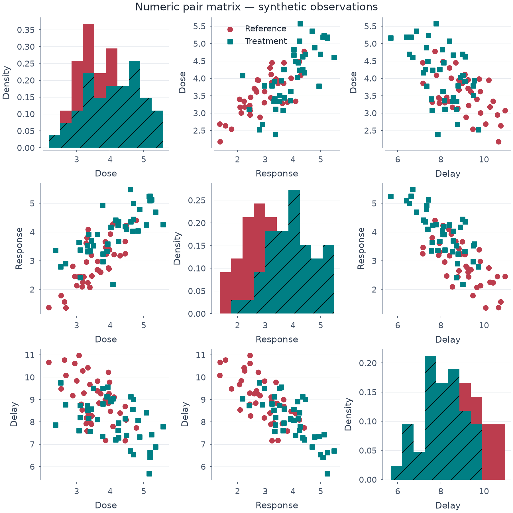

# Numeric pair grid와 이름 기반 값축 공유

*[English](PAIR_GRID.md)*

Pair-grid는산점도행렬과대각선histogram/KDE/ECDF를지원합니다. Seaborn의 모든
PairGrid/pairplot 동작과 동등한 구현은 아닙니다.



[편집 spec](images/pair_observations.mplot.json) ·
[SVG](images/pair_observations.svg) · [PDF](images/pair_observations.pdf) ·
[실행 코드](../examples/pair_observations.py)

80개 값은 독립 합성 관측입니다. 목표 검토 폭은 데스크톱 900px이며 임의의
모바일 축소판이나 접근성 인증이 아닙니다.

## 데이터에서 만든 뒤 셀별 편집

```python
p = (mp.plot(raw).theme("publication").legend(False)
       .pair(["Dose", "Response", "Delay"], group="condition", bins=10)
       .size(9, 9))
p.legend(location="upper left", panel=1)
```

`pair()`/`SetPairGrid`는 빈 기본 패널 하나에서 시작합니다. Figure의 theme/font/
size/suptitle/legend 설정은 유지하고 기존 layer/축 설정은 버리지 않고 오류로
처리합니다. 서로 다른 numeric 열 2..8개로 row-major 4..64패널을 만듭니다.
전체 크기는 자동으로 늘리지 않으므로 직접 지정하세요. 이후 편집은 panel index를
사용하며 범례 반복도 예제처럼 직접 숨길 수 있습니다.

- 대각선 밖은 raw scatter로 열 변수가 x, 행 변수가 y입니다.
- 대각선은 typed histogram이며 raw 그룹끼리 bin을 공유합니다.
- 정수 `bins`는 기존 histogram 상한을 따릅니다.
- `diag_stat`은 `count`/`density`/`probability`/`percent`입니다.
- 선택적인 범주형 `group`과 선택/예약 `hue_order`로 셀 사이 색/marker/hatch 자리를
  유지합니다. 빠진 그룹을 가짜 관측으로 만들지 않습니다.

## 설정 가능한 KDE 대각선

```python
p = (mp.plot(raw).pair(["Dose", "Response"], group="condition",
         diag_kind="kde", kde={"bw_adjust": 0.8, "gridsize": 128, "cut": 0})
       .size(7, 7))
```

[예제](images/kde_pair.png) · [편집 spec](images/kde_pair.mplot.json) ·
[소스](../examples/kde_grids.py). 변수별 단변량 관측을 그대로 사용하며 전체 열의
listwise 삭제로 바꾸지 않습니다. KDESpec의 bandwidth/grid/cut/clip/common_norm/
common_grid/fill을 검증하고 독립 복사합니다. KDE는 diag_stat='density', 사용하지
않는 기본 bins=20만 허용하고 weights/CDF는 거부합니다. 단일값/특이 그룹은 기존
경고/skip 규칙을 따르며 가짜 밀도를 만들지 않습니다. 유한 support·누락 질량으로
보이는 면적이 1이 아닐 수 있습니다. 같은 clip 설정이 모든 변수에 적용되므로 각
단위에 맞아야 합니다. Histogram 기본 동작은 바꾸지 않았습니다.

## 경험적누적대각선

```python
p = (mp.plot(raw).pair(["Dose", "Response"], group="condition",
       diag_kind="ecdf", diag_stat="percent").size(7, 7))
```

Count/probability(proportion)/percent를명시하고density는거절합니다. 미사용bins=20/KDEconfig생략을
유지하세요. 대각선은자기변수/group행만사용하며전체변수완전행으로줄이지않고곡선별정규화합니다.
반복값전체jump/최소값중복·질량0시작을보존하며가짜무한tail은없습니다. 누적질량y는측정값y와
공유하지않고weighted/complementarygrid옵션은미지원입니다. Hist기본은유지합니다.

## 전체 열 listwise 삭제가 아닌 쌍별 관측

원래 `FigureSpec.data`는 그대로입니다. 산점도 셀은 동적 `dropna=[x,y,group]`,
대각선은 해당 변수/group만 사용합니다(group 미사용 시 생략). 관계없는 열의
결측값 때문에 관측을 제거하지 않습니다.

따라서 대각선 표본 수가 변수 쌍의 표본 수보다 클 수 있습니다. 쌍 관측이 없는
셀은 비워 두고 유효한 단변량 관측은 대각선에 표시합니다. 사용할 numeric 관측이
전혀 없는 선택 변수는 오류입니다. Bool/범주/비유한 좌표는 거부하고 선택 밖
그룹은 좌표 검증 전에 제외합니다. 상관계수나 추론을 만들어 넣지 않습니다.

`SetData` 후 쌍 선택과 자동 표시 범위는 갱신합니다. 변수/group 종류는
materialized snapshot이므로 새 변수를 포함하려면 빈 템플릿에서 다시 구성합니다.

## Density와 측정값 축을 섞지 않기

`AxisSpec.share_id`는 primary Cartesian x/y의 이름 기반 공통 축입니다. Pair는
변수 열의 x와 **대각선 밖** 행의 y만 공유합니다. 대각선 histogram의 count/
density y는 측정값 y와 독립이고 고정된 데이터 범위 snapshot이 필요하지 않습니다.

```python
p.share_axis("y", "response", panel=1)
p.share_axis("y", "response", panel=2)
# share_axis(axis, None, panel=...)으로 이름을 지울 수 있습니다.
```

수동 공유는 `SetAxisShare`를 사용합니다. 해당 figure 전체 공유 mode는 `none`이어야
하며 scale/명시 limits 충돌은 검증에서 거부합니다. 보조축/polar/3-D 이름 공유도
미지원입니다. 예전 AxisSpec JSON은 `share_id=None`으로 열리며 이름이 없으면
기존 `share(x='all'|'row'|'col')` 동작은 그대로입니다.

## JSON/에디터와 제한

```json
{"type": "SetPairGrid", "columns": ["Dose", "Response", "Delay"],
 "group": "condition", "bins": 10, "diag_stat": "density"}
```

구성·검증·action 재생에는 optional numeric/render dependency가 필요 없습니다.
기존 에디터로 spec을 열고 셀 선택/label control과 SVG/PDF 내보내기를 사용할 수
있습니다. Corner/삼각 grid·continuous/semantic hue·weights·complementaryCDF·callable·
중첩 grid는 이번 범위 밖입니다. 새 workflow이지 layer 종류나 spec version을
추가한 것은 아닙니다.

```bash
uv run python -m examples.pair_observations
uv run pytest -q tests/test_pair_grid.py tests/test_joint_grid.py tests/test_facets.py
```

원래 행·쌍별 결측·대각선 단위 분리·공유 충돌·데이터 범위 갱신·group·잘못된 요청의
state 보존·예전 JSON·schema/editor/action 경로·PNG/PDF/SVG 재현성·global RNG
비사용을 검사합니다. 최종 배치 가독성은 별도 사람의 검토가 필요합니다.
