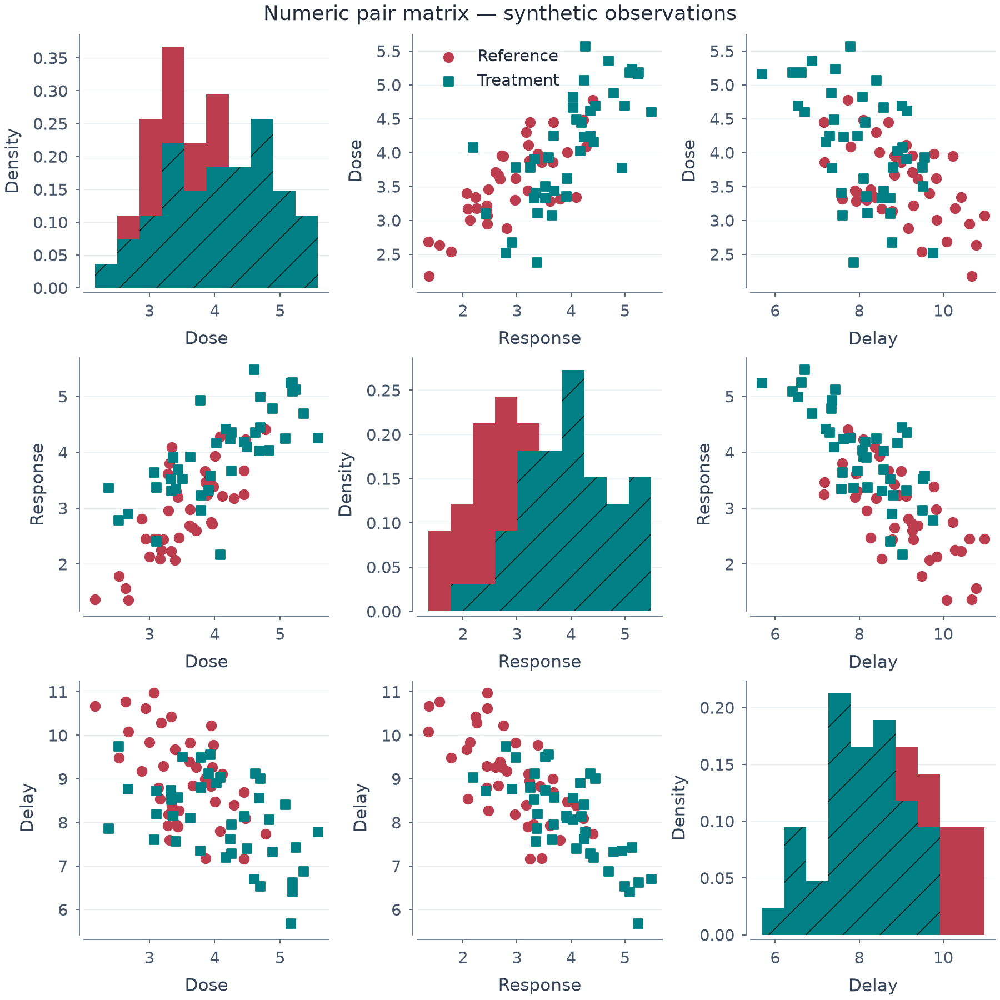

# Numeric pair grids and named value axes

*[한국어 / Korean](PAIR_GRID.ko.md)*

Pair grids use scatter off the diagonal and typed histogram/KDE/ECDF on the
diagonal. The full square remains the default; `corner=True` uses the lower triangle.



[Editable spec](images/pair_observations.mplot.json) ·
[SVG](images/pair_observations.svg) · [PDF](images/pair_observations.pdf) ·
[Source](../examples/pair_observations.py)

The 80 independent observations are synthetic; the example is reviewed at 900px
desktop width, not as an arbitrary mobile thumbnail or accessibility certificate.

## Explicit temporal variables

Numeric remains the default. Declare date variables with
`pair(columns, temporal={"time": {"timezone": "UTC"}})`; each map value is a
`TemporalSpec` or its strict dictionary form. The [temporal contract](TEMPORAL_AXES.md)
also covers explicit numeric unit/origin, cell-local missing rows and per-day
hist/KDE density. Density axes stay numeric; undeclared strings still reject.

## Construct from data, then edit cells

```python
p = (mp.plot(raw).theme("publication").legend(False)
       .pair(["Dose", "Response", "Delay"], group="condition", bins=10)
       .size(9, 9))
p.legend(location="upper left", panel=1)
```

`pair()` / `SetPairGrid` needs one empty default panel. Figure theme, font, size,
suptitle and legend settings remain; existing layers/axis settings are rejected
rather than discarded. Select 2..8 distinct numeric columns, creating 4..64
row-major panels. Size is not automatically multiplied. Later operations use
explicit panel indices. Legend repetition can be hidden as in the example.

- Off-diagonal cells are raw scatter: column variable on x, row variable on y.
- Diagonal cells are typed histograms with common bins across raw groups.
- Integer `bins` follows the existing histogram cap.
- `diag_stat` is `count`, `density`, `probability` or `percent`.
- Optional categorical `group` and selecting/reserving `hue_order` share stable
  colour/marker/hatch slots across cells. Missing groups add no false observations.

## Configured KDE diagonals

```python
p = (mp.plot(raw).pair(["Dose", "Response"], group="condition",
         diag_kind="kde", kde={"bw_adjust": 0.8, "gridsize": 128, "cut": 0})
       .size(7, 7))
```

[Example](images/kde_pair.png) · [Editable spec](images/kde_pair.mplot.json) ·
[Source](../examples/kde_grids.py). KDE uses each variable's univariate cohort,
not a new global listwise-deletion rule. All KDESpec bandwidth/grid/cut/clip/
common_norm/common_grid/fill controls are validated and independently copied.
KDE requires `diag_stat="density"` and unused default `bins=20`. It accepts
the same named `weights` column; use ECDF for cumulative mass.
Singular groups retain existing warning/skip semantics; no density is invented.
Finite support and skipped mass mean displayed area need not equal one. One clip
configuration applies to every variable, so choose bounds appropriate to their
units. Histogram remains the unchanged default.

## Empirical cumulative diagonals

```python
p = (mp.plot(raw).pair(["Dose", "Response"], group="condition",
       diag_kind="ecdf", diag_stat="percent").size(7, 7))
```

Choose count/probability(proportion)/percent explicitly; density is rejected. Keep
unused bins=20 and omit KDE config. Each diagonal uses only its own variable/group
rows, not complete cases across all variables, and normalizes per curve. Ties keep
their full jump and the ECDF includes a duplicated minimum/zero-mass start, without
infinite tail coordinates. Cumulative-mass y axes never share measurement-value y.
`complementary=True` draws strictly greater mass at each knot. `weights=`
selects one original nonnegative mass column. Histogram remains the default.

## Pairwise data is not global listwise deletion

The original `FigureSpec.data` remains intact. Each scatter panel uses dynamic
`dropna=[x,y,group]` selectors (group omitted when unused); a diagonal uses only
its variable/group. Missing unrelated columns never remove observations.

A diagonal can therefore include more observations than a corresponding pair.
Entirely empty bivariate cells remain empty while univariate diagonals can still
show valid data. A selected variable with no usable numeric observations is an
error. Bool/category/nonfinite coordinates fail; unselected groups are excluded
before coordinate validation. No correlation or inference is fabricated.

After `SetData`, pairwise cases and automatic display ranges refresh. Column and
group memberships remain materialized snapshots: rebuild from an empty template
to add variables/group levels.

### Weighted corners and typed roles

```python
p = (mp.plot(raw).size(11, 9)
     .pair(["Dose", "Response", "Delay"], corner=True, weights="Weight",
           semantics=mp.SemanticSpec(hue="Arm"),
           diag_kind="ecdf", diag_stat="probability", complementary=True))
```

See [weighted grid example](../examples/weighted_grids.py). The actual N13
placements are the lower `n(n+1)/2` cells in row-major order; the upper cells
have no axes. A cell remains editable when all its observations are missing.
The named semantic scope shares raw domains, not observations or statistical
axes. Scatter size is marker diameter; diagonal size is native stroke width.
Style is an actual glyph or native dash as allowed by the mark, not a dummy
scatter point. Use either `semantics=` or legacy `group=`/`hue_order=`.

Raw role orders and missingness are checked before clock/coordinate projection.
Missing or zero weights omit the physical row; selected nonfinite, negative or
Boolean weights fail. No normalization turns scatter weights into marker sizes.
Advanced panels save `grid_cohort: true` and the normal owner declarations, not
filtered columns or ID arrays. One scientific layer plus annotations is allowed;
replace the owner to change only that cell. Omitted options retain old behavior.

## Density is not a measurement-value axis

`AxisSpec.share_id` names explicit primary Cartesian x/y sharing groups. Pair
construction links x by variable column and y across **off-diagonal** row cells.
Diagonal histogram y axes are independent count/density units, never joined to
measurement y. No fixed data-range snapshots are needed.

```python
p.share_axis("y", "response", panel=1)
p.share_axis("y", "response", panel=2)
# share_axis(axis, None, panel=...) clears a name.
```

Manual named sharing uses `SetAxisShare`. The corresponding figure-wide sharing
mode must be `none`. Conflicting scales or explicit limits fail validation;
polar/3-D named groups are rejected. Joint's explicit mixed y2 link is separate.
Old AxisSpec JSON defaults to `share_id=None`. Existing `share(x='all'|'row'|'col')` is unchanged when names
are absent.

## JSON, editors and limits

```json
{"type": "SetPairGrid", "columns": ["Dose", "Response", "Delay"],
 "group": "condition", "bins": 10, "diag_stat": "density"}
```

Construction, validation and action replay require no optional numeric/render
dependencies. Specs open in the existing editors, with normal cell selection,
label controls and SVG/PDF exports. N13 adds public declarative
`pair(...).nest(...)` and complete outer placement with stable IDs; see
[layout contract](PANEL_LAYOUTS.md). No callback, new layer type or spec-version bump.

```bash
uv run python -m examples.pair_observations
uv run pytest -q tests/test_pair_grid.py tests/test_joint_grid.py tests/test_facets.py
```

Tests cover original rows, pairwise missingness, independent diagonal units,
named conflicts, live data ranges, grouping, rejected inputs without state loss,
old JSON defaults, schema/editor/action paths and repeatable PNG/PDF/SVG without
using global RNG. Final layout readability still needs human review.
