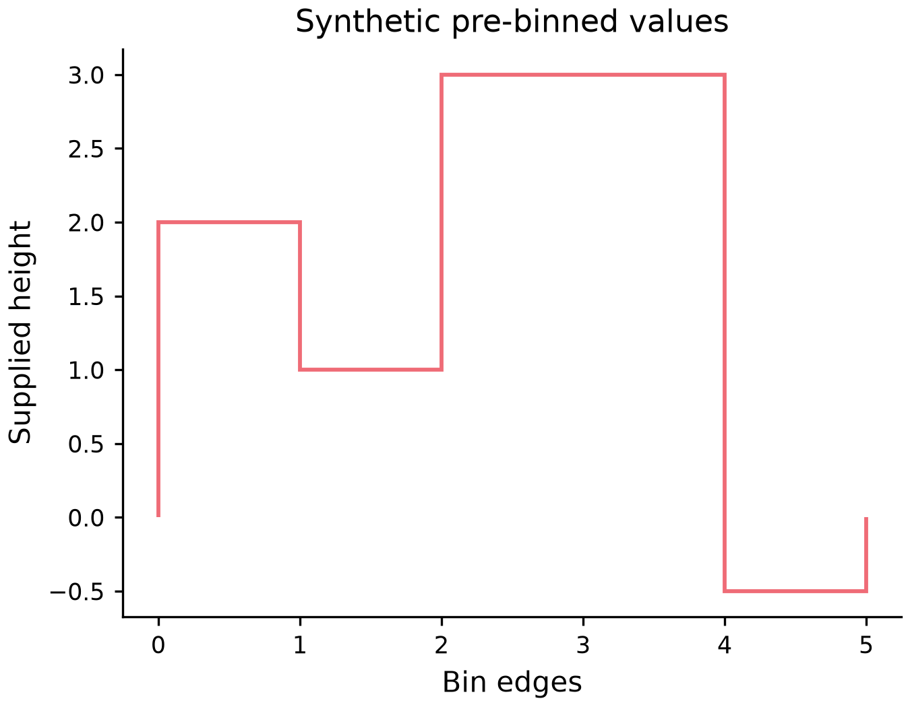

# 주어진높이의 stairs

*[English](STAIRS.md)*



[실행source](../examples/plots/stairs.py) · [편집spec](images/plots/stairs.mplot.json)

```python
p = (mp.plot({"height": [2, -1, 3]})
       .stairs("height", [0, 1, 3, 4], baseline=0)
       .labels(x="Bin edges", y="Supplied height"))
```

이미계산된높이이며다시histogram추정할관측이아닙니다. Sorting/정규화/rebinning/보간은없고
N높이에N+1유한·엄격증가edge/유한양수폭이필요합니다. 원본table은N행으로유지하고기존
LayerSpec.x는높이열,LayerSpec.bins는edge설정입니다. Edge는열이아니므로축단위이름을명시하세요.
원본/edge/JSON/actions·SetData를보존하며높이개수가달라지면맞는edge도명시수정해야합니다.

첫범위는linearCartesianprimary/y2축의수직unfilledoutline입니다. Bool/결측/범주가아닌
1..10,000유한높이가필요합니다. Baseline은기존유한rawscalar필드/기본0이며rawJSONNone도
open이아닌0입니다. 음수높이/baseline은가능하고colour/dash/alpha·유한[0,1000]line_width와
명시0을보존합니다. 성공Figure는호출자가소유하므로close해야합니다.

Horizontal/fill/open-baseline/log/polar/3D/group/semantic/weight/facet/dropna는미지원이며
지원하지않는nondefault필드는조용히무시하지않습니다. 자원상한은전체CPU/RAM/sandbox보장이나
독립사람가독성/AT인증이아닙니다. 기존rawaction에새필드없이구성합니다.

```json
{"type":"AddLayer","layer":{"type":"stairs","x":"height","bins":[0,1,3,4],"baseline":0}}
```
