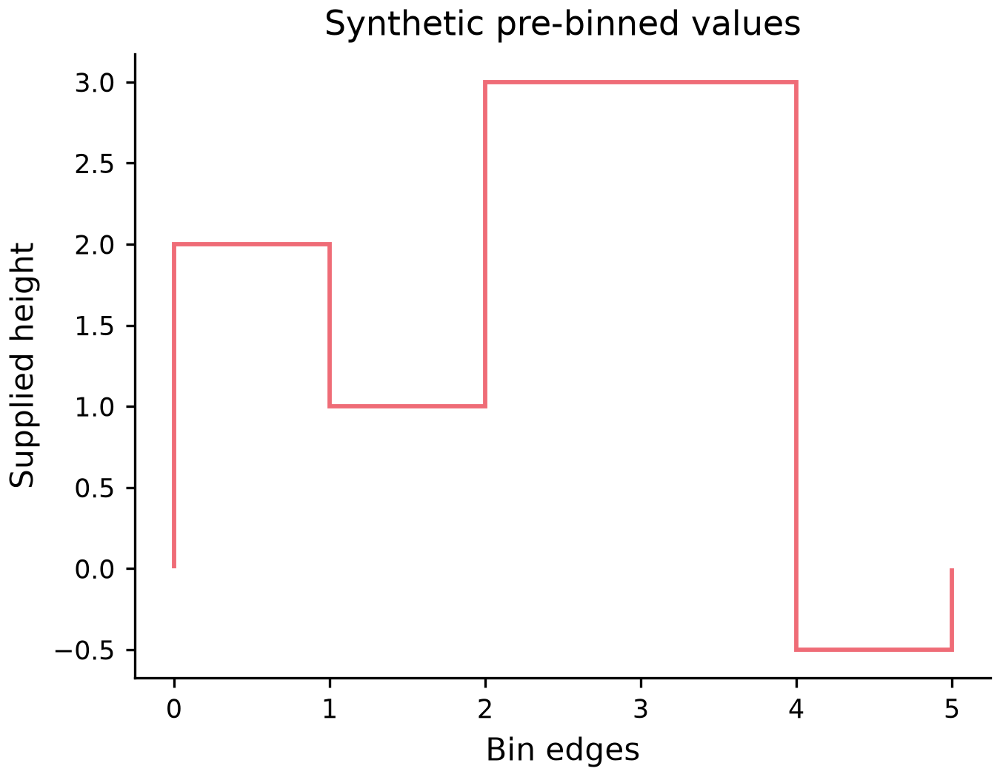

# 주어진 높이로 그리는 계단 플롯

*[English](STAIRS.md)*



[실행source](../examples/plots/stairs.py) · [편집spec](images/plots/stairs.mplot.json)

```python
p = (mp.plot({"height": [2, -1, 3]})
       .stairs("height", [0, 1, 3, 4], baseline=0)
       .labels(x="Bin edges", y="Supplied height"))
```

높이 열은 다시 히스토그램으로 계산할 관측값이 아니라 **이미 계산한 값**입니다.
기본 호출은 N개 높이와 유한한 양의 폭을 가진 N+1개 오름차순 경계를 사용합니다.
기본 축 또는 활성화한 `axis="y2"`에 채우지 않은 수직 윤곽을 그립니다.
`baseline` 생략이나 JSON `null`은 0이며 선형 축에서는 음수도 허용합니다.

`stairs=mp.StairsSpec(fill=True)`는 기준선까지 채웁니다. `open=True`는
기준선과 양 끝의 선분을 그리지 않으며 채우기 또는 0이 아닌 기준선과 함께
쓸 수 없습니다. 로그 축에서 실제 그리는 좌표는 모두 양수여야 하며,
그리는 기준선도 예외가 아닙니다. Symlog, asinh, logit에는 각 축의 범위
규칙을 적용합니다. 날짜 X의 경계는 벡터마다 ISO 문자열 또는 UTC 1970 기준 일
좌표로 지정합니다. 날짜 Y/Y2에는 제공된 날짜 높이를 사용할 수 있고 숫자
기준선의 단위는 절대 일 좌표입니다.

`group`과 `hue_order`는 그룹의 선택과 색 순서를 정합니다. 고정·라이브
패싯은 원본 표의 0부터 시작하는 행 번호를 구간 ID로 사용합니다. 여러 그룹이
공통 격자의 같은 구간에 각자의 높이를 갖는 경우 `bin_index="slot"`을
지정합니다. 한 그룹 안에서 같은 구간의 높이를 중복 지정할 수 없습니다.
빈 구간을 연결하거나 채우지 않으며 예약된 빈 그룹·패널은 아무것도 그리지
않습니다. `SetData`는 고정 선택자와 원래 저장 방식을 유지합니다.

`StairsRebinSpec(edges=[0, 1, 3, 5], measure="mass")`는 `[0, 2, 5]`에
주어진 질량 `[4, 9]`를 `[2, 5, 6]`으로 재구간화합니다. 구간 내 질량은
균등하다고 가정합니다. `measure="density"`는 적분을 보존하며 날짜 X에서는
일당 밀도입니다. 양쪽 끝 경계가 정확히 같고 비어 있지 않은 각 그룹에 모든
원본 구간이 있어야 합니다. 재구간화할 높이는 유한한 음이 아닌 물리량이며
날짜는 사용할 수 없습니다. 최종 반올림 전까지 정확하게 계산하고, 범위를
넘거나 양수가 0으로 사라지는 결과는 거부합니다. 원본/선택 높이와 산출
높이는 그룹 전체에 각각 10,000개 상한을 적용합니다.

[PNG/SVG/PDF 실행 예제](../examples/stairs_workflow.py)를 참고하세요.
가로 방향, 통계 추정, 가중치, 의미 매핑은 지원하지 않습니다. 반환된 Figure는
호출자가 닫아야 합니다. 기존 AddLayer 액션에 옵션을 지정할 수 있습니다.

```json
{"type":"AddLayer","layer":{"type":"stairs","x":"height","bins":[0,2,5],"stairs":{"rebin":{"edges":[0,1,3,5],"measure":"mass"}}}}
```
