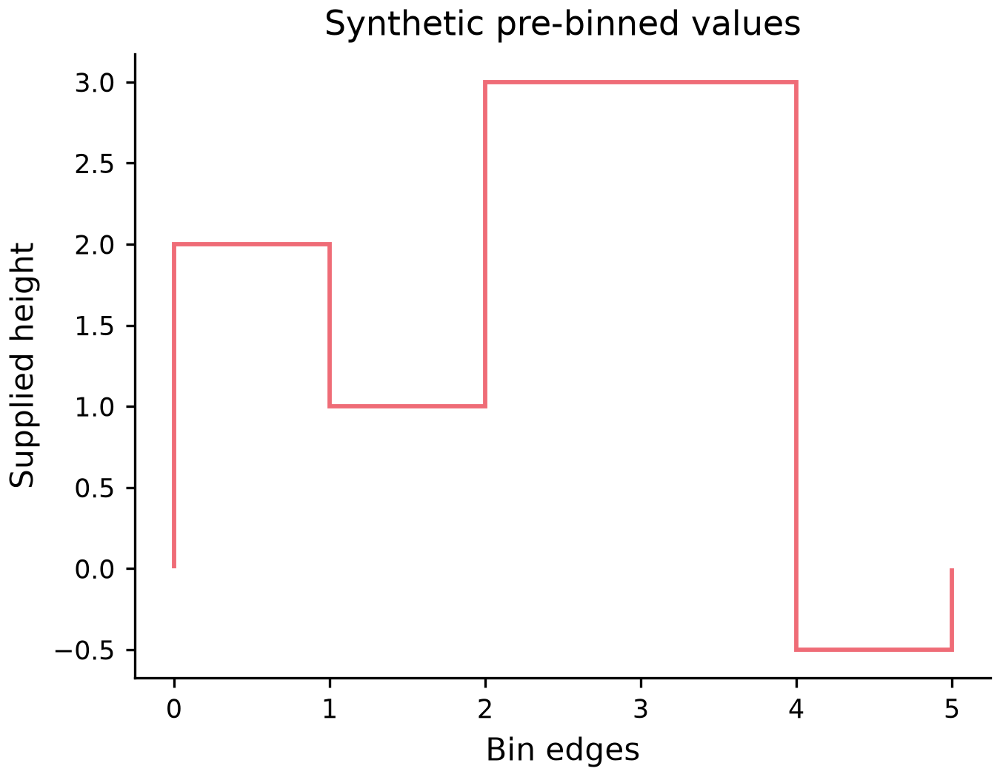

# Supplied-height stairs

*[한국어 / Korean](STAIRS.ko.md)*



[Executable source](../examples/plots/stairs.py) ·
[Editable spec](images/plots/stairs.mplot.json)

```python
p = (mp.plot({"height": [2, -1, 3]})
       .stairs("height", [0, 1, 3, 4], baseline=0)
       .labels(x="Bin edges", y="Supplied height"))
```

The height column supplies **already computed values**, not observations to
histogram again. A plain aligned call uses N heights and N+1 finite, strictly
increasing edges with representable widths. It draws an unfilled vertical
outline on the primary or enabled `axis="y2"` axis. Omitted or null `baseline`
means raw zero. Signed ordinary heights and baselines remain valid on linear
axes.

Use `stairs=mp.StairsSpec(fill=True)` to fill to a raw baseline, or
`stairs=mp.StairsSpec(open=True)` to omit the baseline and its end segments.
Open stairs cannot be filled or use a nonzero baseline. On a log axis the
drawn coordinates must be strictly positive, including the value baseline
when present. Symlog, asinh and logit follow their native axis domains.
Declare a date X axis to use ISO or literal canonical-day edges; do not mix
the two within one vector. A date Y/Y2 axis may use supplied date heights.
Its scalar baseline is a raw UTC-1970 day coordinate, not a clock offset.

`group` and typed `hue_order` select and reserve colours. On fixed or live
facets, selected rows keep their original zero-based table index as bin ID.
Use `bin_index="slot"` for separate heights on an interleaved common grid.
A selected group cannot contain the same bin twice. Supplied gaps split the
path; empty reserved groups or panels draw nothing. `SetData` preserves the
fixed selectors, and no derived geometry replaces the saved source.

`StairsRebinSpec(edges=[0, 1, 3, 5], measure="mass")` conservatively rebins
source masses `[4, 9]` on `[0, 2, 5]` to `[2, 5, 6]`. Each mass is uniform
within its source bin. Use `measure="density"` to conserve the integral and
keep the output in density units, including per day on date X. The source and
target must have exactly the same outer endpoints, with complete source
support for each nonempty group. Rebin heights must be finite and nonnegative
physical quantities, not dates. Arithmetic is exact before the final rounding;
overflow and a positive result rounded to zero are errors. Source bins/selected
heights and total derived heights are each bounded at 10,000, not per group.

See the [runnable PNG/SVG/PDF example](../examples/stairs_workflow.py).
No horizontal geometry, estimator, weights or semantic mappings. Successful
figures remain caller-owned. The existing AddLayer action accepts the options:

```json
{"type":"AddLayer","layer":{"type":"stairs","x":"height","bins":[0,2,5],"stairs":{"rebin":{"edges":[0,1,3,5],"measure":"mass"}}}}
```
