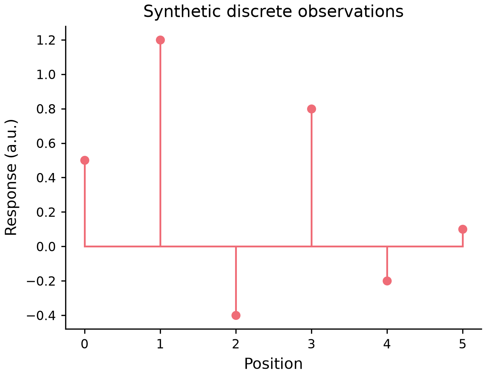

# 수직 numeric stem plot

*[English](STEM.md)*



[실행예제](../examples/plots/stem.py) · [편집spec](images/plots/stem.mplot.json) ·
[SVG](images/stem.svg) · [PDF](images/stem.pdf)

```python
p = (mp.plot({"x": [2, 1, 2], "y": [3, -1, 4]})
       .stem("x", "y", baseline=0, marker="o", marker_size=5, line_width=1.2)
       .labels(x="Position", y="Response"))
```

첫범위는primaryCartesian/y2의수직numericstem입니다. 행마다marker와rawscalarbaseline부터y까지의
segment를만들고원본순서/반복위치/linear음수/원자료를보존합니다. Sorting/binning/집계/추론구간은없고
SetData뒤artist를갱신하며오래된파생segment를저장하지않습니다.

Baseline은기존LayerSpec필드이며기본0(rawJSON의None도0)입니다. Logx는양수위치,log응답축은
head와baseline모두양수여야하고epsilon대체는없습니다. X/y/baseline은bool이아닌유한숫자이며
1..10,000행을지원합니다. 결측은조용히버리지않고거절합니다. 명시markersize0을보존하며명시설정
marker_size/line_width는유한[0,1000]입니다. 색/alpha/dash는stem·baseline에일관적용하고markershape/
size는head를설정합니다. 성공시반환Figure는호출자가소유하므로사용후close해야합니다.

Horizontal/group/hue/semantic/weight/facet·dropna/polar·3D/colorbar/다른layer옵션은명시미지원입니다.
자원상한은전체CPU/RAM/sandbox보장이아니며합성예제는실험값이나독립사람가독성/AT인증이아닙니다.
기존AddLayer/JSON/editorrawaction경로를사용합니다.

```json
{"type":"AddLayer","layer":{"type":"stem","x":"x","y":"y","baseline":0}}
```
