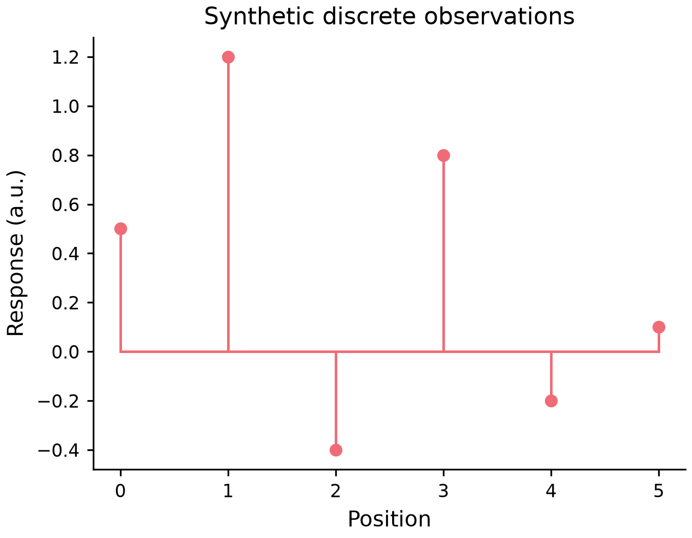

# 원본 관측값을 그리는 스템 플롯

*[English](STEM.md)*



[실행예제](../examples/plots/stem.py) · [편집spec](images/plots/stem.mplot.json) ·
[SVG](images/stem.svg) · [PDF](images/stem.pdf)

```python
p = (mp.plot({"x": [2, 1, 2], "y": [3, -1, 4]})
       .stem("x", "y", baseline=0, marker="o", marker_size=5, line_width=1.2)
       .labels(x="Position", y="Response"))
```

`x`는 위치 열, `y`는 끝점 값 열입니다. 기본 `orient="v"`는 X에 위치,
Y에 값을 표시합니다. `orient="h"`는 Y에 위치, X에 값을 표시합니다.
`axis="y2"`를 쓰면 `.secondary_yaxis(...)`로 활성화한 실제 Y2를 Y 대신
사용합니다. 입력 순서와 중복 위치를 보존하며 집계, 구간화, 위치 이동은
하지 않습니다. `SetData`는 원본 열을 교체하고 파생 기하를 저장하지 않습니다.

`baseline`의 생략 또는 JSON `null`은 0입니다. 로그 위치 축에서는 위치가,
로그 값 축에서는 끝점과 기준선이 모두 양수여야 합니다. 날짜 축은 명시적으로
선택한 선형 축입니다. 날짜 값 축의 기준선은 입력 단위나 원점 오프셋이 아닌
UTC 1970 기준의 절대 일 좌표입니다. 선택된 좌표의 결측은 자동 제거하지 않습니다.

`group`과 `hue_order`는 그룹과 순서를 지정합니다. `.facet(...)`와 라이브
패싯은 고정 선택자를 사용하며, 비어 있는 그룹이나 패널에는 가짜 스템이나
기준선을 그리지 않습니다. 각 스템 뷰의 선택된 관측값 상한은 10,000개입니다.

기존 `SemanticSpec`은 색, **포인트 단위 스템 선 두께**, 끝점 마커 모양과
선택적 스템 점선을 매핑합니다. 색은 선과 끝점에 함께 적용합니다. `marker_size`는
끝점 지름이며 매핑된 두께와 별개입니다. 매핑된 두께와 `line_width`를 함께 쓸 수
없습니다. `group`은 크기·스타일과 병용할 수 있지만 매핑된 색과는 함께 쓸 수
없습니다. 그룹 또는 매핑을 사용해도 기준선은 하나이며 고정 설정을 따릅니다.
연속 색상표와 공유 범례는 기존 범위 설정을 사용합니다.
[수평 예제](../examples/stem_workflow.py)를 참고하세요.

극좌표·3D, 가중치 및 추정은 지원하지 않습니다. 반환된 Figure는 호출자가
닫아야 합니다. 기존 AddLayer/JSON/editor 액션 경로를 이어서 사용합니다.

```json
{"type":"AddLayer","layer":{"type":"stem","x":"x","y":"y","baseline":0}}
```
