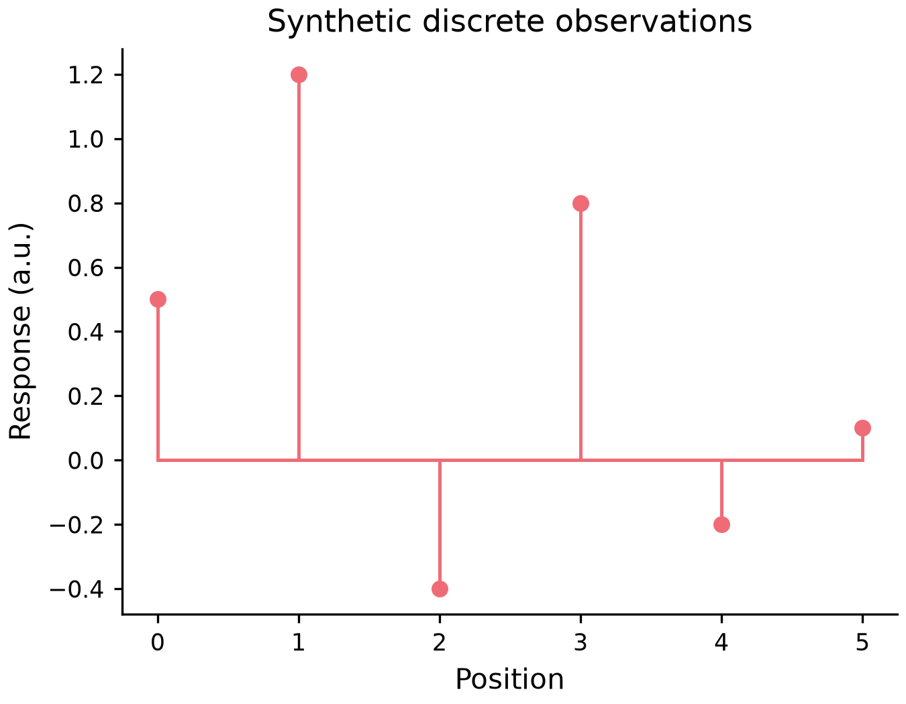

# Stem plots from supplied observations

*[한국어 / Korean](STEM.ko.md)*



[Executable example](../examples/plots/stem.py) ·
[Editable spec](images/plots/stem.mplot.json) ·
[SVG](images/stem.svg) · [PDF](images/stem.pdf)

```python
p = (mp.plot({"x": [2, 1, 2], "y": [3, -1, 4]})
       .stem("x", "y", baseline=0, marker="o", marker_size=5, line_width=1.2)
       .labels(x="Position", y="Response"))
```

`x` names the location column and `y` the head-value column. The default `orient="v"`
draws positions on X and values on Y (or Y2 with `axis="y2"`). With `orient="h"`,
locations instead use the actual Y or Y2 axis and values use X. Enable Y2 with
`.secondary_yaxis(...)`. The segment runs from the literal baseline to its head:
repeated positions and source order survive, with no binning, aggregation,
dodge or jitter. `SetData` changes the observations, not the saved geometry.

`baseline` is a raw scalar; omission or JSON `null` means zero. A log location
axis requires positive positions; a log value axis requires positive heads and
baseline. Date axes are explicit and linear. A baseline on a date-valued axis is
an absolute UTC-1970 day coordinate, not a numeric input-unit or origin offset.
Selected coordinates must be finite; missing coordinates are not silently dropped.

`group` splits colour and `hue_order` can fix typed levels. `.facet(...)` and live
facet templates use fixed row selectors. Reserved empty groups/cells draw no
stems or baseline. Up to 10,000 selected observations are supported per stem
view; groups do not increase this limit.

Use the existing `SemanticSpec` for categorical or numeric hue, stroke size in
**points**, and head-marker style with optional stem dashes. Hue colours both
stems and heads. `marker_size` still controls head diameter; `line_width` may not
compete with mapped size. Raw `group` may accompany size/style, but not mapped
hue. Grouped/mapped views have one baseline in the fixed explicit colour or a
neutral default, independent of mapped traits. Numeric hue uses the existing
colourbar and named guide scopes. See the [horizontal example](../examples/stem_workflow.py).

Polar/3-D, weighting and estimates are unsupported. Successful figures remain
caller-owned. The existing AddLayer/JSON/editor action route is unchanged:

```json
{"type":"AddLayer","layer":{"type":"stem","x":"x","y":"y","baseline":0}}
```
