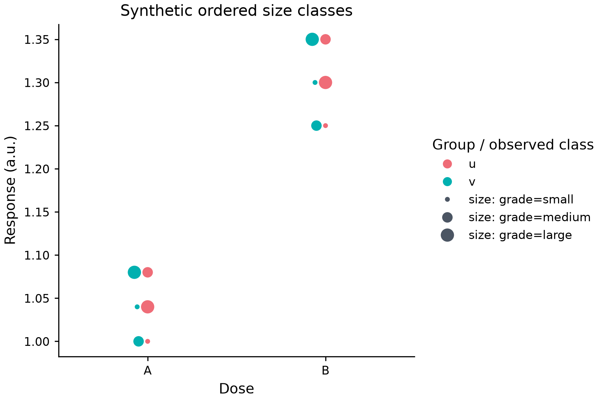

# Categorical size-only swarm

*[English](SWARM_CATEGORICAL_SIZE.md)* · [Numeric size](SWARM_SIZE.ko.md)



[실행source](../examples/swarm_categorical_size.py) · [편집spec](images/swarm_categorical_size.mplot.json)

```python
p = mp.plot(data).swarmplot(
    "category", "response", group="group", dodge=0,
    semantics={"size": "grade", "size_kind": "categorical",
               "size_order": ["small", "reserved", "medium", "large"],
               "sizes": [4, 10]},
)
```

기존SemanticSpec의categorical size는rank이지count/weight/추정된ordinal의미가아닙니다.
Size_order가없으면선택level의최초관측순서를유지하며사전/숫자순정렬은없습니다. 명시order는
행을선택하고미관측level도rank를예약합니다. 위small/reserved/medium/large지름은4/6/8/10pt이고
미관측reserved는guide/가짜관측을만들지않습니다. Domain한level은중간지름입니다.

Scatter/line과동일typedcategorykey/rankfraction을재사용하고bool과numeric은서로선택하지않습니다.
유한scalar/빈문자열아닌문자에서최대64개고유하고표시상명확한label이필요합니다. Malformedcategory를
sizeorder로숨기지않으며결측은category/value/group/size동일cohort에서제외합니다. 원본action/JSON행은유지합니다.

지름을Matplotlib면적pt²로제곱하고보정된개별반지름packing을사용합니다. Guide도동일rank/domain으로
만들며관측좌표/group인용·URL이없습니다. Group색은관측만표시하고non-dodged일때함께packing합니다.
Legend=False는크기guide만생략하고mapping은유지합니다. Numeric의clipping/중간값경로는변경하지않고
categorical에numeric size_norm을주면거절합니다.

[전체 C02 workflow](SWARM_FACETS.ko.md)는 숫자/범주 공유 hue/size·실제 named style
glyph·날짜·v/h/y2·명시 cross-layer packing/live template 편집을 지원합니다.
[Named size](SWARM_SHARED_SIZE.ko.md)는 기존 다른 point/curve 계열과 rank를 공유하고
mark별 물리 단위를 구분합니다. Scalar marker_size와 mapped size 충돌은 계속 거부합니다.
선택 뒤 layer별 2,000행 상한은 그대로이며 새 named 연산은 그린 instance를 중복 제거하지
않고 4,000개로 제한합니다. 양수 면적 표현 불가는 artist 전에 실패하며 epsilon/원본 강제
변환/의존성 변경은 없습니다. Figure는 호출자가 close하며 합성 preview나 행 상한을
사람 접근성/전체 CPU·RAM 보장으로 부르지 않습니다.
