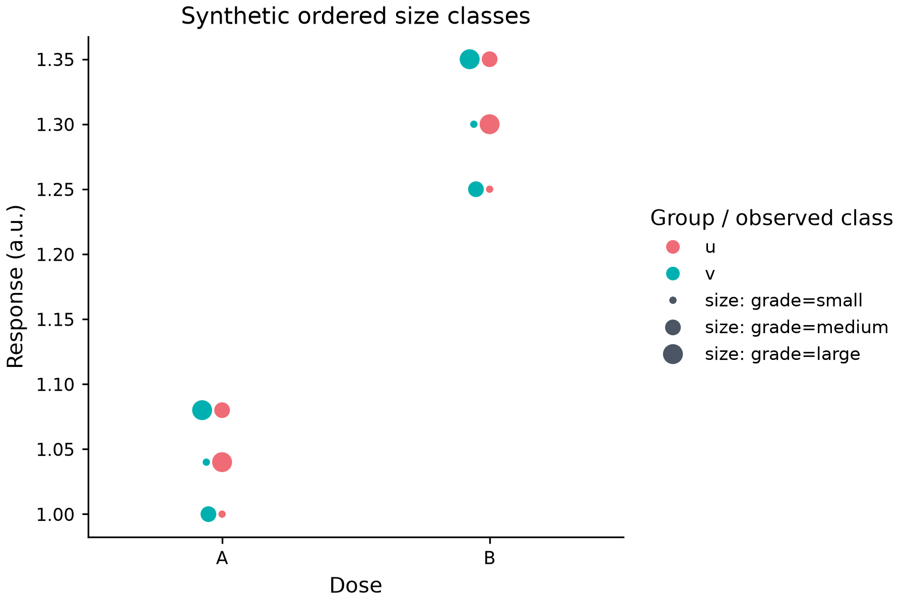

# Categorical size-only swarm

*[한국어 / Korean](SWARM_CATEGORICAL_SIZE.ko.md)* · [Numeric sizes](SWARM_SIZE.md)



[Executable source](../examples/swarm_categorical_size.py) ·
[Editable spec](images/swarm_categorical_size.mplot.json)

```python
p = mp.plot(data).swarmplot(
    "category", "response", group="group", dodge=0,
    semantics={"size": "grade", "size_kind": "categorical",
               "size_order": ["small", "reserved", "medium", "large"],
               "sizes": [4, 10]},
)
```

The existing SemanticSpec adds categorical size ranks, not counts, weights or
an inferred ordinal meaning. Without size_order, selected levels retain their
first-observed order, not alphabetical/numeric sorting. An explicit order selects
rows and reserves each rank even when that level is absent. The example maps
small/reserved/medium/large to diameters4/6/8/10pt; the absent reserved level
gets no guide or fake observation. A one-level domain uses the midpoint diameter.

Reuse the same typed category keys and rank fractions as scatter/line semantics.
Booleans and numeric categories do not select one another. Allow at most64 unique,
unambiguous visible labels from nonempty strings or finite scalars. Malformed
categories are not hidden by an explicit size order; missing rows still drop with
the category/value/group/size cohort. Source/action/JSON rows are not rewritten.

Actual sizes are squared to Matplotlib pt² and use the calibrated per-point
packing. Guides use the same rank/domain and have no data coordinates or group
URLs/citations. Colour groups stay observed-only and pack jointly when not dodged.
Legend=False removes size guides, not mapping. Existing clipping/midpoint behavior
for numeric size is unchanged; numeric size_norm is invalid for categorical size.

Single primary Cartesian layers only: semantic hue/style, dates, y2, facet/dropna,
named/shared scales and simultaneous scalar marker_size are still rejected.
The2,000-usable-row limit applies after explicit row selection. Nonrepresentable
positive areas fail before artists; no epsilon or source coercion. No model/action/
spec fields or dependencies are added. Successful Figures remain caller-owned.

Raw JSON is preserved by both editors; dedicated controls and independent human
readability/AT certification are not claimed. Resource bounds are not a total
CPU/RAM/sandbox guarantee. Broader style/date/facet semantics remain open.
