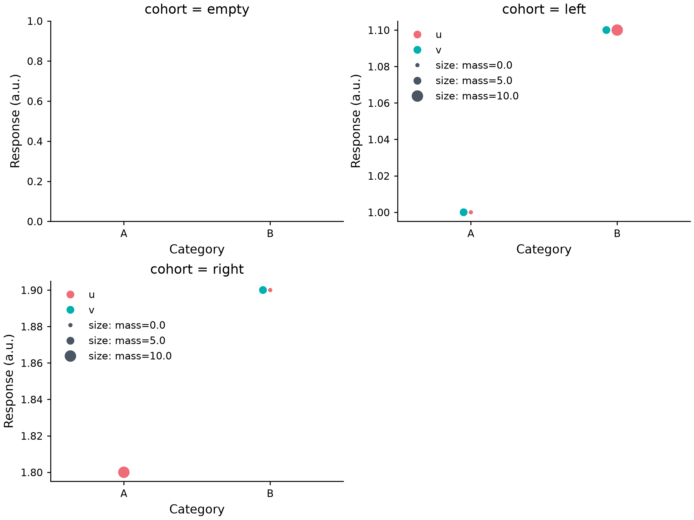

# Swarm facets and empty cells

*[한국어 / Korean](SWARM_FACETS.ko.md)* · [Size mapping](SWARM_SIZE.md) · [Named sizes](SWARM_SHARED_SIZE.md)



[Executable source](../examples/swarm_facets.py) · [Editable spec](images/swarm_facets.mplot.json)

```python
p = (mp.plot(data)
     .swarmplot("category", "response", group="group", dodge=0,
                semantics={"size": "mass"})
     .facet(col="cohort", col_order=["empty", "left", "right"], col_wrap=2))
```

Existing facet materialization freezes explicit cells, category/hue slots and
source-row filters. Scalar circles or numeric/categorical size mappings are
supported on primary Cartesian axes. Sized facets automatically receive a shared
size scale ID, so the selected original-row union defines bounds/ranks, not a
separate normalization for each cell. Missing size drops in the same local cohort;
source rows, values, JSON/actions and existing filter fields are not rewritten.

An explicitly filtered empty cohort is **frame-only**: no SwarmCollection, marker,
observed group proxy or size guide. Known frozen category slots remain; unknown
categories are not invented. A reserved-only semantic grid does not normalize an
empty numeric domain. Plain unfiltered empty/all-missing Swarm still rejects.
Explicit panel dropna uses the same selection contract; unknown columns reject.

Empty first layers do not consume a named guide that belongs to a later populated
member. Reserved group colour slots still behave consistently. Guides in nonempty
cells use the pooled size domain; local observations/URLs and group colours stay
local. SetData can fill a reserved cell and empty it again without changing its
materialized filters/panels. New category/facet levels are not automatically added;
update explicit orders or rematerialize deliberately.

Empty cells still validate options, columns, native scales, widths/dodge and
representable declared sizes. Numeric native/log categories, orientation, log
values, DPI and redraw retain their existing calibrated geometry. Per-layer2,000
usable rows, named pooled10,000 distinct rows,64 size levels,64 facet cells and the
existing total-layer expansion limit remain. Invalid expansion is atomic.

No new model/action/spec fields, dependencies or versions are required. Both
editors preserve raw filtered JSON, with metadata edits/undo-redo/cache tested;
dedicated facet/size controls are not claimed. y2, semantic hue/style/date,
arbitrary markers and mixed-family shared IDs remain rejected. Empty behavior for
other plot families is not changed by this Swarm-specific validation path.

Successful Figures are caller-owned and must be closed. Synthetic preview review
is not independent human readability/AT certification or a total CPU/RAM/sandbox
guarantee. This is explicit materialization, not a new live template mapper.
