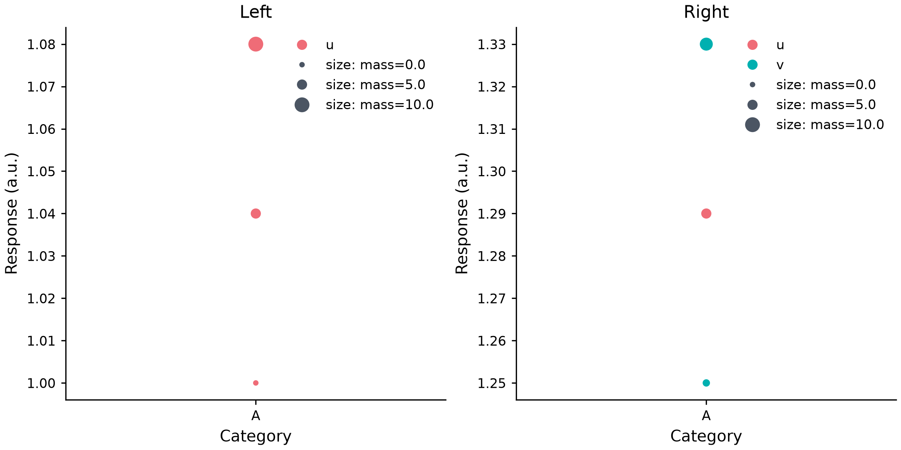

# Named shared Swarm sizes

*[English](SWARM_SHARED_SIZE.md)* · [Numeric](SWARM_SIZE.ko.md) · [Categorical](SWARM_CATEGORICAL_SIZE.ko.md)



[실행source](../examples/swarm_shared_size.py) · [편집spec](images/swarm_shared_size.mplot.json)

```python
p.swarmplot("category", "left", panel=0,
            semantics={"size": "mass", "scale_id": "shared_mass"})
p.swarmplot("category", "right", panel=1,
            semantics={"size": "mass", "scale_id": "shared_mass"})
```

위 size-only 설정은 **크기 mapping만** 공유하며 관측/좌표/인용이나 cross-layer 충돌 보장을 공유하지 않습니다.
각member의category/value/group/size결측cohort와명시선택은유지하고원본rowID를union/중복제거/
source순으로정렬합니다. Mass0/5/10의left[0,10],right[5,10]은기본지름3..9에서area가각각[9,81]/[36,81]이고
독립정규화right[9,81]이아닙니다.

Numeric bounds/categorical rank는pooled선택행을사용합니다. Categorical은source최초순서나동일명시order와
예약slot을사용하고guide는로컬에없어도pooled관측level을표시하되관측좌표/groupURL을만들지않습니다.
Panel마다named domain의sizeguide는한번이고앞memberlegend=False가뒤enabledguide를숨기지않습니다.
Group색guide는로컬관측그대로이며shared semantic hue로바뀌지않습니다.

Scale_id/legend 외 semantic 설정은 같아야 하며 충돌은 실패합니다. C02는 scatter/
lineplot/strip/ECDF/rug와 호환 domain을 공유하고 mark별 지름/stroke points 단위를
구분합니다. 이름 없는 로컬 동작은 유지합니다. Layer별 2,000행·pooled 고유 10,000행·
64개 범주와 실제 Swarm 행의 pooled area underflow를 artist 전에 검증합니다.

[전체 C02 계약](SWARM_FACETS.ko.md)은 hue/style/named glyph·날짜/y2·명시 pack_scope·
명시 live-template 편집을 지원합니다. 매핑 ID 공유만으로 packing을 합치지 않습니다.
선택 빈 cell은 관측/guide 없는 frame이고 빈 입력은 지원하지만 비어 있지 않은 전체 결측
입력은 거부합니다. Scalar marker_size와 mapped size의 충돌도 계속 거부합니다.
기존 생략 기본값/JSON을 보존하고 선택 scope/live 필드에 의존성·버전 변경은 없습니다.

성공Figure는호출자가close하고합성예제는독립사람가독성/AT인증이아닙니다. 행상한은전체CPU/RAM/sandbox
보장이아니며더넓은shared/facet계약은별도작업입니다.
