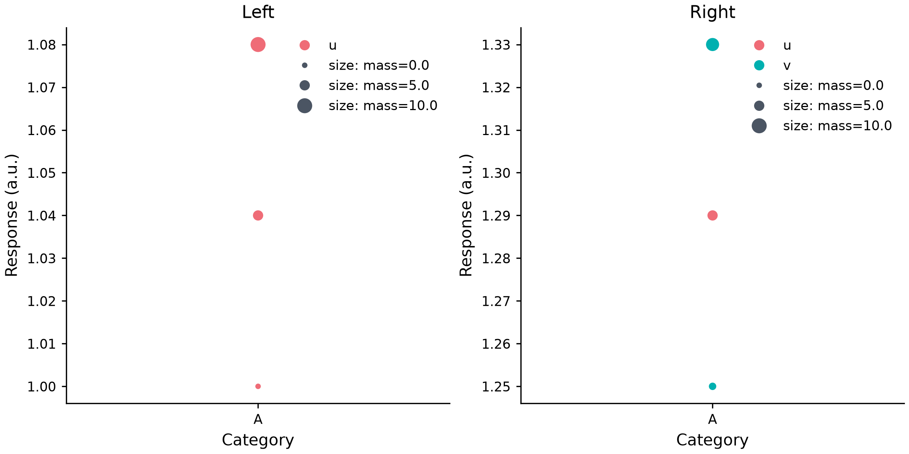

# Named shared Swarm sizes

*[한국어 / Korean](SWARM_SHARED_SIZE.ko.md)* · [Numeric](SWARM_SIZE.md) · [Categorical](SWARM_CATEGORICAL_SIZE.md)



[Executable source](../examples/swarm_shared_size.py) · [Editable spec](images/swarm_shared_size.mplot.json)

```python
p.swarmplot("category", "left", panel=0,
            semantics={"size": "mass", "scale_id": "shared_mass"})
p.swarmplot("category", "right", panel=1,
            semantics={"size": "mass", "scale_id": "shared_mass"})
```

The size-only configuration above shares **only size mapping**, not observations,
positions, references or a cross-layer collision guarantee. Each member keeps its
own category/value/group/size missing cohort and explicit row selections. Their
original source row IDs are unioned, deduplicated and ordered by the source table.
For masses0/5/10 split across left[0,10] and right[5,10], default sizes3..9 produce
areas left[9,81], right[36,81], not independent right[9,81].

Numeric bounds or categorical ranks use the pooled selected rows. Categorical
order is source order or the identical explicit order, including reserved slots.
Guides show pooled-observed levels, even if absent locally, without fake data
coordinates or group URLs. One size guide appears per named domain per panel;
legend=False on an earlier member does not hide a later enabled guide. Group
colour guides stay local/observed and do not become shared semantic hue mappings.

Members require identical semantic settings except scale_id/legend. Conflicting
settings fail. C02 permits compatible mixed-family domains with scatter, lineplot,
strip, ECDF and rug; physical point values retain their documented mark-specific
diameter versus stroke meaning. Unnamed local behavior remains.
Per-layer2,000 usable rows, independent pooled10,000 unique rows and64 unambiguous
categorical levels are validated before artists. Pooled area underflow is checked
by pure validation, preserving an existing output on failure.

[C02's full contract](SWARM_FACETS.md) adds hue/style/named glyphs, dates/y2,
explicit pack_scope and explicit live-template edits. Sharing a mapping ID alone
does not join packing. Selected empty cells are frames without observations or
guides; literal empty input is supported, while nonempty all-missing unselected
input rejects. Scalar marker_size still conflicts with mapped size.

Source JSON and old omitted defaults remain readable. New optional scope/live
fields do not add dependencies or change versions. Both editors retain generic
JSON forms; no independent human readability/AT certification or total CPU/RAM/
sandbox guarantee is claimed. Wider F01/G01/REL01 remain separate.
