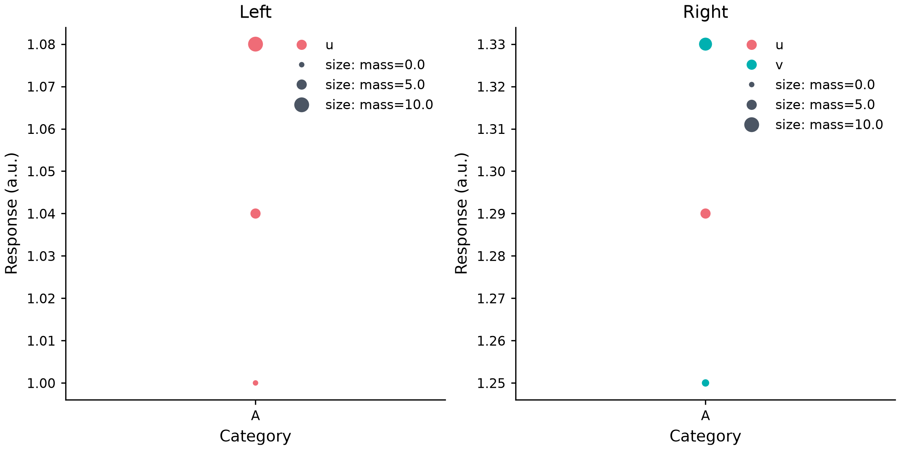

# Named shared Swarm sizes

*[한국어 / Korean](SWARM_SHARED_SIZE.ko.md)* · [Numeric](SWARM_SIZE.md) · [Categorical](SWARM_CATEGORICAL_SIZE.md)



[Executable source](../examples/swarm_shared_size.py) · [Editable spec](images/swarm_shared_size.mplot.json)

```python
p.swarmplot("category", "left", panel=0,
            semantics={"size": "mass", "scale_id": "shared_mass"})
p.swarmplot("category", "right", panel=1,
            semantics={"size": "mass", "scale_id": "shared_mass"})
```

A named domain shares **only the size mapping**, not observations, colours,
positions, references or a cross-layer collision guarantee. Each member keeps its
own category/value/group/size missing cohort and explicit row selections. Their
original source row IDs are unioned, deduplicated and ordered by the source table.
For masses0/5/10 split across left[0,10] and right[5,10], default sizes3..9 produce
areas left[9,81], right[36,81], not independent right[9,81].

Numeric bounds or categorical ranks use the pooled selected rows. Categorical
order is source order or the identical explicit order, including reserved slots.
Guides show pooled-observed levels, even if absent locally, without fake data
coordinates or group URLs. One size guide appears per named domain per panel;
legend=False on an earlier member does not hide a later enabled guide. Group
colour guides stay local/observed and do not become shared semantic hue mappings.

Members require identical semantic settings except scale_id/legend. Conflicting
settings fail. Swarm-only named domains cannot mix with scatter/line members.
Existing scatter/line scale behavior and unnamed Swarm local behavior remain.
Per-layer2,000 usable rows, independent pooled10,000 unique rows and64 unambiguous
categorical levels are validated before artists. Pooled area underflow is checked
by pure validation, preserving an existing output on failure.

Only unfiltered nonempty primary Cartesian Swarm layers are supported here.
Facet/panel dropna, empty cells, y2, semantic hue/style/date and scalar marker_size
overrides remain rejected. Manual panels and different local cohorts are valid.
No new model/action/spec fields, dependencies or versions are needed. Raw semantic
JSON survives both editors; dedicated UI controls are not claimed.

Successful Figures remain caller-owned. Synthetic examples are not independent
human readability/AT certification, and row bounds are not a total CPU/RAM/sandbox
guarantee. Other shared/facet contracts remain separate work.
