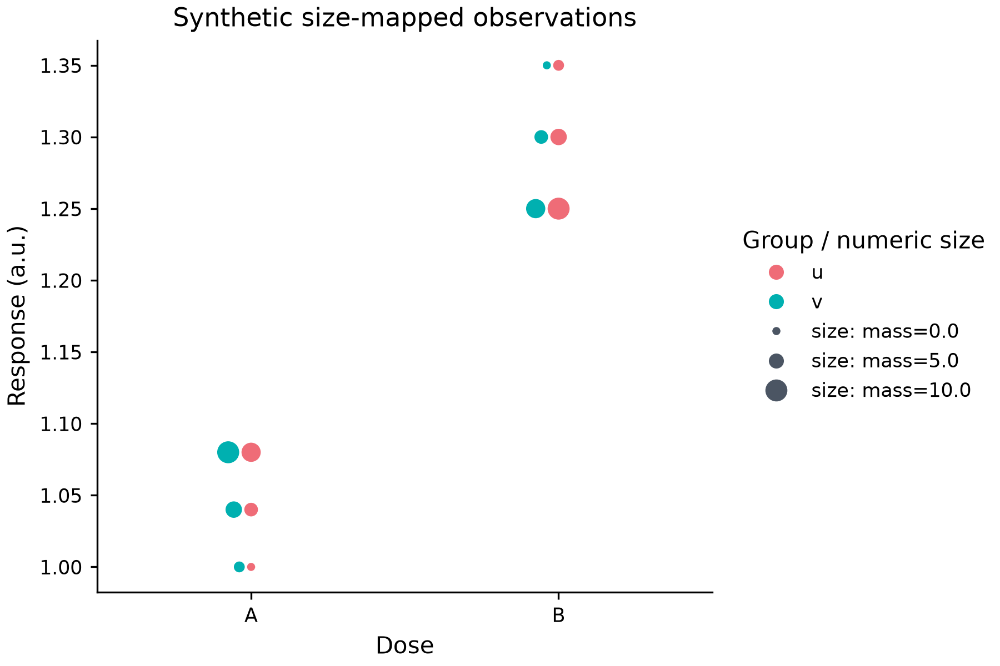

# Numeric size-only swarm

*[English](SWARM_SIZE.md)*



[실행예제](../examples/swarm_size_semantics.py) · [편집spec](images/swarm_size_semantics.mplot.json)

```python
p = mp.plot(data).swarmplot(
    "category", "response", group="group", dodge=0,
    semantics={"size": "mass", "size_norm": [0, 10], "sizes": [3, 9]},
)
```

기존SemanticSpec의numeric size열하나를지원합니다. Sizes는**point단위지름**이고선형매핑뒤
제곱해Matplotlib면적pt²가됩니다. 위bounds의mass0/5/10은실제area9/36/81이며개별관측매핑이지
그룹count/density/weight가아닙니다.

Category/value/group/size결측을동일행에서제외하고명시category/hue순서의선택rowID를packing·area/
observedguide·유효행2,000상한에공유합니다. Missing size는보간하지않고원본data/actions/JSON행은
고치지않습니다. 선택된bool/Inf/문자size는거절하고선택밖invalidsize는plot에영향을주지않습니다.
단strictJSON은전체source어디든비유한숫자가있으면여전히거절합니다.

기본은한layer의선택cohortdomain이며[Swarm-onlynamed scale](SWARM_SHARED_SIZE.ko.md)은pooled크기를
opt-in지원합니다. Size_norm은clipping이지행filter가아닙니다.
좁고큰숫자/넓은유한범위는기존stable정규화를쓰고상수domain은중간지름·한guide를사용합니다.
같은mapping의guide원은관측좌표가없고legend=False는sizeguide만생략하며크기매핑은그대로입니다.
Legacygroup색guide는panellegend설정으로제어하고대표지름은중간값입니다. Sizeguide는group인용/URL을
상속하지않습니다.

최종DPI/layout/scale의실제반지름·stroke·gutter로packing하고기존orientation/dodge/nativecategory를
유지합니다. 양수지름의면적underflow는artist전에거절합니다. Shape/semantic-hue-style/
facet-dropna/cross-familysharedscale/date/y2지원은아니며scalar marker_size와mappedsize동시지정도거절합니다.
[Categorical size/order](SWARM_CATEGORICAL_SIZE.ko.md)는별도opt-in범위입니다.
Semantics=None의legacy경로는유지하고새model/action/specfield/의존성은없습니다. 양editor는rawJSON을
보존하지만전용sizecontrol완료를주장하지않습니다. 성공Figure는호출자가close해야합니다.

합성예제는독립사람가독성/AT인증이나전체CPU/RAM/sandbox보장이아닙니다. 더넓은style/date/facet의미는남습니다.
