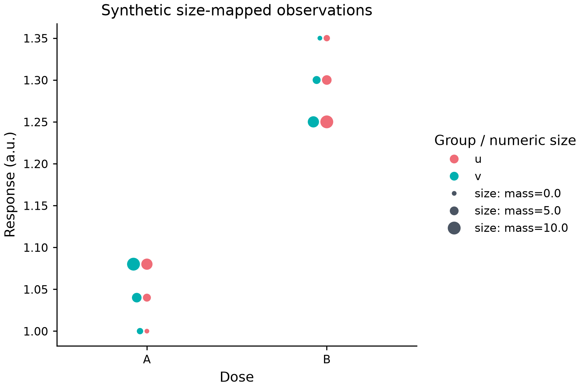

# Numeric size-only swarm

*[한국어 / Korean](SWARM_SIZE.ko.md)*



[Executable example](../examples/swarm_size_semantics.py) ·
[Editable source spec](images/swarm_size_semantics.mplot.json)

```python
p = mp.plot(data).swarmplot(
    "category", "response", group="group", dodge=0,
    semantics={"size": "mass", "size_norm": [0, 10], "sizes": [3, 9]},
)
```

The existing SemanticSpec supplies one numeric size column. Sizes are marker
**diameters in points**, mapped linearly before squaring into Matplotlib pt² areas.
For masses 0/5/10 with the bounds above, actual areas are 9/36/81. These are
mappings of individual observations, not group counts, density or weights.

Listwise-missing category/value/group/size rows are dropped together. Explicit
category/hue orders select the same source row IDs for packing, area mapping,
legend observations and the 2,000-usable-row limit. Missing size is not imputed;
source rows/data/actions/JSON are not rewritten. Selected bool/Inf/string sizes
reject. An unselected invalid size does not affect a plot, but strict JSON still
rejects nonfinite numbers anywhere in the source table.

By default, one layer's selected cohort defines its numeric domain.
[Named shared scales](SWARM_SHARED_SIZE.md) can opt into pooled size domains.
Explicit
size_norm clips the mapping, never filters observations. Stable normalization
handles narrow high-magnitude and wide finite ranges; a constant domain maps to
the midpoint diameter and one guide. Guide circles use that same scale and have
no data coordinates. Semantic legend=False omits size guides, not size mapping;
legacy group colour guides remain controlled by the panel legend. Size guides do
not acquire group references/URLs. A group legend uses the midpoint diameter.

Circle packing uses actual per-point radii, strokes and gutters at final
DPI/layout/scales, including existing orientation/dodge/native-category modes.
Positive diameters whose areas underflow reject before artists. This size-only
example retains its existing circle/group behavior; the complete
[C02 contract](SWARM_FACETS.md) also supports native named glyphs, hue/style,
mixed-family domains, dates/y2 and explicit packing/live-template transactions.
Scalar marker_size plus mapped size still rejects. Size is never weight/mass.
No dependency/version change is required; omitted legacy controls/JSON remain.
Successful Figures are caller-owned.

Synthetic data is not independent human readability/AT certification or a total
CPU/RAM/sandbox guarantee. Broader F01/G01 catalogue gates remain separate.
