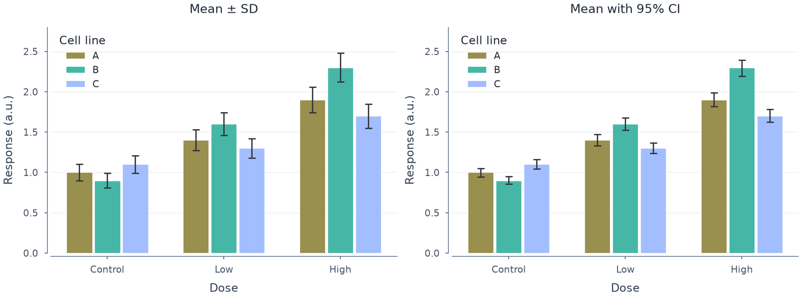

# 논문용 bar: SD와 95% CI



그룹 bar에서도 오차막대가 각 막대의 실제 중심에 맞춰 표시됩니다.

```python
summary = {
    "condition": ["Control", "Treatment"],
    "mean": [1.0, 1.45], "sd": [0.12, 0.17],
    "ci_low": [0.93, 1.35], "ci_high": [1.08, 1.57],
}
(mp.plot(summary).theme("publication")
    .bar("condition", "mean", yerr="sd", bar_width=0.60)
    .labels(y="Response", title="Mean ± SD")
    .save("mean_sd.svg"))

# 오차 크기가 아닌, 구간의 절대 하한·상한:
(mp.plot(summary).theme("publication")
    .bar("condition", "mean", y_lower="ci_low", y_upper="ci_high")
    .labels(y="Response", title="Mean with 95% CI")
    .save("mean_ci95.svg"))
```

`yerr`는 대칭인 비음수 오차 크기입니다. 대신 `y_lower`와 `y_upper`를 함께
지정하면 중심값을 포함하는 절대 구간을 표시하며, `errorbar()`에서도 같은
방식으로 쓸 수 있습니다. **이 primitive는 통계를 계산하지 않습니다.** SD는 관측값의
산포이고 CI는 추정량의 불확실성입니다. CI 계산 방법은 사용자가 선택해야 하며,
평균의 95% CI를 단순히 `1.96 * SD`로 만들면 안 됩니다. 위 코드는 설명용
요약값을 직접 제공한 예입니다.

`bar_width`는 범주에 할당된 전체 폭(기본 0.8, 그룹별 분할),
`edge_color`/`line_width`는 막대 테두리를 조절합니다. 오차막대의 색·굵기·캡은
`error_color`, `error_line_width`, `capsize`, `capthick`으로 조절하며,
선과 캡 크기의 단위는 point입니다. `capsize=0`이면 캡이 없어집니다.
선택형 `publication` 테마는 차분한 색상·축과 막대 뒤의 옅은 가로 그리드를
사용합니다. 기존 테마와 오차가 없는 bar의 기본값은 그대로 유지합니다.
기본 해칭 구분도 유지하며, 갤러리에서는 깔끔한 면을 위해 명시적으로 끕니다.
soft 팔레트의 측정된 안전성 보장 범위는 최대 5개 범주입니다.

[`uv run python examples/bar_uncertainty.py`](../examples/bar_uncertainty.py)로 이미지를 재현할 수 있습니다.
이 예제는 고정 시드의 합성 관측값(셀·dose별 12개)에서 `ddof=1` 표본 SD와
4,000회 재표본화한 평균의 95% percentile-bootstrap CI를 **렌더러 밖에서**
계산합니다.
[기존 스타일](images/bar_before.png) ·
[SD SVG](images/bar_sd.svg) · [CI SVG](images/bar_ci95.svg) ·
[편집 가능한 비교 spec](images/bar_uncertainty.mplot.json).
