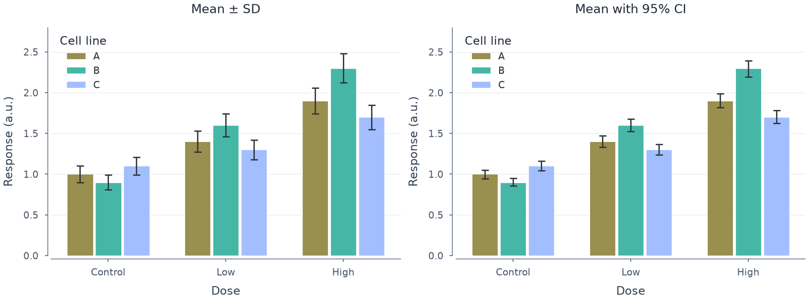

# Publication-style bars: SD and 95% CI



Bars now draw uncertainty at their own centers, including grouped bars:

```python
summary = {
    "condition": ["Control", "Treatment"],
    "mean": [1.0, 1.45], "sd": [0.12, 0.17],
    "ci_low": [0.93, 1.35], "ci_high": [1.08, 1.57],
}
(mp.plot(summary).theme("publication")
    .bar("condition", "mean", yerr="sd", bar_width=0.60)
    .labels(y="Response", title="Mean ± SD")
    .save("mean_sd.svg"))

# Absolute interval endpoints, NOT error magnitudes:
(mp.plot(summary).theme("publication")
    .bar("condition", "mean", y_lower="ci_low", y_upper="ci_high")
    .labels(y="Response", title="Mean with 95% CI")
    .save("mean_ci95.svg"))
```

`yerr` supplies symmetric nonnegative magnitudes. Alternatively, supply both
`y_lower` and `y_upper` as absolute endpoints containing the central value;
these also work with `errorbar()`. **These primitives do not compute statistics:**
SD describes observation spread, while a CI describes uncertainty in an
estimate. Choose and compute the CI method yourself; do not use `1.96 * SD`
as a mean's 95% CI. The small snippet uses illustrative supplied summaries.

Control bar outlines with `edge_color`/`line_width`, category span with
`bar_width` (default 0.8, divided between groups), and uncertainty with
`error_color`, `error_line_width`, `capsize`, and `capthick` (stroke/cap sizes
in points). `capsize=0` removes caps. The opt-in `publication` theme uses soft
fills, quiet spines and a subtle y-grid behind the marks; other themes and
existing no-error bars keep their defaults. Redundant hatch encoding remains
on by default. The gallery explicitly turns it off for clean fills; the soft
palette's measured safety guarantee is limited to five categories.

Reproduce the images with [`uv run python examples/bar_uncertainty.py`](../examples/bar_uncertainty.py). This
example generates seeded synthetic observations (12 per cell/dose), computes
sample SD with `ddof=1`, and estimates a 95% percentile-bootstrap CI of the
mean using 4,000 resamples **outside the renderer**.
[Original style](images/bar_before.png) ·
[SD SVG](images/bar_sd.svg) · [CI SVG](images/bar_ci95.svg) ·
[Editable comparison](images/bar_uncertainty.mplot.json).
